**English** | [中文 (Chinese translation)](README.zh-CN.md)

<h1 align="center">MGU Custom Apps</h1>

<p align="center">
  <b>Custom apps for the BMW MGU head unit (iDrive 7), drawn by their own GPU render engine at a true 60 fps.</b><br>
  Plus a complete kit to build your own.
</p>

<p align="center">
  
  
  
  
</p>

<p align="center">
  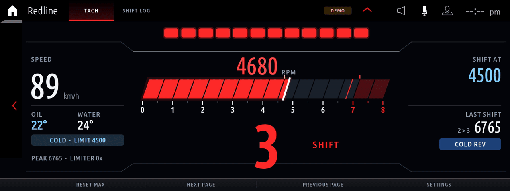
</p>

Real electric range, battery health and a charge log for plug-in hybrids, and live battery
power, cell temperatures and climate power use. A sport cluster with
boost, fuel pressures, ignition timing, misfires and tyre data. Shift lights and a full-screen
tach, a virtual dyno, brake and drag timers, a G-meter, an oil warm-up guide, a fault-code
scanner / cleaner, the car's service items, and Doom for when you're parked. They run on the car's own app platform, use the HMI's real buttons and
settings menus, read live vehicle data and survive reboots. Everything can be removed again
with one command.

> **Disclaimer.** This is an unofficial hobby project. It is not affiliated with, endorsed by
> or supported by BMW AG. You modify your own head unit at your own risk. Use the apps parked
> or on a closed track, and keep your eyes on the road. The Fault Scanner can clear fault
> memories in every control unit of the car, so read the codes first.

---

## Not a PNG slideshow: a custom render engine

BMW's app platform has one way for an app to show custom graphics: draw a picture in
JavaScript, compress it to **PNG**, and hand it to the HMI, which decodes it and puts it in an
image box. It's the only route the SDK offers for custom graphics, and it tops out at a handful
of frames per second: on the head unit's Atom CPU, just compressing one 1600 × 520 PNG takes
about 60 ms, before anything is drawn or sent.

These apps don't do that. They ship with **`mgu-renderd`**, a render engine in C on OpenGL ES 2
(since 2.0 [mgu-render](kit/renderd/README.md#the-engine-mgu-render) by Robert Nisipeanu and
IterioDev, grown out of this project's first engine). An app doesn't send pictures at all: it sends a few kilobytes
of **drawing commands** per frame, and the engine draws them on the head unit's Intel GPU, on
its own compositor layer, in step with the display's refresh. Result: **a true 60 fps**, with
needles and bars that glide instead of jump.

<p align="center">
  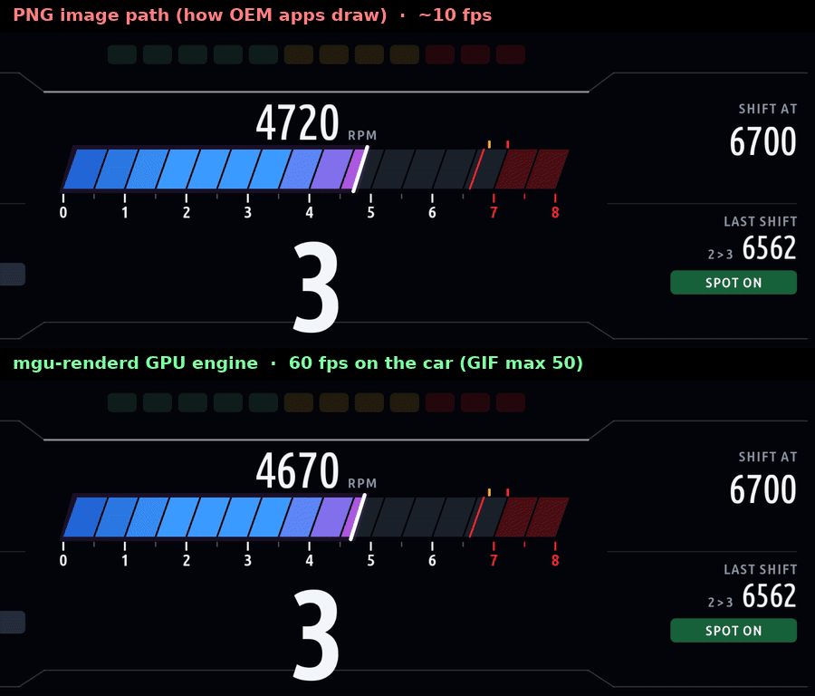<br>
  <sub>Top: the same frames held at 10 fps, the PNG path's typical rate. Bottom: every frame, as the engine draws them.</sub>
</p>

| | Stock way: PNG images | `mgu-renderd` |
|---|---|---|
| **What the app sends** | a compressed bitmap per frame | drawing commands, a few KB per frame |
| **Who draws** | JavaScript on the CPU, pixel by pixel | the Intel HD Graphics 505 GPU |
| **Frame rate** | a few fps (PNG encode alone: ~60 ms) | **60 fps**, paced by the display |
| **Motion** | values jump from frame to frame | spring-smoothed gauges, every frame |
| **Screen space** | the HMI's image box, its title bar and 120 px button bar | full screen: header in the HMI's title strip, slim 48 px bar |

**Measured on a real car** (head unit app logs, 10-second averages):

| App | Frame rate | GPU time per frame | App (JavaScript) time per frame |
|---|---|---|---|
| M Vitals | 60-61 fps | 1.0-1.3 ms (peak 11 ms) | 2-5 ms |
| eDrive | 60-61 fps | 1.0-1.2 ms | |
| G-Force | 56-61 fps | 1.3 ms | |

A frame has 16.7 ms at 60 fps. The GPU needs about one of them, so there is plenty of headroom.
Static parts (cards, dial faces, scales) are drawn once and cached on the GPU. If the engine
isn't installed, the same apps fall back to the PNG path automatically (same code, same look).

```
 app (Node.js)  ──  drawing commands  ──▶  mgu-renderd (C, OpenGL ES 2)  ──▶  own layer above the HMI
     │              Unix socket, per frame        Intel GPU, synced to vsync          (input still goes to the HMI)
     └── buttons, settings, tiles: BMW's own HMI widgets, so the iDrive controller and touch work as usual
```

More in [How apps draw](#44-how-apps-draw-remote-hmi-rhmi) and [`kit/renderd`](kit/renderd/README.md).

---

## Gallery

<table>
<tr>
<td width="50%">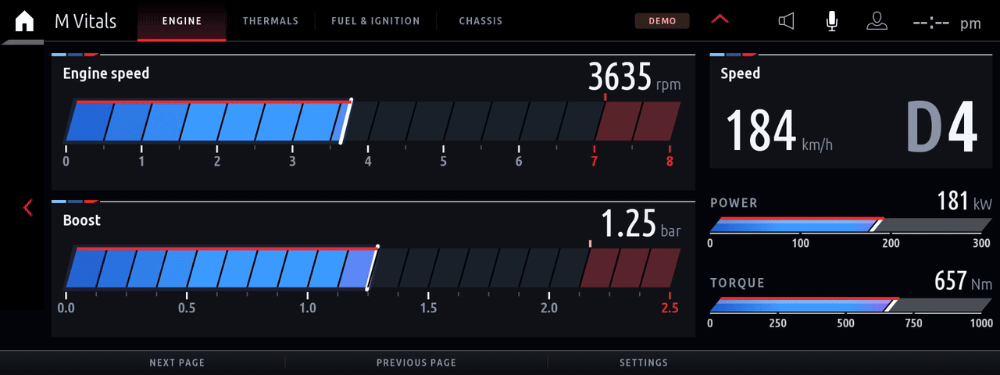<br><b>M Vitals</b>: rpm, boost, speed + gear, power, torque</td>
<td width="50%">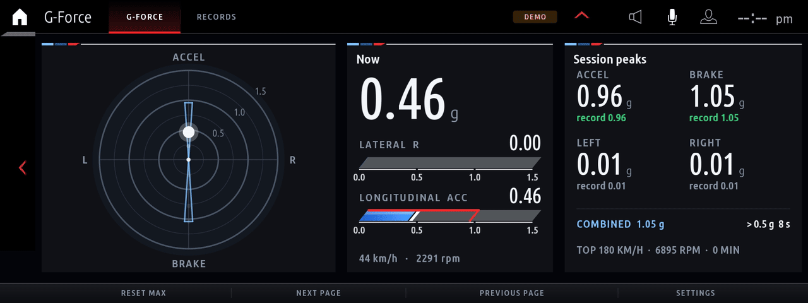<br><b>G-Force</b>: friction circle with trail, grip envelope, peaks, records</td>
</tr>
<tr>
<td>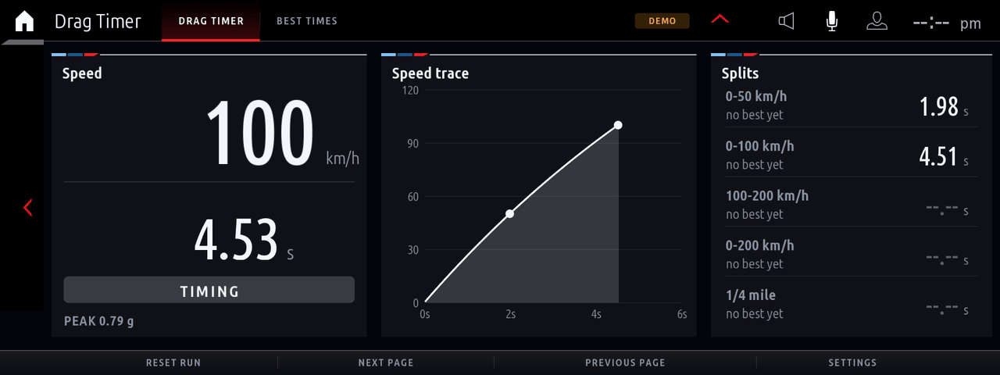<br><b>Drag Timer</b>: live speed trace, splits, ¼ mile</td>
<td>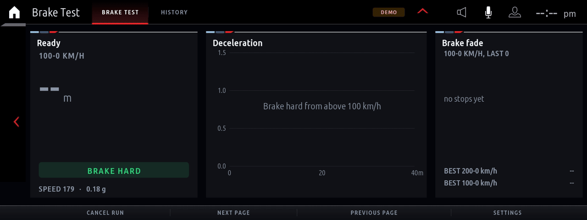<br><b>Brake Test</b>: 100-0 distance, deceleration trace, fade</td>
</tr>
<tr>
<td>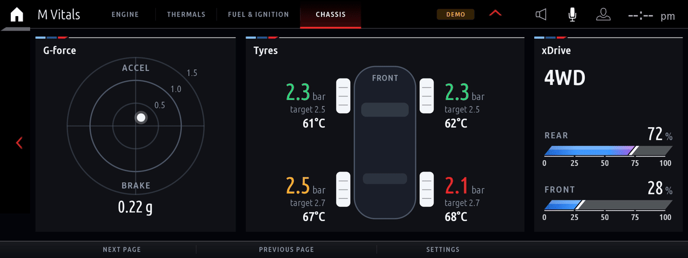<br><b>M Vitals</b>: g-force, tyre pressures + temperatures, xDrive split, ZF 8HP gear + converter</td>
<td>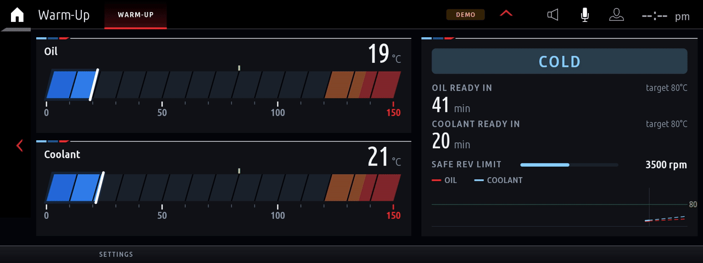<br><b>Warm-Up</b>: time to working temperature, safe rev limit</td>
</tr>
<tr>
<td>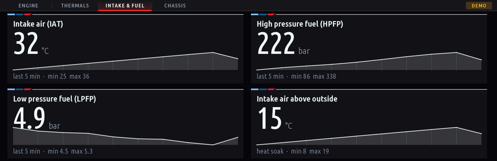<br><b>M Vitals</b>: intake air, HPFP / LPFP fuel pressure, ignition timing, misfires per cylinder</td>
<td>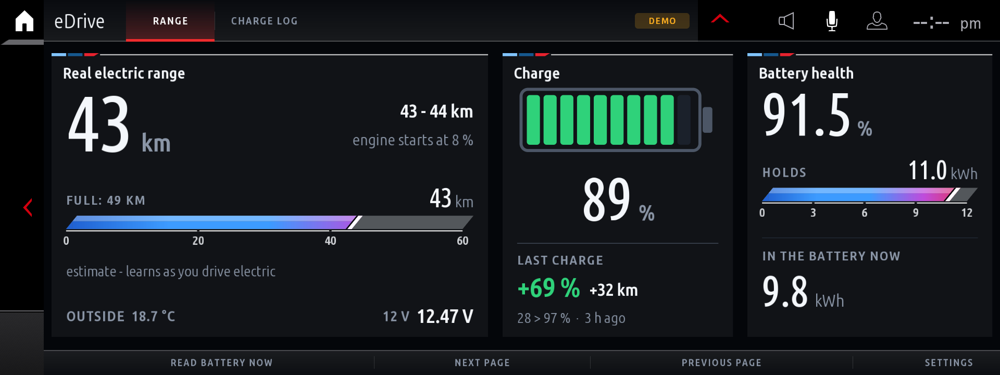<br><b>eDrive</b>: real electric range, battery health, last charge, 12 V</td>
</tr>
<tr>
<td>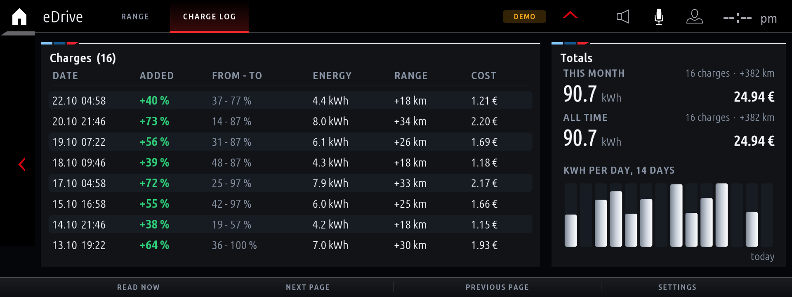<br><b>eDrive</b>: charge log with cost and totals</td>
<td>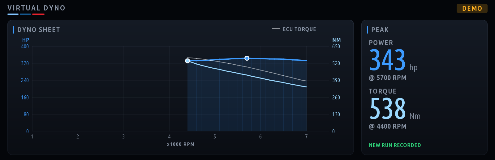<br><b>Virtual Dyno</b>: power and torque curve from a pull</td>
</tr>
<tr>
<td>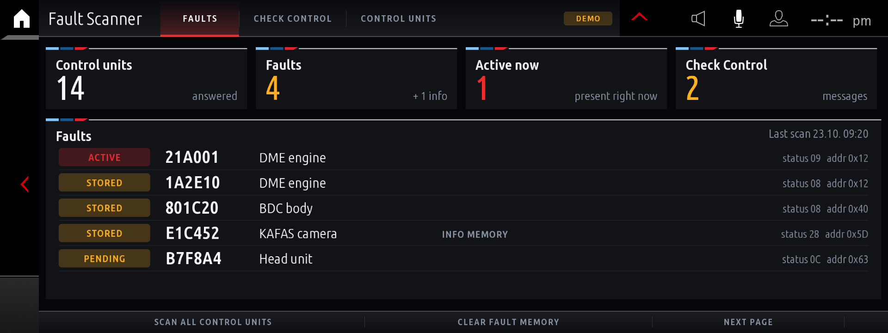<br><b>Fault Scanner</b>: fault codes of every control unit, with their texts</td>
<td>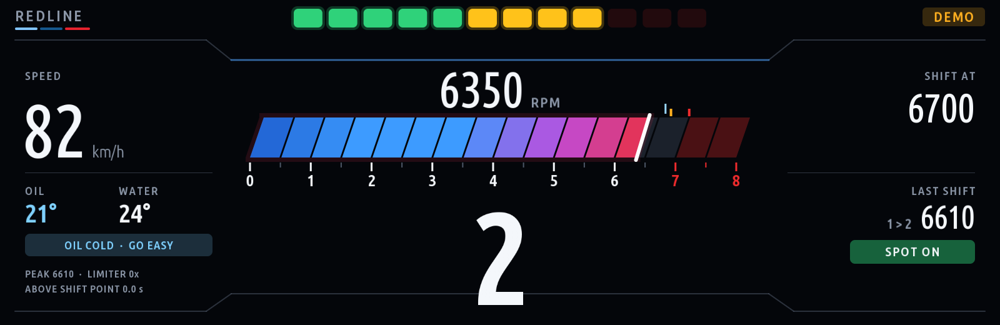<br><b>Redline</b>: G20-style rev bar, big gear, shift scoring</td>
</tr>
<tr>
<td>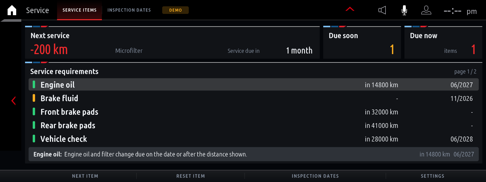<br><b>Service</b>: service requirements, next service, details per item</td>
<td>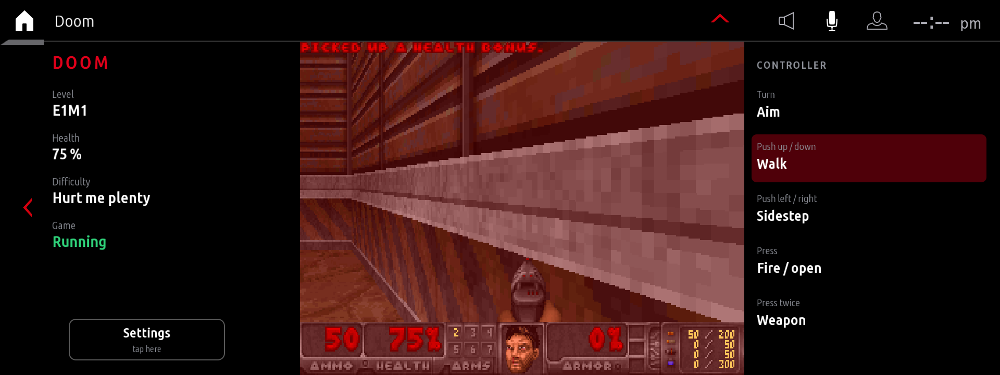<br><b>Doom</b>: Freedoom in full resolution across the whole screen, on the iDrive controller, saves itself</td>
</tr>
<tr>
<td>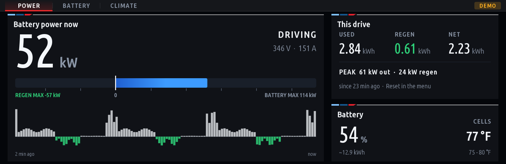<br><b>eDrive</b>: HV battery power now, regen / drive against the battery's limits, drive totals</td>
<td>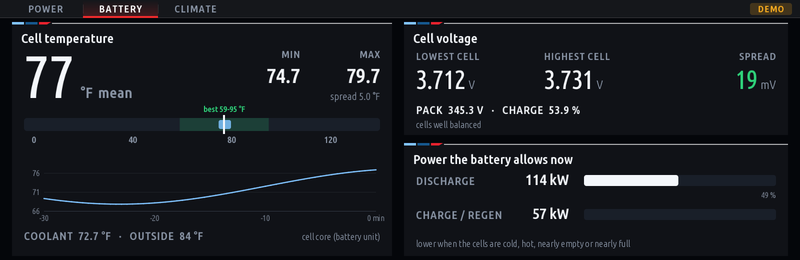<br><b>eDrive</b>: cell temperatures and voltages, coolant, power the battery allows</td>
</tr>
<tr>
<td>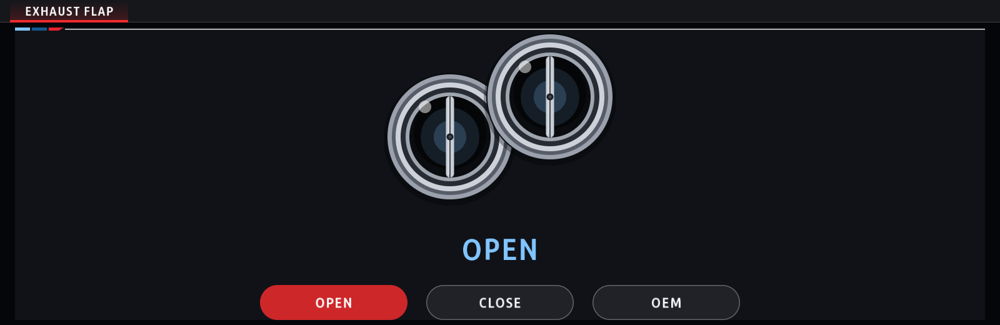<br><b>Live Adjustments</b>: exhaust flap open, closed or handed back to the car (OEM), state read back from the DME</td>
<td>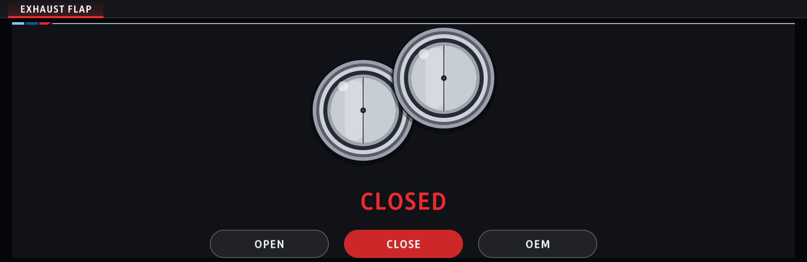<br><b>Live Adjustments</b>: flap closed, the selected mode in red; more adjustments can be added as tabs</td>
</tr>
</table>

<sub>Every animation is recorded offline from the app's built-in demo drive through the engine's
own drawing code (`mgu-renderd --replay`, see [6.3](#63-preview-build-deploy)), over the HMI's
back arrow and status icons, in the default M Tricolour theme. GIFs play at 50 fps at most;
the car shows 60. Every app also has M Red, Ice White and Night Amber themes. In the car the
same screens show live data.</sub>

---

## Contents

- [Not a PNG slideshow](#not-a-png-slideshow-a-custom-render-engine) · [Gallery](#gallery)
1. [The apps](#1-the-apps)
2. [What you need](#2-what-you-need)
3. [Quick start](#3-quick-start)
4. [How the head unit works](#4-how-the-head-unit-works)
5. [How the apps get onto the unit](#5-how-the-apps-get-onto-the-unit)
6. [Writing your own app](#6-writing-your-own-app)
7. [Vehicle signals reference](#7-vehicle-signals-reference)
8. [Troubleshooting and gotchas](#8-troubleshooting-and-gotchas)
9. [Known limits](#9-known-limits)
10. [Repository layout](#10-repository-layout)

---

## 1. The apps

Every app has a settings screen in the HMI's own style: four colour themes (M Tricolour, the
default, M Red, Ice White, Night Amber), units, how often the speed readout changes (5 times a
second like BMW's cluster, up to 60), and a demo mode. Results and records are saved on
the unit and kept across reboots.

| App | What it does |
|---|---|
| **Redline** | A G20 Live Cockpit style rev display: a wide rev bar across the middle that fills left to right in slanted segments (theme colour to red at your shift point), digital rpm above it and a big gear below it, digital speed, and a 12-LED shift-light bar. At the shift point the shift lights, the gear and a SHIFT prompt turn solid red; the *Blink and flash* setting (off by default) makes them strobe and flashes the whole screen red. Gear read from the gearbox or learned from rpm/speed. Every upshift is scored (EARLY / SPOT ON / LATE / LIMITER), with a shift log and accuracy stats. Cold oil is always flagged; the cold-engine guard (on by default) also lowers the shift point until the oil is warm. |
| **Virtual Dyno** | Do a full-throttle pull in one gear and get a power and torque curve, calculated from acceleration, car weight, air drag and rolling resistance. Settings for weight, body shape, drivetrain loss, hp/PS/kW and Nm/lb-ft. Runs are saved; pin one as a baseline to see ± on every new pull. Optional overlay of the engine computer's own torque reading. |
| **Brake Test** | 100-0 and 200-0 km/h (or 60-0 and 100-0 mph): distance, time, peak deceleration and a deceleration trace. The start crossing is interpolated between samples, so results don't depend on the sample rate. A brake-fade chart compares your last stops and warns when distances grow. Bests plus full history. |
| **Drag Timer** | 0-50, 0-100, 100-200, 0-200 km/h and ¼ mile (or mph equivalents), with interpolated splits, optional one-foot rollout, a live speed trace and saved best times. |
| **G-Force** | Friction circle with a fading trail and a grip envelope that grows as you use more grip in each direction. Live lateral/longitudinal bars, session peaks per direction, time spent above 0.5 g, all-time records. The g numbers update at the *G-force display rate* (10 a second by default); the dot and trail move at full frame rate. |
| **Warm-Up** | Oil and coolant gauges and a warm-up calculator: minutes and clock time until oil and coolant reach working temperature, from the measured warm-up rate (typical rates until enough is measured, "engine off" when a hybrid drives electric), projected on a temperature trend graph. A safe rev limit that rises with oil temperature, and a turbo cool-down countdown after hard driving (high rpm or high power: 30 s to 3 min of gentle driving, depending on how long you drove hard). |
| **M Vitals** | A sport cluster: rpm, boost, speed with the gear (D / S / M + number), power from the iDrive sport display (its % × your car's max power, so stock or tuned engines both read right; kW, hp or PS) and torque (Nm or lb-ft), coolant and oil temperature, g-forces and more, over several pages, with peak values.  A Fuel & ignition page shows intake air temperature (IAT), high-pressure fuel (HPFP / rail) and low-pressure fuel (LPFP) pressure, ignition timing, boost target against actual boost and requested against actual air charge (with a 5-minute trace of both, BMW DME DIDs 4AB0 / 580B / 480C / 5813 with OBD PID 0x70 as the fallback) and the misfire counter of every cylinder (this driving cycle, OBD service 06), read from the DME over UDS / OBD (standard OBD data IDs, adjustable in `app.json` config.dme), plus how much warmer the intake air is than outside; the Thermals page adds the gearbox temperature from the gearbox unit (EGS, config.dme.egs). Each of these has an Auto / Show / Hide setting, and the tiles share the screen: whatever the car doesn't answer is left out. Tyre pressures (against the car's target) and temperatures are shown large on the Chassis page; its xDrive card can be set to Auto (shown once the car reports all-wheel drive), Show or Hide for rear-wheel-drive cars. When the car's own torque split signal sends nothing, the card reads the torque going to the front axle from the transfer case unit (LMV, UDS `22 DB32`, `app.json` config.xdrive) and estimates the split from engine torque and the gear; the card says where its number comes from. Boost, gearbox oil temperature, the tyre card and tyre temperatures have the same Auto / Show / Hide setting: Auto shows them once the car has sent real data, and a hidden item gives its space to the others. Values outside a plausible range (a tyre at 255 °C) and fields that never change (gearbox oil stuck at 0 °C) count as no data; the raw values the car sends for these go to the log (`raw tyre temperature`, `raw gearbox oil`, `raw FES boost`), to calibrate `app.json` config.scaling. Boost comes from the sport display, or, when that sends nothing usable, from the DME over OBD (charge / manifold pressure minus outside air pressure, candidates in config.dme.boost); the setting Boost from picks one by hand. Dials run from blue to red as they near the redline / boost limit. |
| **Fault Scanner** | Scans every control unit for stored fault codes (UDS over the head unit's diagnostic gateway), shows them per module with status, shows live Check Control messages, and can clear fault memories (two-press confirm). Fault texts come from your car's own coding-tool export (`kit/tools/dtc_texts.py`), a few hand-written ones, and, if you import one, a fault text database for every control unit (`kit/tools/dtc_texts.py --db`): units with faults are then asked their SGBD index (UDS 22 F1 50), which picks their texts and their name. Only English texts are imported (one with German in it is left out, and that fault shows no text). A fault code list (CSV, `kit/tools/dtc_texts.py --codes`) fills in faults that still have none, for the units its texts belong to. Fault text tables (the `dtc_scanner_*.json` files, `kit/tools/dtc_tables.py`, after `--db`) add a text for each unit type and each address. The build packs the whole database into one compressed file (`dtc_db.pack`: about 19 MB of texts in 3.7 MB, `kit/tools/pack_data.py`), and the app only unpacks the few KB that hold the codes it shows. The repository ships the fault text tables already packed (`apps/dtc_scanner/dtc_db.pack`: the tables and the SGBD index, used with permission); a local `dtc_db/` folder you import replaces it. Imported databases and car exports stay out of git. |
| **eDrive** | For plug-in hybrids / EVs: real electric range that adapts to how your car is driven: the charge above the point where the engine starts, divided by what the car uses per km for driving (learned from electric-only driving, last ~60 km) plus what climate control and the on-board electrics draw per hour (heating when cold, A/C when hot, learned per outside-temperature band while standing or creeping with the engine off). Driving is learned per speed band (under 35, 35-60, 60-85, 85-110, over 110 km/h) and the range uses your current pace, so motorway driving shows less range than town. The climate's draw is also learned while driving (what it uses above the same speed with the climate off), seat and steering-wheel heating are counted from their levels, and an Energy page shows use per speed band, where the power goes now (driving, climate, seats, wheel, on-board, with the km each costs), the car's own power distribution figures and the HV battery temperature (also on the Range page). The climate draw costs range by the hour, so it costs more of it in slow traffic; the screen shows it in kW and the km it costs. Whether climate control is on comes from the car itself (ClimateMaster `statusClimateSystemOn`): switched off, only the on-board electrics (learned separately, typically 0.3 kW) are taken off and the range goes up; switched on, it goes down again (shown as CLIMATE ON / CLIMATE OFF, with A/C when the A/C button is on). Until it has learned, the range comes from the outside temperature (a full battery gives 50 km at 20 °C, 40-45 km at 10 °C, 30-38 km at 0 °C, 20-30 km at -10 °C, scaled to your own 20 °C range), shown with its low-high spread, battery health (SOH: how much a full charge holds compared to new, in % and kWh) and the energy in the battery now (kWh; the battery size when new is a setting, e.g. 12 kWh for a 330e / 530e, 24 kWh for an X5 45e). Also shows the last HV battery charge (+%, kWh, km added; a charge done while the head unit slept shows at the next start) and the 12 V battery voltage. A charge log page lists every charge (date, % and kWh added, range added, cost from your electricity price, 0.25 €/kWh by default) with monthly / all-time totals and a 14-day chart. On a car without a hybrid system it detects that the battery unit never answers and shows only the 12 V battery (or set Hybrid system = No). Charge and SOH are read from the battery control unit over UDS; a Diagnostics page shows the raw replies so the DIDs can be adjusted per model in `app.json`. |
| **eDrive: live pages** | eDrive's live values (`apps/edrive/live.js`), set up for the X5 xDrive45e (24 kWh) and adjustable for other plug-in hybrids. **Battery:** the HV battery's power now in kW (pack voltage x current from the battery unit, read every second; + driving, - regen or charging) on a bar from the most regen to the most drive power the battery allows right now, a two-minute trace, cell temperature and coolant; every cell's voltage as a bar (lowest / highest marked, the spread between them); and this drive: energy used, regen, net, how much of it went to driving and to the climate, and peaks (Reset drive totals in the menu starts a new one). **Climate on the Energy page:** standing still with the engine off and not plugged in, the pack feeds only the car's own consumers, so that draw minus the on-board baseline (learned with the climate off) is what heating / A/C really use; the Energy page's climate row shows that measurement (or the climate unit's own figures) instead of the estimate. Values come from the battery unit (SME) over UDS: `DD68` pack voltage, `DD69` current, `DDBF` cell voltages, `DDC0` cell temperatures, `DD6C` coolant, `DD7D` current limits (BMW's identifiers as OVMS decodes them on the i3); a Diagnostics page shows the replies, and `powerSign` flips the direction if a car reports current the other way. The **home-screen widget** (`startWidget`) shows live power, state, V / A, charge, a power bar, cells and this drive (big widget), or the same as text lines (small one); the Battery unit and Scan pages come with the Diagnostics pages setting. |
| **Service** | The car's service requirements (BMW Condition Based Service) as the iDrive's own *Vehicle status > Service requirements* shows them: engine oil, brakes, brake fluid, vehicle check, inspection and the rest, each with the distance and date the car gives (in its own language and units), coloured green / yellow / red, a summary of the next service, and the item's service hint text as details. Read from the instrument cluster (`KombiInterface_2`). Read-only: these cars offer the head unit no service reset (that is done in the cluster's own menu or by a workshop). |
| **Doom** | Freedoom: Phase 1 (four episodes, free game data) running in the head unit as WebAssembly. The engine draws the 3D view in full resolution across the whole screen (1920 x 504, Doom's vertical field of view widened to the screen), with the status bar, menus and messages on top at 4:3; 35 fps on the VM. A main menu (Play / Continue, New game, all settings) comes first; the game then has the screen to itself with no header or button bar, and BACK returns to the menu. **Turn the controller to aim, push it to walk and sidestep, press to fire and open doors, press twice for the next weapon.** While you play, the game has the controller to itself: the HMI ignores the knob, press and tilt, so pushing forward no longer opens the HMI's pull-down menu and pushing left no longer leaves the game. BACK, MENU and the touchscreen always work. This uses the controller gate that `deploy-car.sh` loads into the HMI (see [5.1](#51-what-deploy-carsh-install-does)). Without the gate, the game reads the controller signal itself and the HMI reacts to it too. It pauses when you leave the screen or a popup / call covers it, and saves itself each time, so it carries on where you stopped. Settings, in the main menu: difficulty, episode, move speed (slow walk by default, walk, run), aim speed and direction, render resolution (full / medium / low). GPL-2.0, see [Doom licences](#doom-licences). **Parked only** by default: the game saves and waits while the car drives (setting *Parked only*, can be turned off). |
| **Live Adjustments** | Live tweaks as tabs: **Exhaust Flap**, **Map** and **Max cooling**. Exhaust Flap: Open, Close, or hand control back to the car (OEM), shown as the twin tailpipes opening and closing with the big state word. **Safe by default** — the *Car control* setting ships **Disarmed** (simulated, touches nothing); set it to **Armed** only after you have validated it on your own car. On a stock DME the flap goes over the car's own diagnostic link (UDS `2F 60FD` "EL_AGK", Bosch MG1 / DME8 as used by B48 / B58 / S58; OPEN 10 %, CLOSE 90 %, OEM hands control back; the DME self-times the override in ~20 s). On an **MHD-flashed DME** — found by a read-only unlock check, the memory tag MHD's own app reads — the tune's own controls are used: **Map** slot 1–4 (`2F 01`, a second press confirms), the flap (`2F 02`) and **Max cooling** on / off (`2F 03`), as captured from MHD's app by a1-mapping (PR #23). Without an MHD flash, Map and Max cooling say so and send nothing. |

On the VM or a bench unit without vehicle data, every app switches to a built-in demo drive
after 5 seconds (launch, pull through the gears, a hard stop, corners, an engine warming up from
cold). A **DEMO** badge shows when the data isn't from the car.

---

## 2. What you need

**In the car**

- **A BMW with the MGU head unit** (iDrive 7, "ID7"). Developed and tested on firmware
  `P18_23w44.2`. Other MGU versions very likely work; the installer's `check` step tells you
  before it changes anything.
- **Root shell access to the head unit** (SSH or serial console). **This project does not
  provide it and cannot publish how to get it.** There are community guides for rooting MGU
  units; search for them. Everything below assumes you can log in as `root`.
- **BMW's app SDK (`oap-sdk`), extracted from your own unit.** It's BMW's copyrighted code, so it
  isn't in this repository. It is inside every BMW app on your head unit, and
  [`kit/tools/extract_sdk.js`](kit/tools/extract_sdk.js) rebuilds it from one of them in a
  second (see Quick start).

**On your PC**

Windows, macOS or Linux. You need just **Python** and **Node.js**: no Linux, no compiler, no
Docker. The GPU renderer comes **prebuilt** in the repository
([`kit/renderd/prebuilt/`](kit/renderd/prebuilt)), and the kit builder checks that it matches
the renderer's source.

| Tool | Needed for | Required? |
|---|---|---|
| **Python 3.6+** | `build.py` (packages the apps), `make_kit.py` (packs the car kit) | yes |
| **Node.js 14+** | the build (draws the app icons), `extract_sdk.js`, `preview.js` | yes |
| **ssh / scp** (OpenSSH) | installing on the car (`push-to-car.sh` / `push-to-car.ps1`) | yes: built into Windows 10/11, macOS and Linux |
| **Docker** | recompiling the GPU renderer `mgu-renderd` yourself | only if you change the renderer's C code |
| **ffmpeg**, **bash** | `make_gif.sh`: recording animations like the ones above | optional |
| **Pillow** (`pip install pillow`) | `bake_fonts.py`: re-baking the fonts | optional |

No npm packages: the build uses only Node's and Python's standard libraries.

**Windows:** install Python from [python.org](https://www.python.org/downloads/) (tick *Add
python.exe to PATH*) and Node.js LTS from [nodejs.org](https://nodejs.org/). That's all.

**macOS:** `brew install python node` (Homebrew), or the installers from the same two sites.

**Ubuntu / WSL:** `sudo apt install python3 nodejs openssh-client`. Node.js must be 14 or newer:
Ubuntu 24.04 ships 18; on 22.04 and older the packaged one is too old, so use
[nodejs.org](https://nodejs.org/) or nvm.

Check (any OS, in a terminal):

```sh
python3 --version     # Windows: python --version
node --version
```

**Changing the renderer** (`kit/renderd/src`): then you need Docker
([Docker Desktop](https://www.docker.com/products/docker-desktop/) on Windows / macOS,
[Docker Engine](https://docs.docker.com/engine/install/) on Linux). The kit builder compiles it
in an Ubuntu 18.04 image, so it matches the head unit's libraries (first time: ~550 MB download,
a few minutes), always for x86-64 like the head unit's CPU, also on ARM machines like Apple
Silicon Macs. It then updates the prebuilt copy for you to commit. If the source has changed and
it can't compile it, it says so and asks before packing a kit with the older renderer.

---

## 3. Quick start

### 3.1 Get the SDK from your unit

Copy the x_call app that ships in the firmware off the head unit, and extract the SDK from it:

```sh
scp root@<unit>:'/usr/lib/oap-mainapp/preinstalled_apps/x_call@*.tgz' .
mkdir x_call && tar xzf x_call@*.tgz -C x_call
node kit/tools/extract_sdk.js x_call/javascript/app.js     # writes ./oap-sdk/
```

On Windows the same commands work in PowerShell (scp and tar are built in), with the real file
name instead of `x_call@*.tgz`.


You get:

| Path | What it is |
|---|---|
| `oap-sdk/index.js`, `package.json` | the runtime the build vendors into each app (`require('oap-sdk')`) |
| `oap-sdk/source/` | every SDK module as a readable file at its real path (`source/src/core/OnlineApp.js`, ...) |

The firmware copy (SDK 24.10.x) has the full public API. The x_call your car may download
later (`/var/opt/public/oap/oap_12204/source/javascript/app.js`) carries a newer SDK that
lacks `telephony`, `appstart`, `map` and `poi`. The kit's apps don't need those, so it works
too; the tool lists anything missing.

`oap-sdk/` is listed in `.gitignore`. Never commit it.

### 3.2 Build

```sh
python3 kit/tools/build.py            # all apps -> dist/<id>@<ver>.mgu
python3 kit/tools/build.py redline    # just one
python3 kit/tools/build.py --language zh-CN   # Simplified Chinese -> dist/<id>@<ver>-zh.cn.2.mgu
node kit/tools/preview.js dist/redline preview wait=10   # render it on the PC -> preview/*.png
```

(On Windows type `python` instead of `python3`.)

English is the default. **Chinese:** `--language zh-CN` builds every app in Simplified Chinese
(the language is fixed at build time; the car's language setting doesn't change it). Installing
the other language's package swaps it like an update. Chinese translation by 小白151
([JackieZ123430](https://github.com/JackieZ123430), [idrive7-apps-cn](https://github.com/JackieZ123430/idrive7-apps-cn));
Chinese guide: [README.zh-CN.md](README.zh-CN.md).

The `.mgu` files contain BMW's SDK, so keep them for your own car and don't publish them.

### 3.3 Install on the car

Car parked, ignition on, ideally with a battery charger connected. First pack the kit (the
apps, the installer and the GPU renderer) into `dist/mgu-custom-apps.tar.gz`:

```sh
deploy/make-car-kit.sh                 # macOS / Linux / WSL
deploy\make-car-kit.cmd                # Windows (cmd or PowerShell)
python3 kit/tools/make_kit.py redline  # any OS; just some apps
python3 kit/tools/make_kit.py --language zh-CN   # Chinese kit -> dist/mgu-custom-apps-zh-CN(.tar.gz)
```

(For the Chinese kit, give `push-to-car.sh` `KIT=dist/mgu-custom-apps-zh-CN` and `push-to-car.ps1`
`-Kit dist\mgu-custom-apps-zh-CN.tar.gz`.)

Then push it over SSH. macOS / Linux / WSL:

```sh
HU=root@<unit-ip> PORT=22 KEY=~/.ssh/id_mgu deploy/push-to-car.sh check    # read-only: checks the unit, lists what it would touch
HU=root@<unit-ip> PORT=22 KEY=~/.ssh/id_mgu deploy/push-to-car.sh install  # backup -> install -> restart the app platform
HU=root@<unit-ip> PORT=22 KEY=~/.ssh/id_mgu deploy/push-to-car.sh restore  # undo: back to the backup
```

`KEY` is the SSH private key for the unit (`chmod 600` it). Every command needs it, unless
the key is already in your `~/.ssh/config` or ssh-agent.

**Windows:** `deploy/push-to-car.ps1` does the same with Windows' own OpenSSH client,
using the SSH key the [idrive7-8-ssh-root](https://github.com/cauliflowermossgrape/idrive7-8-ssh-root)
tool writes (`data\enrollments\<VIN>\id_rsa`, the unit's IP is in `connect.txt` next to it):

```powershell
powershell -ExecutionPolicy Bypass -File deploy\push-to-car.ps1 check   -Key <path>\id_rsa -Ip <unit-ip>
powershell -ExecutionPolicy Bypass -File deploy\push-to-car.ps1 install -Key <path>\id_rsa -Ip <unit-ip>
```

It takes `dist\mgu-custom-apps.tar.gz` (or `-Kit <path>`).

No network? Copy `dist/mgu-custom-apps/` to a USB stick and on the unit run
`sh deploy-car.sh check`, then `sh deploy-car.sh install`.

After about 1-2 minutes the tiles appear under **Apps**. More commands on the unit (in
`/var/opt/mgu-custom-apps`):

```sh
sh deploy-car.sh status     # installed apps, running state, hook state
sh deploy-car.sh backups    # list backups
sh deploy-car.sh restore    # back to stock (asks you to type YES)
```

### 3.4 Doom: the extra steps

Doom installs like the other apps: it is in the kit unless you list only other apps. There are
four differences:

1. **The build downloads the game data once.** Git doesn't keep the WAD, so the first
   `build.py` / `make-car-kit` run fetches Freedoom: Phase 1 0.13.0 (a 24 MB zip from the
   [Freedoom releases](https://github.com/freedoom/freedoom/releases/tag/v0.13.0)), checks its
   SHA-256, and saves `apps/doom/freedoom1.wad`. Later builds reuse it. **No internet on the
   build PC?** Download `freedoom-0.13.0.zip` somewhere else and put `freedoom1.wad` from it
   into `apps/doom/`. Any other WAD (including id's original `doom.wad`) fails the SHA-256 check.
2. **It is bigger.** The package is ~11 MB (the engine plus the game data), so the push takes a
   little longer. Nothing to do on your side.
3. **It needs the GPU renderer for the full screen.** The kit installs `mgu-renderd` anyway. If
   it isn't running, Doom falls back to a smaller picture inside the normal app area.
4. **The head unit reboots once at the end of the install, for the controller gate.**
   `deploy-car.sh install` sets up `mgu-inputgate.so` to load into the HMI, so the game can have
   the controller to itself (see [5.1](#51-what-deploy-carsh-install-does)). It loads when the
   head unit starts, so the install ends with a reboot: the screen goes black for about a minute,
   then everything comes back by itself and Doom is ready. If the HMI fails to come up with it,
   it is left out by itself. Rather reboot later? `NO_REBOOT=1 sh deploy-car.sh install`: it then
   loads at your next drive. Don't want it at all? `NO_INPUTGATE=1 sh deploy-car.sh install`. Doom then still works, but the HMI also
   reacts to the controller (pushing forward opens its pull-down menu).

```sh
python3 kit/tools/build.py doom                       # -> dist/doom@<ver>.mgu (fetches the WAD the first time)
deploy/make-car-kit.sh doom                           # just Doom in the kit (or no arguments: all apps)
HU=root@<unit-ip> PORT=22 KEY=~/.ssh/id_mgu deploy/push-to-car.sh install
```

On the car: **Apps → Doom** opens the main menu (Play / Continue, New game, settings). Starting
it the first time takes a few seconds while the head unit compiles the engine. Saves stay in the app's data folder, so they survive reinstalls of the same
app, but not `restore`.

### 3.5 Back to stock

`restore` stops the platform and removes every custom app, the hook and the boot drop-in. It
then puts every touched file back exactly as it was in the **stock backup**, the first backup
`install` ever made, which is never overwritten. Each file is verified against that backup.
Finally it restarts the HMI so the removed tiles disappear without a reboot.

---

## 4. How the head unit works

This is what the MGU looks like from the inside, as far as it matters for apps. Everything here
was learned from a running unit.

### 4.1 Hardware

| Part | Details |
|---|---|
| CPU | Intel Apollo Lake (x86-64), Intel GPU (i915 / Mesa, EGL + GLES2) |
| OS | Linux 4.14 (`-apl`), systemd, BusyBox userland |
| Storage | eMMC: read-only root filesystem + a writable `/var/opt` (apps live in `/var/opt/public`). Plus a 2.5" hard disk: one read-only partition (navigation and other data) and a writable ~90 GB share at `/var/opt/hdshare`. |
| Video in | Intel IPU4 camera-capture block with six CSI-2 ports (on our unit no camera is wired to them; the camera views arrive over Ethernet, see 4.6) |
| Network | One Ethernet port into the car (`socnet0`), split into VLANs for the different car domains; Wi-Fi (`wlan0`) for the phone hotspot / CarPlay |

### 4.2 Software stack

```
 ┌───────────────────────────── HMI (HmiMain3D, RAMSES 3D renderer) ─────────────────────────────┐
 │  BMW's screens and menus   +   "Remote HMI" (RHMI) screens that apps describe and fill with data │
 └───────────────▲──────────────────────────────────────────────────────────▲────────────────────┘
                 │ SOME/IP + joynr                                             │ SOME/IP
 ┌───────────────┴──────────────┐   ┌──────────────────────────────────────┴─────────────────────┐
 │  OAP app platform            │   │  Native services                                             │
 │  oapcontroller -> MainApp    │   │  media (mediaengine, mediaapp), cameras (dasvideo,           │
 │  (Node.js) -> one Node       │   │  icam2proxy), AVB streams, navigation, phone, diagnostics    │
 │  process per app             │   │  gateway (TASU), provisioning, connectivity (connman)        │
 └───────────────┬──────────────┘   └──────────────────────────────────────┬─────────────────────┘
                 │                     SOME/IP over Ethernet VLANs            │
 ┌───────────────┴────────────────────────────────────────────────────────────┴─────────────────┐
 │  The rest of the car: engine and chassis data, instrument cluster, cameras, telematics (TCB)   │
 └───────────────────────────────────────────────────────────────────────────────────────────────┘
```

- **SOME/IP** (vsomeip) is the main bus. Every service, in the head unit or anywhere in the car,
  is described in one catalog on the unit, `/etc/oap/someip/someip-interfaces.json`: interfaces,
  fields (with or without a getter and a change notifier), methods and events, plus their wire
  ids and data types. Vehicle data such as rpm, speed, temperatures and accelerations arrives as
  SOME/IP field notifications.
- **joynr** is a higher-level RPC layer on top (BMW's cluster controller listens on ports
  4242/4243). The platform uses it for app management and HMI entry points.
- **The HMI** is a 3D renderer (RAMSES) with BMW's own asset database. Apps never draw directly:
  they describe screens with BMW's widget templates and push text, images and properties into
  them (see 4.4).

### 4.3 The app platform (OAP)

BMW calls it the **Online Apps Platform**. It's how BMW ships its own apps (weather, news, M
Laptimer, emergency call, service and battery apps, ...), and these custom apps use exactly the
same mechanism.

- `oapcontroller.service` starts **MainApp** (`/usr/lib/oap-mainapp`, a Node.js host running as
  uid 12201). MainApp installs, starts, stops and supervises every app.
- **Each app is an npm-style package** (`package.json`, `manifest.json`, `permissions.json`,
  `rhmiData/`, `javascript/app.js`). It is installed into
  `/var/opt/public/oap/oap_<uid>/` and runs as **its own Linux user** (uid 12203 and up). Apps
  run under Node.js 8, with native add-ons for SOME/IP, certificates, codings and more.
- **Registry:** `oap_12201/security/uids.txt` (uid ↔ app) and `oap_12201/data/apps/<app>.json`
  (version, install source, state).
- **Install sources:** BMW's app store via the backend, or the read-only preinstalled folder
  `/usr/lib/oap-mainapp/preinstalled_apps/`. At install MainApp **generates** the app's SOME/IP
  config (`someipInterfaces/*.json`) and access list (`acl.json`) from its `manifest.json` and
  the catalog. An app can only reach the services and fields its manifest asks for.
- **Provisioning decides what's visible.** A BMW-signed file
  (`/var/opt/public/tm/tm_12000/data/prov/ProvSigned.xml`, pushed from the BMW backend) lists
  which apps and features this car may use. MainApp hides any app that isn't enabled there. The
  file is signed, so it can't simply be edited; this kit adds a fallback instead (see 5.2).
- **Crash handling is harsh.** If an app exits unexpectedly, MainApp's `CorruptAppsHandler`
  wipes its data folder; the second time, it uninstalls the app. So never kill an app process
  by hand. To restart apps, restart the platform (`systemctl restart oapcontroller`), which
  stops them cleanly.
- Each app gets **CPU, memory and disk limits** from `oapAppSettings` in its `package.json`.

### 4.4 How apps draw: Remote HMI (RHMI)

The HMI doesn't run app code. An app ships a **description** of its screens:

- `rhmiData/application.json`: the app's identity and its **entry points** (the tiles in the
  Apps menu: icon, title, position).
- `rhmiData/uiDescriptions/ID7/application.xml` + `uiDescription.json`: screens ("states") made
  of components (labels, buttons, lists, checkboxes, images), each using one of BMW's **widget
  templates** (`LT_State_*`, `LT_Label_*`, `LT_Button_*`, ...).
- At runtime the app pushes values: text, visibility, enabled state, list rows and **images**.

The kit's trick for rich graphics: each app's main screen is a single large image component,
and the app draws it itself. Two ways to get the drawing on screen, chosen automatically:

- **The GPU render engine, 60 fps** ([`kit/renderd`](kit/renderd/README.md)). The app records
  its drawing commands (`kit/runtime/record.js`: rectangles, gradients, arcs, lines, glyph runs
  from baked font atlases, cached layers) and streams them to `mgu-renderd`, a small system
  service, over a Unix socket. `mgu-renderd` draws them with OpenGL ES 2 on its own compositor
  layer over the HMI and asks for the next frame when the compositor takes the last one, so
  frames are paced by the display itself. Static parts (cards, dial faces, scales) are drawn
  once into GPU textures. Gauges glide between values with spring smoothing. A watchdog hides
  an app that stops sending frames, so a hung app can never cover the HMI.
- **PNG fallback, the stock way.** Without the service (or with the app setting *Renderer =
  Software*), the same recording is played into a pure JavaScript rasteriser
  (`kit/runtime/canvas.js`), encoded as PNG and handed to the HMI's image component at 4-15 fps.
  Same code, same look, with the HMI's own title and bar.

With the renderer, apps use the whole screen (app setting *Screen layout = Full screen*,
the default):

```
 ┌──┬──────────────────────────────────────────────────────┬───────────────────────┐
 │H │ M Vitals  ENGINE  THERMALS  FUEL & IGN.  CHASSIS │ HMI status strip       │  header: app name + page tabs
 ├──┼──────────────────────────────────────────────────────┴───────────────────────┤
 │  │                                                                              │
 │ <│                       page content, scaled up to fill                        │
 │  │                                                                              │
 ├──┴──────────────────────────────────────────────────────────────────────────────┤
 │      NEXT PAGE          PREVIOUS PAGE          SETTINGS                          │  slim 48 px bar
 └─────────────────────────────────────────────────────────────────────────────────┘
```

- **Header** in the HMI's title strip, in the strip's own black: the app's name, its page tabs
  and badges (DEMO), only as wide as that. Right of it the strip is see-through, so the HMI's own
  status (radio station, phone signal, notifications, volume, voice, profile, clock) shows and
  works as usual.
- **Slim button bar**, 48 px instead of the HMI's 120 px, drawn by the kit. Each label sits over
  the HMI button underneath, so touch and controller presses still go to the HMI as before.
  The bar buttons report focus to the app (`Focusable=3`), so the button the iDrive controller
  is on lights up like BMW's own.
- The HMI's back arrow and home button stay visible: that column is see-through down to the
  bar; below it the app covers the HMI's own bar, so it doesn't show at the bottom left. HMI
  popups (options, warnings, calls) hide the renderer's surface while they're open.
- *Screen layout = Standard* keeps the HMI's own title and 120 px bar; the renderer then only
  covers the image area.

Buttons and the settings screens are normal RHMI widgets, so they behave like BMW's own (rotary
controller, touch, back button).

See [`docs/rhmi-widgets.md`](docs/rhmi-widgets.md) for the widget vocabulary, ids and update
format.

### 4.5 Diagnostics

The head unit is a diagnostic gateway: the SOME/IP service
`com.harman.infotainment.systemfunctions.tasu.tasu.InternalTasu` sends **UDS requests** to any
control unit (or to all of them via the functional address `0xDF`). Replies come back as events.
BMW's own diagnostic job list on the unit uses the same requests.

- Read fault codes: `0x19 02 <mask>` (ReadDTCInformation, by status mask)
- Clear fault codes: `0x14 FF FF FF` (ClearDiagnosticInformation)
- Read data: `0x22 <DID>` (e.g. `F190` = VIN)

Clearing fault codes in all modules can make control units restart, and the head unit itself
may reboot.

### 4.6 Media, cameras and the Drive Recorder

- Audio and video between the head unit and the rest of the car run over **AVB** (audio/video
  bridging on Ethernet). The network chip uses a dedicated AVB driver (`igb_avb`) that hands
  these streams straight to BMW's stream handler, outside the normal Linux network stack.
- **Camera views** (rear-view / surround view) come in as **H.264 over AVB** and are displayed
  by `dasvideo`. They're only streamed while a camera view is on screen.
- BMW's **Drive Recorder** service (`VideoBuffer`, served by `icam2proxy`) needs **two**
  switches: the coding flag (Drive Recorder active) **and** BMW provisioning
  (`oap_drive_recorder` enabled in the signed provisioning file). Coding alone does nothing.
  Without both, there is no service an app could record from.

### 4.7 Connectivity

The head unit has no internet route of its own. BMW's servers are reached only through the
**telematics unit (TCB)** over one of the internal VLANs. If the TCB has no mobile connection
(for example a US car in Europe whose eSIM doesn't work there), the head unit is offline:
provisioning can't be updated and BMW's online apps don't work. The custom apps here don't need
the internet.

---

## 5. How the apps get onto the unit

### 5.1 What `deploy-car.sh install` does

1. **Checks** the unit and test-builds the MainApp patch for *this*
   firmware. If anything is unexpected it stops before changing a file.
2. **Backs up** every file it will touch into `backups/<time>/` next to the script **and**
   `/var/opt/public/mgu_custom_backup/<time>/`, then verifies both copies. The first backup ever
   made is kept as the **stock backup**.
3. **Enables the provisioning hook** (5.2) and makes it survive reboots (a systemd drop-in for
   `oapcontroller.service`).
4. **Installs** each `.mgu`: unpacks it to `/var/opt/public/oap/oap_<uid>/` (uids 12221+, never
   touching BMW's apps), generates the SOME/IP configs and ACL with **BMW's own generator, loaded
   from the unit's firmware**, registers the app as preinstalled, and fixes ownership and
   permissions.
5. **Installs the GPU renderer** `mgu-renderd` (kit/renderd) as a systemd service that starts
   with the app platform. It runs as root in the compositor's group (its foreground gate reads
   which app is in front over SOME/IP; touch routing for apps that claim touch uses nft).
   It also makes the **page template** for in-page drawing from the unit's HMI (up to 2 min;
   mounted from `/run` before each HMI start behind a boot guard, nothing on the partitions is
   written; `NO_EMBED=1` skips it). How apps use it: [kit/renderd](kit/renderd/README.md#using-it-in-an-app).
   If it can't be installed the apps still work, drawn in software.
6. **Sets up the controller gate** `mgu-inputgate.so` to load into the HMI (a systemd drop-in for
   `hmi.service`; other preloads are kept). While a full-screen app asks
   for the controller (Doom while you play), the HMI gets the knob, press and tilt as "untouched",
   and the app gets the real events through the renderer. The buttons (BACK, MENU, ...) and the
   touchscreen are never held back. It holds only while the renderer keeps a marker file
   (`/run/mgu-renderd/inputgate`) fresh for an app that is on screen and asking. App closed or
   crashed, popup, renderer gone: the HMI has the controller back within 0.7 s.
   The HMI is never restarted for it: it stops with SIGABRT, and the head unit answers an aborted
   HMI by rebooting the whole unit. So the gate loads at the next start, through a small guard
   (`mgu-inputgate-guard.service`) that runs just before the HMI. If the HMI didn't come up healthy
   with the gate twice in a row (`mgu-inputgate-check.service` confirms it 2 minutes after each
   start), the guard leaves it out by itself; installing again gives it a fresh try.
   (Both stay active for good: the head unit reboots when any service stops.)
   `sh deploy-car.sh status` shows `controller gate: loaded`, `set up, loads the next time the
   head unit starts` or `left out by the boot guard`. `NO_INPUTGATE=1` skips this step.
7. **Restarts the app platform** once. The HMI reloads the Apps list in about 1-2 minutes.
   If the controller gate was just set up, the head unit **reboots** instead, 10 s after the
   install is done: that loads the gate and restarts everything else too. `NO_REBOOT=1` skips the
   reboot (the gate then loads at the next drive).

Files it touches:

```
/var/opt/public/oap/oap_12201/security/uids.txt          app id list
/var/opt/public/oap/oap_12201/data/apps/                 app registry
/var/opt/public/oap/oap_12201/data/custom_apps.json      (new) list of custom apps
/var/opt/public/oap/_mgu_custom/                         (new) patched main.js + boot script
/etc/systemd/system/oapcontroller.service.d/50-mgu-custom-apps.conf   (new)
/var/opt/public/oap/oap_12221 ... oap_12299/              (new) the apps
/var/opt/mgu-renderd/                                    (new) the GPU renderer
/etc/systemd/system/mgu-renderd.service                  (new) its service (+ oapcontroller.service.wants link)
/etc/systemd/system/mgu-renderd-hmi.service              (new) mounts the page template before the HMI (+ hmi.service.wants link)
/etc/systemd/system/display-bridge*.d/mgu-renderd.conf   (new) display-bridge stands down while the renderer is installed
/etc/systemd/system/hmi.service.d/zz-mgu-inputgate.conf  (new) loads the controller gate into the HMI
/etc/systemd/system/mgu-inputgate-guard.service          (new) decides at each start whether it loads
/etc/systemd/system/mgu-inputgate-check.service          (new) confirms the HMI is healthy with it
```

### 5.2 The provisioning hook

MainApp only shows apps that BMW's signed provisioning file enables, and custom apps are never
in it. The kit copies MainApp's `main.js` and adds one fallback: *"if provisioning has no entry
for an app, use its entry from `custom_apps.json`"*. It then **bind-mounts** that copy over the
original when the platform starts. The read-only system partition is never modified, BMW's own
apps keep their real provisioning, and nothing is faked or re-signed.

After a **firmware update** the boot script notices MainApp has changed and does **not** apply
the old copy. The unit runs stock and the custom apps are simply hidden. Run
`sh deploy-car.sh install` again to rebuild the hook for the new firmware.

---

## 6. Writing your own app

An app is two files in `apps/<id>/`: `app.json` (what it is) and `main.js` (what it does).
`build.py` generates the BMW package around them: RHMI layout, entry point, icon, text bundles for
all 33 HMI languages, manifest, permissions and runner.

### 6.1 `app.json`

```json
{
  "id": "boost",
  "title": "Boost",
  "description": "Big boost gauge",
  "version": "1.0.0",
  "vendor": "custom",
  "loggingId": "OAA1",
  "iconGlyph": "gauge",
  "signals": {
    "de.bmw.infotainment.vehicle.CDS": { "statusEngineSpeed2": "rs" },
    "de.bmw.infotainment.vehicle.Vehicle2": { "statusCarSpeed2": "rs" }
  },
  "screens": [
    { "name": "MAIN", "kind": "canvas", "title": "Boost",
      "buttons": [["BTN_RESET", "Reset peak"], ["BTN_SETTINGS", "Settings"]] }
  ],
  "settings": [
    { "key": "theme", "label": "Colour theme", "type": "choice", "default": "m_red",
      "options": [["m_red", "M Red"], ["ice", "Ice White"]] },
    { "key": "max", "label": "Gauge max", "type": "number", "unit": "bar", "default": 2.0, "steps": [1.5, 2.0, 2.5] },
    { "key": "peakHold", "label": "Hold peak", "type": "bool", "default": true }
  ]
}
```

| Key | Meaning |
|---|---|
| `loggingId` | 4-character log tag, **unique per app** (BMW apps use `OA1x`, the apps here `OA93`-`OA9F`) |
| `iconGlyph` | tile icon drawn by `make_icon.js` when the app has no `icon.png`: `gauge`, `flag`, `engine`, `rpm`, `dyno`, `brake`, `temp`, `gforce`, `battery`, `wrench`, `doom`, or up to ~3 letters. An `icon.png` (140 x 140, transparent) in the app folder is used instead: the shipped apps' icons are drawn as SVG in `kit/icons/<app>.svg` and rendered with `python3 kit/tools/render_icons.py` on a transparent background (needs Pillow and Chromium / Chrome; `--sheet out.png` makes a preview, `--tile` puts them on a glass tile) |
| `signals` | `interface → { field: flags }`; `r` = read once at start (needs a getter), `s` = subscribe to changes (needs a notifier), `w` = write (its setter, `ctx.signals.set`). Optional `_instances`, `_methods`, `_broadcasts`. `"_optional": "<what the app loses>"`: a unit whose firmware lacks this interface still installs the app, without it (the installer and the app's log say what is missing); without `_optional` such a unit refuses the app and `deploy-car.sh` leaves it out |
| `screens` | `canvas` screens: one big image + up to 4 buttons. `BTN_SETTINGS` opens the settings screen generated from `settings`. `"bar": false`: the kit draws no button bar on that screen and the content gets the full height (a game); the buttons still exist in the HMI under the picture, for controller focus and taps. `"chrome": false`: no header, bar or panels at all, the whole display is the app's (`cv.place.full`). `"kind": "menu"` with `"items"` (`["button", NAME, label]`, `["text", NAME, label]`): an HMI list screen; `"settings": true` adds every setting to it (then no separate settings screen is made) |
| `assets` | files the build downloads into the app folder and packs, checked by SHA-256: `[{ "file", "sha256", "url" }]`, for a zip also `"zipSha256"`, `"zipMember"` (Doom's game data). `.wasm`, `.wad`, `LICENSE` and `NOTICE` files in the app folder are packed as they are |
| `settings` | `choice`, `number` (stepped through `steps`) and `bool`, saved in the app's `data/settings.json`. Shown in this order: the app's own settings first, the screen ones (theme, display rate, layout, renderer, demo) last. `"markDefault": true` adds " (default)" to the default's row; `"reset": n` moves every car to the default once when `n` changes (for a new default) |
| `startWidget` | optional home-screen widget, built as `rhmiDataStartWidget/` the way BMW's own widgets are (Drive Recorder, Weather): `name` (shown in the widget list), `layout` (an HMI widget template, e.g. `LT_Table_OnlineApps_DriveRecorderWidget`), `image` (the template's cell the drawn picture goes into, e.g. `BackgroundImage1`), `size` ([w, h] of that picture; the HMI scales it to the big widget and crops it centred; 384 x 256 fits the G05) and `cells` (`{cell: [value, type]}` written once per placed widget). The app draws with `ctx.widget.loop(fps, (inst) => canvas)`, writes other cells with `ctx.widget.set(spawnId, cell, value, type)`; a tap opens the app. See `apps/edrive` (live.js) |

**Check your flags against the catalog.** The unit's installer refuses `r` on a field without a
getter (some getters have id 0, which also counts as missing). Copy the catalog from your unit
to `reference/someip-interfaces.json` and run:

```sh
python3 kit/tools/check_signals.py      # every app.json vs. the catalog
python3 kit/tools/sigdoc.py de.bmw.infotainment.vehicle.CDS2   # fields, getters/notifiers, data types
```

### 6.2 `main.js`

```js
'use strict';
const mgu = require('./kit/mgu');
const G = require('./kit/gauges');
const Car = require('./kit/car');

mgu.run({
    async start(ctx) {
        const car = new Car(ctx, ['rpm', 'speed']);     // scaled signals + automatic demo fallback
        let peak = 0;
        car.onSample((d) => { if (G.isNum(d.rpm)) peak = Math.max(peak, d.rpm); }, () => { peak = 0; });
        ctx.ui.onClick('BTN_RESET', () => { peak = 0; });

        // while the screen is visible: every display refresh (60 fps) with the GPU renderer,
        // else 10 fps
        ctx.loop('MAIN', 10, () => {
            const t = ctx.theme(), d = car.data();
            const cv = ctx.canvas(1600, 520).clear(t.bg);
            G.frame(cv, t, ['Boost'], 0, [d.demo && { text: 'DEMO' }]);   // page tabs (header)
            G.radial(cv, t, 800, 290, 210, { value: d.rpm, min: 0, max: 8000, label: 'RPM', ticks: 8 });
            cv.text('PEAK ' + peak, 800, 500, 32, t.dim, { align: 'center', font: 'bold' });
            return ctx.ui.image('MAIN_GFX', cv);
        });
    },
});
```

**`ctx`** gives you:

| | |
|---|---|
| `ctx.ui` | `image(name, canvas)`, `text(name, str)`, `visible(name, on)`, `checked(name, on)`, `rows(name, n)`, `onClick(name, fn)` |
| `ctx.settings` | `get(key)`, `onChange(fn)` |
| `ctx.canvas(w, h)` | the surface to draw one frame on (reused; pass it to `ui.image`). Use 1600 x 520: page tabs via `G.frame`, page content between `G.TOP` (44) and `G.BOTTOM` (512) |
| `ctx.loop(screen, fps, fn)` | render loop that runs only while that screen is shown: once per display refresh with the GPU renderer, `fps` times a second without; returns `{stop()}` |
| `ctx.theme()` | current colour theme (`bg`, `text`, `dim`, `accent`, `warn`, `crit`, `cold`, ...) |
| `ctx.signals` | raw SOME/IP access: `watch(iface, instance, handlers)`, `proxy`, `call`, `set(proxy, field, value)` (needs `w`) |
| `require('./kit/parked')` | `watch(ctx, log)` -> `{ moving(), speed() }`: is the car driving (above 3 km/h)? For games and anything that mustn't run while driving. A quiet speed signal keeps the last reading (parked stays parked, driving stays driving); no speed at all (VM, bench) = parked. Needs `Vehicle2.statusCarSpeed2` ("rs"). **Every game has a bool setting `parkedOnly`, on by default**, and pauses while `moving()` |
| `ctx.controller` | `grab(on)`: the iDrive controller's knob, press and tilt go to this app only while it is shown (the HMI stops reacting to them; BACK, MENU and touch still work). `onInput(fn)`: fn gets each held-back event (`frontRotaryEncoderOperation`, `frontRotaryEncoderPushButton`, `frontRotaryEncoderDeflection`, numbers as in FrontCCU). Needs the GPU renderer and the controller gate (5.1) |
| `ctx.log` | `info/warn/error` → system log + `data/<id>.log` |
| `ctx.dataDir` | the app's writable folder (persistent) |

**Drawing** (`ctx.canvas()`): `fillRect`, `gradientRect`, `roundRect`, `strokeRoundRect`,
`arc(cx, cy, r0, r1, a0, a1, color, {round, ramp})`, `circle`, `line`, `polyline`, `quad`,
`fillUnder`, `rampRect`, `clip`/`noclip`, `alpha`,
`text(str, x, baselineY, size, color, {font, align, spacing})` (returns its width),
`textWidth`, `blit(layer, x, y)`, `image(id, x, y, w, h)` (a pixel image, e.g. a game frame:
`setImage(id, w, h, rgba)` from `kit/record`, uploaded to the GPU again only when it changes),
`xf(1, 0, 0)` ... `xf()` (draw in screen pixels; `cv.place` says where the frame lands). No pixel reads: draw static parts once with
`G.layer(key, w, h, (c) => ...)` and blit them each frame (cached on the GPU).

**Templates** (`kit/runtime/gauges.js`, all take the theme `t`): `panel`, `radial`, `needle`,
`ring`, `bar`, `segBar`, `stat`, `readout`, `shiftLights`, `gear`, `chart`, `table`, `pill`,
`tyres`, `gmeter`, `frame` (page tabs: in the header on the full-screen layout, a slim tab
bar otherwise), `header`, `menuBar` (`slim` / `standard`). Dials, bars
and the g-meter glide to new values on their own; `G.smooth(key, value)` does the same for your
own drawings. Fonts: `label`, `bold`, `num`, `light`, `gear`. Large sizes contain digits and a
few letters only; re-bake with `kit/tools/bake_fonts.py` (Ubuntu font family) if you need more.

**`Car`** (`kit/runtime/car.js`): groups `rpm`, `speed`, `temps`, `accel`, `gear`, `torque`.
`car.data()` returns `{ rpm, speed, gLong, gLat, coolant, oil, gear, torque, demo }` in real
units, with invalid raw values filtered out. Demo mode follows the app's `demo` setting: `auto`
switches to the simulated drive when no car data arrives for 5 s.

### 6.3 Preview, build, deploy

```sh
python3 kit/tools/build.py boost
node kit/tools/preview.js dist/boost out wait=8 BTN_RESET render --set theme=ice
deploy/make-car-kit.sh boost && HU=root@<unit> KEY=~/.ssh/id_mgu deploy/push-to-car.sh install
```

`preview.js` runs the built app on your PC with a stubbed head unit and demo data, and saves
every frame the app pushes as a PNG (the software path). To see the full-screen GPU layout,
record what the renderer would get and replay it in `mgu-renderd`
(see [`kit/renderd`](kit/renderd/README.md#test-without-a-car)):

```sh
node kit/tools/preview.js dist/boost out wait=8 render --gpu out/stream.bin
```

To record an animation like the ones at the top, `frames=<n>` draws n frames at 60 a second in
real time, and `mgu-renderd --replay ... --raw` writes every one of them. `make_gif.sh` does it
all and encodes a GIF (needs Docker and ffmpeg):

```sh
kit/tools/make_gif.sh docs/media/redline.gif redline 6 6 --set coldGuard=false   # 6 s, after 6 s of demo drive
```

### 6.4 Live emulator

<p align="center">
  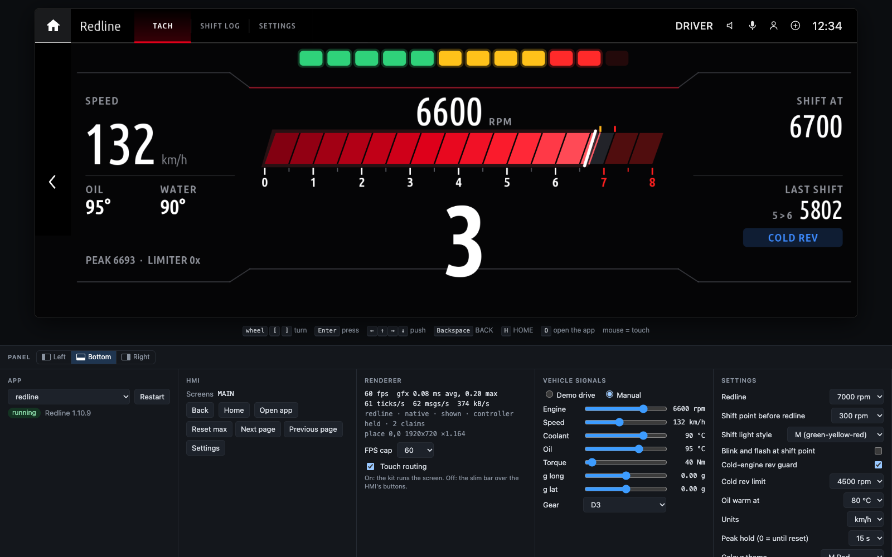<br>
  <sub>Redline in the emulator. The full guide, with more screenshots: <a href="docs/emulator.md">docs/emulator.md</a>.</sub>
</p>

```sh
node kit/tools/emu.js redline                  # -> http://localhost:8077
node kit/tools/emu.js doom --port 8080 --bg hmi-screenshot.png
node kit/tools/emu.js car_vitals --no-touch    # a renderer without touch routing
```

`emu.js` builds the app, runs it live with the real runtime on a stubbed head unit, and plays the
part of the GPU renderer: the page draws every frame with the car's own draw engine
(`kit/renderd/src/gfx.c` compiled to WebAssembly, `kit/emu/web/gfx/`) at up to 60 fps. The app
gets its ticks, touch and controller as `mgu-render` gives them on the car, so the kit runs the
screen itself: header tabs, slim bar, the settings sheet, scrolling. Save a file under
`apps/<id>/` or `kit/runtime/` and the app is built and restarted while the page stays open; a
build that fails is shown on the page, and the last good build keeps running. The server answers this
computer only (127.0.0.1), and only pages it serves itself.

| Input | Does |
|---|---|
| mouse on the screen | touch (a tap outside the app's claims goes to the "HMI": the home icon is HOME, the back arrow BACK) |
| mouse wheel, `[` `]` | turn the iDrive knob |
| `Enter` | press the knob |
| arrow keys | push it up / right / down / left |
| `Backspace`, `H`, `O` | BACK, HOME, open the app again |

The side panel switches the app, shows the log and the renderer's numbers, changes the app's
settings live (saved in `preview/emu/<id>/`), and feeds the vehicle signals: **Demo drive**
(`sim.js`, setting `demo` on) or **Manual** sliders, sent as raw values (section 7) so that
`car.js` scales them as in the car. Menu screens and the HMI's bar buttons (Doom's menu, the
standard layout) are buttons in the panel. The panel docks left, right or at the bottom (its own control, or
`?panel=left|right|bottom`); narrow windows put it at the bottom.

BACK on the app's last screen, or HOME, leaves the app for the HMI's app list ("Installed Apps",
drawn by the page as on the car): the app keeps running hidden, as on the car, and a rebuild keeps it
there. Its tile opens it again; another app's tile starts that one. On the car HOME goes to the main
menu; the app list stands in for it here.

**Touch routing** (the panel's switch, or `--no-touch` at start) picks the renderer. On, as the
Store's `mgu-render`: the kit runs the screen, with tabs and page buttons and no bar. Off, as a
renderer without it: the kit draws the slim bar over the HMI's own buttons, as in
[docs/screens](docs/screens); taps and the controller's focus go to those buttons, and tabs can't be tapped.

Limits: of the BMW HMI only its frame around the app (home icon, back arrow, status corner) and the
app list are drawn; its popups, main menu and own settings screen are not (the panel stands in). Frame times are your computer's GPU and CPU, not the car's. Signals come at
20 Hz without the car's timing or gaps, and nothing answers diagnostics (UDS) or other SOME/IP
calls. A large app such as Doom takes a few seconds to build.

---

## 7. Vehicle signals reference

The signals these apps use, with the scaling applied by `car.js` (raw × factor + offset):

| Value | Interface · field | Scaling |
|---|---|---|
| Engine speed | `vehicle.CDS` · `statusEngineSpeed2` | × 0.25 rpm |
| Vehicle speed | `vehicle.Vehicle2` · `statusCarSpeed2` | × 0.015625 km/h |
| Coolant / oil temperature | `vehicle.CDS` · `statusEngineTemperature` (`temperatureEngineDrive`, `temperatureEngineOilDrive`) | × 1 − 48 °C |
| Longitudinal / lateral acceleration | `vehicle.CDS2` · `statusLongitudinalAccelerationMassCenter` / `statusLateralAccelerationMassCenter` | × 0.002 − 65 m/s² |
| Gear | `vehicle.VehicleInformation` · `statusGearboxDrive.statusActualGearDrive` | enum: R = 1, N/P = 2, 1st = 3 … 10th = 12 (event only) |
| Engine torque | `vehicle.FES` · `statusActualValueTorque2.actualValueTorqueCrankshaft` | raw 4095 = invalid |
| iDrive controller | `controlelements.FrontCCU` · `statusRotaryEncoderState` | `frontRotaryEncoderOperation` = knob counter (16 bit, wraps), `frontRotaryEncoderPushButton` = press (`DREHGEBER_KURZ/LANG_GEDRUECKT`), `frontRotaryEncoderDeflection` = push N / E / S / W (`NORD_KURZ_GEDRUECKT` ...), `MITTELSTELLUNG` = centre. Enums arrive by name; all `SIGNAL_UNGUELTIG` = no controller (VM). The HMI acts on the controller too |
| Controller buttons | `controlelements.FrontCCU` · `statusPushButtonsState` | `frontOperationButton1..8`: short / long press, touched. Used by the HMI itself (MENU, BACK, ...) |
| Service items | `KombiInterface_2` · `cbsDataServiceList` | the cluster's list: id, name, colour, distance and date as text |

Many more are in the catalog: boost, steering angle, yaw rate, wheel speeds, pedal positions,
battery, ambient temperature, the instrument-cluster interface and more. Use `sigdoc.py` to
explore it.

---

## 8. Troubleshooting and gotchas

- **The tile shows "Loading app" forever.** The app's process isn't reaching the HMI. Look at
  `/var/opt/public/oap/oap_<uid>/data/<id>.log` (the kit logs startup steps and fatal errors
  there) and `sh deploy-car.sh status`.
- **An app vanished after crashing.** That's MainApp's crash handler (4.3). Fix the crash, then
  run `install` again.
- **Never `kill` an app process.** Restart the platform instead:
  `systemctl restart oapcontroller` (the HMI's app list reloads).
- **A removed app's tile is still shown.** The HMI caches tiles. `restore` handles this by
  restarting `hmi.service` and then the platform; a reboot does the same.
- **`interface generation failed ... no getter available`** during install. An `r` flag is set
  on a field without a getter; run `check_signals.py` and change it to `s`.
- **Everything shows DEMO in the car.** The app got no data for that signal group for 5 s. Check
  the log, and that the ignition is on (with the head unit merely awake, much of the vehicle
  data isn't sent).
- **After a firmware update the apps are gone.** They're installed but hidden, because the hook
  refuses to patch an unknown MainApp. Run `sh deploy-car.sh install` again.

---

## 9. Known limits

- **No dashcam.** Recording the cameras would need BMW's Drive Recorder service, which requires
  BMW provisioning (4.6). The raw camera streams can't be tapped from an app, and they only
  flow while a camera view is on screen.
- **Offline cars stay offline.** These apps don't need the internet, but they can't fix a
  missing TCB connection or unlock BMW's online services.
- **Physical buttons.** Apps see some steering-wheel buttons (scroll-wheel press, voice,
  volume) and the iDrive controller (knob, press, push), but the HMI keeps acting on them too:
  BACK, MENU and OPTION still leave or cover the app.
- Calculated values (dyno power, brake distance) are as good as the car's speed and
  acceleration sensors. Compare against known figures and do runs on flat road.

---

## 10. Repository layout

```
apps/<id>/            app.json + main.js (+ helpers) per app
apps/doom/            Doom: doom-core.js (WebAssembly runner, files over Node fs), controls.js
                      (controller -> keys), doom.wasm (built from third_party/doomgeneric), GPL-2.0
kit/runtime/          app runtime: mgu.js (platform glue), record.js + display.js + renderd.js
                      (GPU path), canvas.js (software path), gauges.js, themes.js,
                      car.js (signals + demo), sim.js (demo drive), signals.js (SOME/IP),
                      diag.js (UDS over TASU), fonts/
kit/renderd/          mgu-renderd: the GPU renderer service (mgu-render: C, GLES2, Wayland/ivi),
                      GPL-3.0-or-later; prebuilt/ = the ready binary + the source fingerprint it
                      was built from; inputgate/ = the controller gate
kit/platform/         permissions template used by build.py
kit/tools/            build.py, make_kit.py, preview.js, emu.js + hu-stub.js (the live emulator),
                      make_gif.sh, make_icon.js, render_icons.py, bake_fonts.py, extract_sdk.js,
                      check_signals.py, sigdoc.py, oapgen/gen.js
kit/emu/              the emulator's page (web/) and the draw engine as WebAssembly (web/gfx/, built
                      from wasm/ with build.sh), GPL-3.0-or-later for the engine's build
kit/icons/            the apps' tile icons as SVG (render_icons.py -> apps/<app>/icon.png)
deploy/               make-car-kit.sh/.cmd, push-to-car.sh/.ps1, mgu-app-install.sh, mainapp-patch.js
deploy/car/           deploy-car.sh (runs on the unit) + its README
docs/                 RHMI widget reference, the emulator guide (emulator.md), screenshots
                      (docs/screens), animations and emulator screenshots (docs/media)
third_party/doomgeneric/  Doom's engine source (GPL-2.0) with the changes for the app (mgu.patch,
                      MGU.md) and build.sh, which builds apps/doom/doom.wasm
```

Not in the repository, on purpose:

- **`oap-sdk/`**: BMW's SDK. Extract it from your own unit (3.1).
- **`reference/someip-interfaces.json`**: the unit's service catalog. Copy it from your unit.
- **`dist/`**: build output; every `.mgu` contains BMW's SDK.
- Anything that identifies a car (VIN, keys, provisioning files).

BMW's interface generator (needed at install time) is likewise **loaded from the unit's own
firmware** by `kit/tools/oapgen/gen.js`, so no BMW code is shipped here.

### Doom and renderer licences

The repository is MIT-licensed, except two parts. The GPU renderer, `kit/renderd`, is
[mgu-render](https://github.com/robertnisipeanu/mgu-store) by Robert Nisipeanu and IterioDev,
GPL-3.0-or-later (`kit/renderd/LICENSE`); the parts it took from this repository's first renderer
stay MIT too (`kit/renderd/LICENSE.mgu-renderd`), and the controller gate in
`kit/renderd/inputgate` is MIT. It runs as its own program, so the apps that talk to it over its
socket stay MIT. The emulator's build of its draw engine, `kit/emu/wasm` and `kit/emu/web/gfx`
(WebAssembly, section 6.4), contains its code, so it is GPL-3.0-or-later too; the rest of the
emulator, which only feeds it the socket's bytes, stays MIT. The other is the Doom app: `apps/doom` contains `doom.wasm`, the
[doomgeneric](https://github.com/ozkl/doomgeneric) engine (GPL-2.0) compiled to WebAssembly, so
the app as a whole is distributed under the GPL-2.0 (`apps/doom/LICENSE`, `apps/doom/NOTICE`).
Its complete source, with the changes made for the app, is in `third_party/doomgeneric`;
`third_party/doomgeneric/build.sh` rebuilds `doom.wasm` from it byte for byte (zig 0.13 +
binaryen 119). The game data, [Freedoom: Phase 1](https://freedoom.github.io) 0.13.0 (BSD
licence, included in `NOTICE`), is not in the repository: `build.py` downloads it and checks its
SHA-256. Doom is a trademark of id Software; Freedoom and this app are not affiliated with id
Software.
