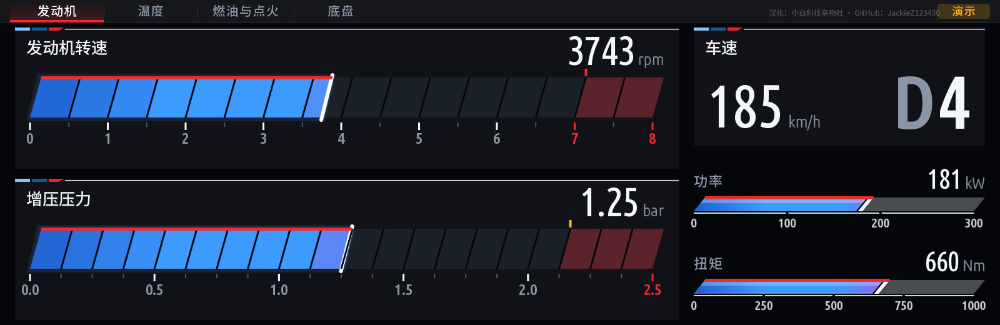
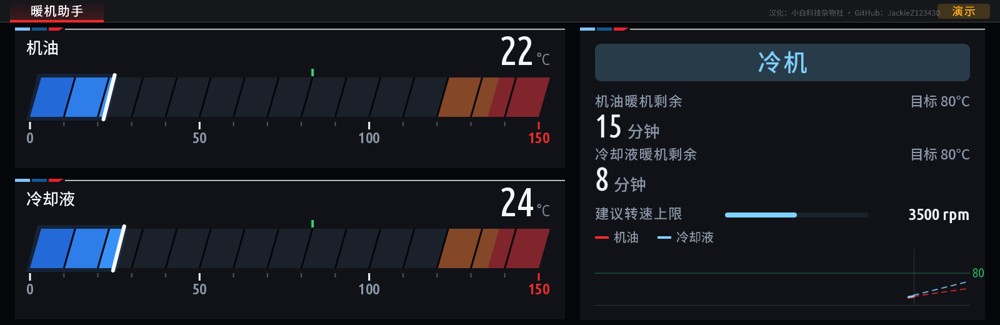

**中文** | [English](README.en.md)

# MGU Custom Apps 简体中文版

**汉化：小白科技杂物社 / Bilibili 小白151 / GitHub [JackieZ123430](https://github.com/JackieZ123430)**
汉化仓库：[JackieZ123430/idrive7-apps-cn](https://github.com/JackieZ123430/idrive7-apps-cn)
上游：[cauliflowermossgrape/idrive7-apps](https://github.com/cauliflowermossgrape/idrive7-apps)

本仓库公开提供源码，不收取下载费或激活费。转载请保留上游许可证和汉化署名，见 [来源说明](NOTICE.zh-CN.md)。

## 汉化内容

- 11 个应用的名称、菜单、按钮、设置，以及内置的仪表标题、状态和常用提示。
- 自绘仪表使用开源 Noto Sans SC 字形，GPU 和软件渲染均支持中文；数字和单位沿用原样。
- 原生 HMI 菜单通过 SDK 的 StringBundle / StringId 传输 Unicode，避免旧版 Text 通道乱码。
- 每个应用的设置页底部保留“小白科技杂物社 / Bilibili 小白151 / GitHub JackieZ123430”署名。
- 画面右上角使用 12 px、约 25% 不透明度的小字署名“汉化：小白科技杂物社 · GitHub：JackieZ123430”；全屏时放在系统状态栏下方，标准布局避开演示标记。
- 应用版本带 `-cn.1` 后缀，便于与上游版本区分。

| 原应用 | 中文名称 |
|---|---|
| M Vitals | M 车辆仪表 |
| Redline | 换挡转速 |
| Virtual Dyno | 虚拟马力机 |
| Brake Test | 制动测试 |
| Drag Timer | 加速计时 |
| G-Force | G 值仪表 |
| Warm-Up | 暖机助手 |
| eDrive | 电驱助手 |
| Fault Scanner | 故障扫描 |
| Service | 保养信息 |
| Doom | 毁灭战士 |

此版本不更改车辆信号、诊断指令或设置的内部取值，不需要 BMW ID 登录。
台架没有对应车辆数据时，可以在设置中开启演示数据。

## 离线预览

以下为演示数据的离线绘制效果，不是实车测试截图。右上角为低对比度汉化署名。





## 已知范围

- Doom 的启动菜单和设置已汉化，游戏内部贴图、关卡文字仍为原文。
- 原厂故障码数据库、ECU 原始响应及车辆返回的说明保留原文；不将技术标识自动翻译成中文。
- 自绘字库包含本版内置译文所需字符；车辆返回的任意中文长文本可能包含额外字形，原生 HMI 字符串不受此字形子集限制。
- 中文底栏宽度按字形测量，但 HMI 的实际字宽与离线近似值可能不同。应在自己的车机验证按钮位置及控制器焦点。
- 已做本地构建、自动检查和离线预览；本仓库汉化版尚未在实机完成安装验证。

## 安装前提

适用于 iDrive 7 MGU，需 root SSH。上游在 `P18_23w44.2` 固件测试；其他版本先执行兼容性检查。
电脑需要 Python 3 和 Node.js 14 以上。预生成中文字库已提交，正常构建无需 Pillow、字体下载或编译 GPU 程序。

安装包包含 BMW 的原厂 SDK，因此本公开仓库只提供源码。请从自己的车机提取 SDK 后构建，不要将提取的 SDK 或含 SDK 的安装包上传到公开仓库。

### Windows 构建

1. 下载本仓库源码并解压，或用 Git 克隆：

   ```powershell
   git clone https://github.com/JackieZ123430/idrive7-apps-cn.git
   cd idrive7-apps-cn
   ```

2. 从车机下载任意原厂 OAP 应用的 `source/javascript/app.js`，保存到电脑，例如 `own-app.js`。
   应用 UID 因车机而异，不要假定固定 UID。也可从车机 `/usr/lib/oap-mainapp/preinstalled_apps/` 下的原厂应用 tgz 解出 `javascript/app.js`。
   具体提取流程见上游 README 的 Quick start。

   ```powershell
   node kit/tools/extract_sdk.js own-app.js oap-sdk
   ```

3. 先构建暖机助手，便于检查中文显示：

   ```powershell
   node kit/tools/test_zh.js
   python kit/tools/test_zh.py
   python kit/tools/make_kit.py warmup
   ```

   构建全部应用：`python kit/tools/make_kit.py`。Doom 首次构建会下载并校验 Freedoom 游戏数据。

4. 用自己的车机 IP 和 SSH 私钥执行检查，再安装。下面的占位值需要替换：

   ```powershell
   powershell -ExecutionPolicy Bypass -File deploy/push-to-car.ps1 check -Key "C:\你的目录\id_rsa" -Ip "车机IP"
   powershell -ExecutionPolicy Bypass -File deploy/push-to-car.ps1 install -Key "C:\你的目录\id_rsa" -Ip "车机IP"
   ```

`check` 检查 MainApp 补丁和应用接口兼容性；它会传输检查文件及生成临时文件，不会执行安装或重启服务。
`install` 会备份配置、安装应用并重启应用平台；Doom 控制器插件首次启用时可能触发车机重启。恢复可使用相同脚本的 `restore` 命令，详见上游安装说明。

## 维护译文与字库

译文在 `kit/runtime/locales/zh-CN.tsv` 和生成的 `zh-CN.json`，应用静态菜单在各自 `app.json`。
修改 TSV 后执行 `python kit/tools/sync_zh.py`，再检查、构建。

新增汉字需要重新生成字形（仅维护者需要 Pillow）：

```powershell
python -m pip install Pillow
python kit/tools/bake_cjk.py
node kit/tools/test_zh.js
python kit/tools/test_zh.py
```

字形生成器会校验字体 SHA-256，并检查中文字库的 GPU 纹理预算。生成后的 `cjk.json` 和译文一起提交。

完整功能、安装实现和恢复细节请阅读 [英文详细文档](README.en.md)。
