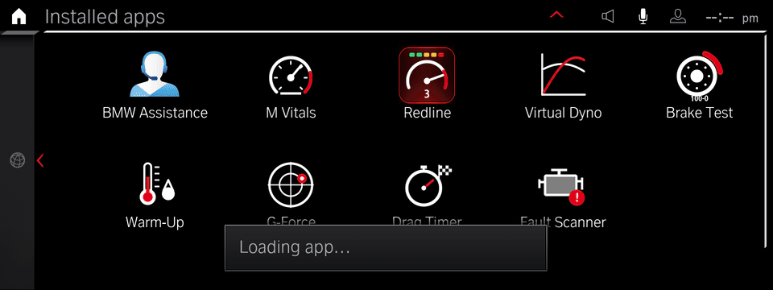
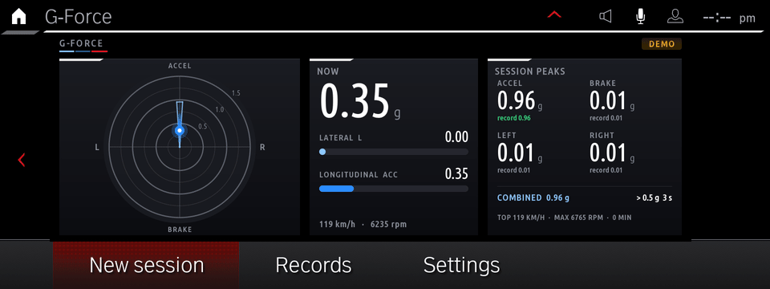
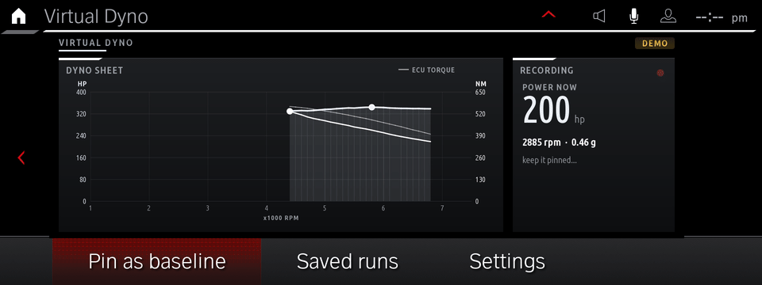
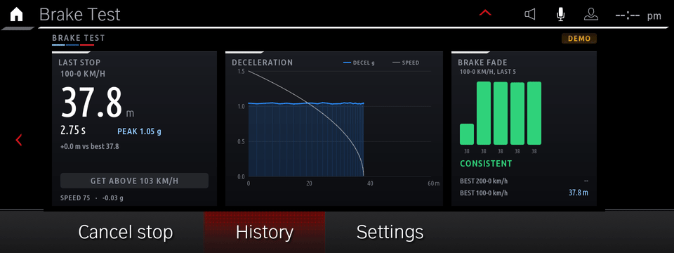
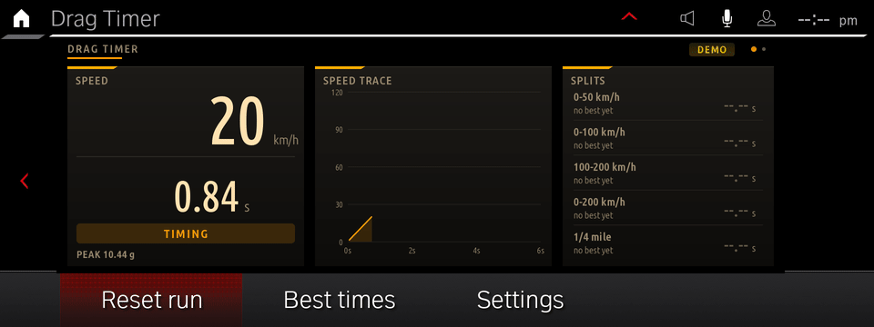
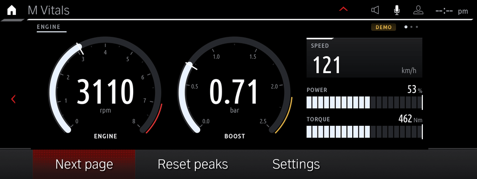
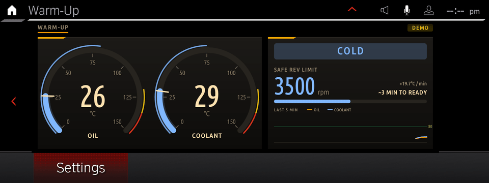
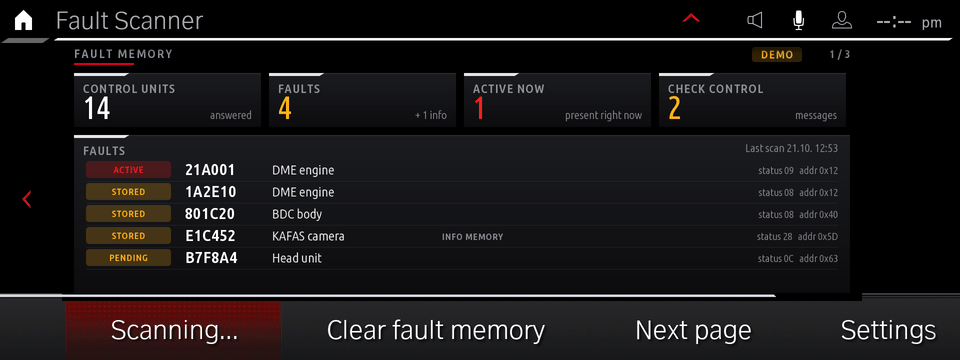

# MGU Custom Apps

**Custom apps for the BMW MGU head unit (iDrive 7 / ID7), plus a complete kit to build your own.**

Shift lights and a full-screen tach, a virtual dyno, brake and drag timers, a G-meter, an
oil warm-up guide, and a fault-code scanner/cleaner. They run on the car's own app platform,
use the HMI's real screens and settings menus, read live vehicle data, and survive reboots.
Everything can be removed again with one command.

| | |
|---|---|
| <br>**Redline**: M Red theme | <br>**G-Force**: M Tricolour theme |
| <br>**Virtual Dyno**: Ice White theme | <br>**Brake Test**: M Tricolour theme |
| <br>**Drag Timer**: Night Amber theme | <br>**M Vitals**: Ice White theme |
| <br>**Warm-Up**: Night Amber theme | <br>**Fault Scanner**: M Red theme |

*(Recorded on the real MGU firmware running in a VM, with each app's built-in demo drive.
Every app has the same four themes, picked from its Settings page: M Red, M Tricolour,
Ice White and Night Amber. In the car the same screens show live data.)*

> **Disclaimer.** This is an unofficial hobby project. It is not affiliated with, endorsed by
> or supported by BMW AG. You modify your own head unit at your own risk. Use the apps parked
> or on a closed track, and keep your eyes on the road. The Fault Scanner can clear fault
> memories in every control unit of the car, so read the codes first.

---

## Contents

1. [The apps](#1-the-apps)
2. [What you need](#2-what-you-need)
3. [Quick start](#3-quick-start)
4. [How the head unit works](#4-how-the-head-unit-works)
5. [How the apps get onto the unit](#5-how-the-apps-get-onto-the-unit)
6. [Writing your own app](#6-writing-your-own-app)
7. [Vehicle signals reference](#7-vehicle-signals-reference)
8. [Troubleshooting and gotchas](#8-troubleshooting-and-gotchas)
9. [Known limits](#9-known-limits)
10. [Repository layout](#10-repository-layout)

---

## 1. The apps

Every app has a settings screen in the HMI's own style: four colour themes (M Tricolour, the
default, M Red, Ice White, Night Amber), units, refresh rate, and a demo mode. Results and records are saved on
the unit and kept across reboots.

| App | What it does |
|---|---|
| **Redline** | Full-screen rev tach with a 12-LED shift-light bar that strobes at your shift point (optionally flashing the whole screen red). Huge gear indicator, read from the gearbox or learned from rpm/speed. Every upshift is scored (EARLY / SPOT ON / LATE / LIMITER), with a shift log and accuracy stats. A cold-engine guard lowers the shift point until the oil is warm. |
| **Virtual Dyno** | Do a full-throttle pull in one gear and get a power and torque curve, calculated from acceleration, car weight, air drag and rolling resistance. Settings for weight, body shape, drivetrain loss, hp/PS/kW and Nm/lb-ft. Runs are saved; pin one as a baseline to see ± on every new pull. Optional overlay of the engine computer's own torque reading. |
| **Brake Test** | 100-0 and 200-0 km/h (or 60-0 and 100-0 mph): distance, time, peak deceleration and a deceleration trace. The start crossing is interpolated between samples, so results don't depend on the sample rate. A brake-fade chart compares your last stops and warns when distances grow. Bests plus full history. |
| **Drag Timer** | 0-50, 0-100, 100-200, 0-200 km/h and ¼ mile (or mph equivalents), with interpolated splits, optional one-foot rollout, a live speed trace and saved best times. |
| **G-Force** | Friction circle with a fading trail and a grip envelope that grows as you use more grip in each direction. Live lateral/longitudinal bars, session peaks per direction, time spent above 0.5 g, all-time records. |
| **Warm-Up** | Oil and coolant gauges, a safe rev limit that rises with oil temperature, an estimate of minutes until the engine is ready, a temperature trend graph, and a turbo cool-down countdown after hard driving. |
| **M Vitals** | A sport cluster: rpm, boost, speed with the gear (D / S / M + number), power from the iDrive sport display (its % × your car's max power, so stock or tuned engines both read right; kW, hp or PS) and torque, coolant and oil temperature, g-forces and more, over several pages, with peak values.  Tyre pressures (against the car's target) and temperatures are shown large on the Chassis page; its xDrive card can be set to Auto (shown once the car reports all-wheel drive), Show or Hide for rear-wheel-drive cars. Dials run from blue to red as they near the redline / boost limit. |
| **Fault Scanner** | Scans every control unit for stored fault codes (UDS over the head unit's diagnostic gateway), shows them per module with status, shows live Check Control messages, and can clear fault memories (two-press confirm). |
| **eDrive** | For plug-in hybrids / EVs: real electric range from the battery's charge and the outside temperature (a full battery gives 50 km at 20 °C, 40-45 km at 10 °C, 30-38 km at 0 °C, 20-30 km at -10 °C, scaled to your own 20 °C range), shown with its low-high spread, battery health (SOH, capacity vs. new) and design capacity left (charge × SOH, in % and kWh). Also shows the last HV battery charge (+%, kWh, km added; a charge done while the head unit slept shows at the next start) and the 12 V battery voltage. A charge log page lists every charge (date, % and kWh added, range added, cost from your electricity price, 0.25 €/kWh by default) with monthly / all-time totals and a 14-day chart. On a car without a hybrid system it detects that the battery unit never answers and shows only the 12 V battery (or set Hybrid system = No). Charge and SOH are read from the battery control unit over UDS; a Diagnostics page shows the raw replies so the DIDs can be adjusted per model in `app.json`. |

On the VM or a bench unit without vehicle data, every app switches to a built-in demo drive
after 5 seconds (launch, pull through the gears, a hard stop, corners, an engine warming up from
cold). A **DEMO** badge shows when the data isn't from the car.

---

## 2. What you need

- **A BMW with the MGU head unit** (iDrive 7, "ID7"). Developed and tested on firmware
  `P18_23w44.2`. Other MGU versions very likely work; the installer's `check` step tells you
  before it changes anything.
- **Root shell access to the head unit** (SSH or serial console). **This project does not
  provide it and cannot publish how to get it.** There are community guides for rooting MGU
  units; search for them. Everything below assumes you can log in as `root`.
- **BMW's app SDK (`oap-sdk`), extracted from your own unit.** It's BMW's copyrighted code, so it
  isn't in this repository. It is inside every BMW app on your head unit, and
  [`kit/tools/extract_sdk.js`](kit/tools/extract_sdk.js) rebuilds it from one of them in a
  second (see Quick start).
- **A PC with Node.js 14+ and Python 3.** Linux, macOS, or Windows with WSL. Pillow is needed
  only if you want to re-bake the fonts.

---

## 3. Quick start

### 3.1 Get the SDK from your unit

Copy any BMW app's bundle off the head unit (x_call is present on every unit) and extract the SDK:

```sh
ssh root@<unit> 'cat /var/opt/public/oap/oap_12204/source/javascript/app.js' > x_call_app.js
node kit/tools/extract_sdk.js x_call_app.js        # writes ./oap-sdk/
```
Or download it of a public internet webiste:
https://bedrive.ru/da77


`oap-sdk/` is listed in `.gitignore`. Never commit it.

### 3.2 Build

```sh
python3 kit/tools/build.py            # all apps -> dist/<id>@<ver>.mgu
python3 kit/tools/build.py redline    # just one
node kit/tools/preview.js dist/redline preview wait=10   # render it on the PC -> preview/*.png
```

The `.mgu` files contain BMW's SDK, so keep them for your own car and don't publish them.

### 3.3 Install on the car

Car parked, ignition on, ideally with a battery charger connected. Pack the kit and push it
over SSH:

```sh
deploy/make-car-kit.sh                                    # -> dist/mgu-custom-apps(.tar.gz)
HU=root@<unit-ip> PORT=22 deploy/push-to-car.sh check     # read-only: checks the unit, lists what it would touch
HU=root@<unit-ip> PORT=22 deploy/push-to-car.sh install   # backup -> install -> restart the app platform
```

No network? Copy `dist/mgu-custom-apps/` to a USB stick and on the unit run
`sh deploy-car.sh check`, then `sh deploy-car.sh install`.

After about 1-2 minutes the tiles appear under **Apps**. More commands on the unit (in
`/var/opt/mgu-custom-apps`):

```sh
sh deploy-car.sh status     # installed apps, running state, hook state
sh deploy-car.sh backups    # list backups
sh deploy-car.sh restore    # back to stock (asks you to type YES)
```

### 3.4 Back to stock

`restore` stops the platform and removes every custom app, the hook and the boot drop-in. It
then puts every touched file back exactly as it was in the **stock backup**, the first backup
`install` ever made, which is never overwritten. Each file is verified against that backup.
Finally it restarts the HMI so the removed tiles disappear without a reboot.

---

## 4. How the head unit works

This is what the MGU looks like from the inside, as far as it matters for apps. Everything here
was learned from a running unit.

### 4.1 Hardware

| Part | Details |
|---|---|
| CPU | Intel Apollo Lake (x86-64), Intel GPU (i915 / Mesa, EGL + GLES2) |
| OS | Linux 4.14 (`-apl`), systemd, BusyBox userland |
| Storage | eMMC: read-only root filesystem + a writable `/var/opt` (apps live in `/var/opt/public`). Plus a 2.5" hard disk: one read-only partition (navigation and other data) and a writable ~90 GB share at `/var/opt/hdshare`. |
| Video in | Intel IPU4 camera-capture block with six CSI-2 ports (on our unit no camera is wired to them; the camera views arrive over Ethernet, see 4.6) |
| Network | One Ethernet port into the car (`socnet0`), split into VLANs for the different car domains; Wi-Fi (`wlan0`) for the phone hotspot / CarPlay |

### 4.2 Software stack

```
 ┌───────────────────────────── HMI (HmiMain3D, RAMSES 3D renderer) ─────────────────────────────┐
 │  BMW's screens and menus   +   "Remote HMI" (RHMI) screens that apps describe and fill with data │
 └───────────────▲──────────────────────────────────────────────────────────▲────────────────────┘
                 │ SOME/IP + joynr                                             │ SOME/IP
 ┌───────────────┴──────────────┐   ┌──────────────────────────────────────┴─────────────────────┐
 │  OAP app platform            │   │  Native services                                             │
 │  oapcontroller -> MainApp    │   │  media (mediaengine, mediaapp), cameras (dasvideo,           │
 │  (Node.js) -> one Node       │   │  icam2proxy), AVB streams, navigation, phone, diagnostics    │
 │  process per app             │   │  gateway (TASU), provisioning, connectivity (connman)        │
 └───────────────┬──────────────┘   └──────────────────────────────────────┬─────────────────────┘
                 │                     SOME/IP over Ethernet VLANs            │
 ┌───────────────┴────────────────────────────────────────────────────────────┴─────────────────┐
 │  The rest of the car: engine and chassis data, instrument cluster, cameras, telematics (TCB)   │
 └───────────────────────────────────────────────────────────────────────────────────────────────┘
```

- **SOME/IP** (vsomeip) is the main bus. Every service, in the head unit or anywhere in the car,
  is described in one catalog on the unit, `/etc/oap/someip/someip-interfaces.json`: interfaces,
  fields (with or without a getter and a change notifier), methods and events, plus their wire
  ids and data types. Vehicle data such as rpm, speed, temperatures and accelerations arrives as
  SOME/IP field notifications.
- **joynr** is a higher-level RPC layer on top (BMW's cluster controller listens on ports
  4242/4243). The platform uses it for app management and HMI entry points.
- **The HMI** is a 3D renderer (RAMSES) with BMW's own asset database. Apps never draw directly:
  they describe screens with BMW's widget templates and push text, images and properties into
  them (see 4.4).

### 4.3 The app platform (OAP)

BMW calls it the **Online Apps Platform**. It's how BMW ships its own apps (weather, news, M
Laptimer, emergency call, service and battery apps, ...), and these custom apps use exactly the
same mechanism.

- `oapcontroller.service` starts **MainApp** (`/usr/lib/oap-mainapp`, a Node.js host running as
  uid 12201). MainApp installs, starts, stops and supervises every app.
- **Each app is an npm-style package** (`package.json`, `manifest.json`, `permissions.json`,
  `rhmiData/`, `javascript/app.js`). It is installed into
  `/var/opt/public/oap/oap_<uid>/` and runs as **its own Linux user** (uid 12203 and up). Apps
  run under Node.js 8, with native add-ons for SOME/IP, certificates, codings and more.
- **Registry:** `oap_12201/security/uids.txt` (uid ↔ app) and `oap_12201/data/apps/<app>.json`
  (version, install source, state).
- **Install sources:** BMW's app store via the backend, or the read-only preinstalled folder
  `/usr/lib/oap-mainapp/preinstalled_apps/`. At install MainApp **generates** the app's SOME/IP
  config (`someipInterfaces/*.json`) and access list (`acl.json`) from its `manifest.json` and
  the catalog. An app can only reach the services and fields its manifest asks for.
- **Provisioning decides what's visible.** A BMW-signed file
  (`/var/opt/public/tm/tm_12000/data/prov/ProvSigned.xml`, pushed from the BMW backend) lists
  which apps and features this car may use. MainApp hides any app that isn't enabled there. The
  file is signed, so it can't simply be edited; this kit adds a fallback instead (see 5.2).
- **Crash handling is harsh.** If an app exits unexpectedly, MainApp's `CorruptAppsHandler`
  wipes its data folder; the second time, it uninstalls the app. So never kill an app process
  by hand. To restart apps, restart the platform (`systemctl restart oapcontroller`), which
  stops them cleanly.
- Each app gets **CPU, memory and disk limits** from `oapAppSettings` in its `package.json`.

### 4.4 How apps draw: Remote HMI (RHMI)

The HMI doesn't run app code. An app ships a **description** of its screens:

- `rhmiData/application.json`: the app's identity and its **entry points** (the tiles in the
  Apps menu: icon, title, position).
- `rhmiData/uiDescriptions/ID7/application.xml` + `uiDescription.json`: screens ("states") made
  of components (labels, buttons, lists, checkboxes, images), each using one of BMW's **widget
  templates** (`LT_State_*`, `LT_Label_*`, `LT_Button_*`, ...).
- At runtime the app pushes values: text, visibility, enabled state, list rows and **images**.

The kit's trick for rich graphics: each app's main screen is a single large image component.
The app renders every frame itself in pure JavaScript (`kit/runtime/canvas.js`: shapes,
anti-aliased arcs, gradients, baked fonts), encodes it as PNG and hands it to the HMI. That's fast enough for smooth
gauges at 6-15 fps.
Buttons under the image and the settings screens are normal RHMI widgets, so they look and
behave like BMW's own (rotary controller, touch, back button).

See [`docs/rhmi-widgets.md`](docs/rhmi-widgets.md) for the widget vocabulary, ids and update
format.

### 4.5 Diagnostics

The head unit is a diagnostic gateway: the SOME/IP service
`com.harman.infotainment.systemfunctions.tasu.tasu.InternalTasu` sends **UDS requests** to any
control unit (or to all of them via the functional address `0xDF`). Replies come back as events.
BMW's own diagnostic job list on the unit uses the same requests.

- Read fault codes: `0x19 02 <mask>` (ReadDTCInformation, by status mask)
- Clear fault codes: `0x14 FF FF FF` (ClearDiagnosticInformation)
- Read data: `0x22 <DID>` (e.g. `F190` = VIN)

Clearing fault codes in all modules can make control units restart, and the head unit itself
may reboot.

### 4.6 Media, cameras and the Drive Recorder

- Audio and video between the head unit and the rest of the car run over **AVB** (audio/video
  bridging on Ethernet). The network chip uses a dedicated AVB driver (`igb_avb`) that hands
  these streams straight to BMW's stream handler, outside the normal Linux network stack.
- **Camera views** (rear-view / surround view) come in as **H.264 over AVB** and are displayed
  by `dasvideo`. They're only streamed while a camera view is on screen.
- BMW's **Drive Recorder** service (`VideoBuffer`, served by `icam2proxy`) needs **two**
  switches: the coding flag (Drive Recorder active) **and** BMW provisioning
  (`oap_drive_recorder` enabled in the signed provisioning file). Coding alone does nothing.
  Without both, there is no service an app could record from.

### 4.7 Connectivity

The head unit has no internet route of its own. BMW's servers are reached only through the
**telematics unit (TCB)** over one of the internal VLANs. If the TCB has no mobile connection
(for example a US car in Europe whose eSIM doesn't work there), the head unit is offline:
provisioning can't be updated and BMW's online apps don't work. The custom apps here don't need
the internet.

---

## 5. How the apps get onto the unit

### 5.1 What `deploy-car.sh install` does

1. **Checks** the unit and test-builds the MainApp patch for *this*
   firmware. If anything is unexpected it stops before changing a file.
2. **Backs up** every file it will touch into `backups/<time>/` next to the script **and**
   `/var/opt/public/mgu_custom_backup/<time>/`, then verifies both copies. The first backup ever
   made is kept as the **stock backup**.
3. **Enables the provisioning hook** (5.2) and makes it survive reboots (a systemd drop-in for
   `oapcontroller.service`).
4. **Installs** each `.mgu`: unpacks it to `/var/opt/public/oap/oap_<uid>/` (uids 12221+, never
   touching BMW's apps), generates the SOME/IP configs and ACL with **BMW's own generator, loaded
   from the unit's firmware**, registers the app as preinstalled, and fixes ownership and
   permissions.
5. **Restarts the app platform** once. The HMI reloads the Apps list in about 1-2 minutes.

Files it touches:

```
/var/opt/public/oap/oap_12201/security/uids.txt          app id list
/var/opt/public/oap/oap_12201/data/apps/                 app registry
/var/opt/public/oap/oap_12201/data/custom_apps.json      (new) list of custom apps
/var/opt/public/oap/_mgu_custom/                         (new) patched main.js + boot script
/etc/systemd/system/oapcontroller.service.d/50-mgu-custom-apps.conf   (new)
/var/opt/public/oap/oap_12221 ... oap_12299/              (new) the apps
```

### 5.2 The provisioning hook

MainApp only shows apps that BMW's signed provisioning file enables, and custom apps are never
in it. The kit copies MainApp's `main.js` and adds one fallback: *"if provisioning has no entry
for an app, use its entry from `custom_apps.json`"*. It then **bind-mounts** that copy over the
original when the platform starts. The read-only system partition is never modified, BMW's own
apps keep their real provisioning, and nothing is faked or re-signed.

After a **firmware update** the boot script notices MainApp has changed and does **not** apply
the old copy. The unit runs stock and the custom apps are simply hidden. Run
`sh deploy-car.sh install` again to rebuild the hook for the new firmware.

---

## 6. Writing your own app

An app is two files in `apps/<id>/`: `app.json` (what it is) and `main.js` (what it does).
`build.py` generates the BMW package around them: RHMI layout, entry point, icon, text bundles for
all 33 HMI languages, manifest, permissions and runner.

### 6.1 `app.json`

```json
{
  "id": "boost",
  "title": "Boost",
  "description": "Big boost gauge",
  "version": "1.0.0",
  "vendor": "custom",
  "loggingId": "OAA1",
  "iconGlyph": "gauge",
  "signals": {
    "de.bmw.infotainment.vehicle.CDS": { "statusEngineSpeed2": "rs" },
    "de.bmw.infotainment.vehicle.Vehicle2": { "statusCarSpeed2": "rs" }
  },
  "screens": [
    { "name": "MAIN", "kind": "canvas", "title": "Boost",
      "buttons": [["BTN_RESET", "Reset peak"], ["BTN_SETTINGS", "Settings"]] }
  ],
  "settings": [
    { "key": "theme", "label": "Colour theme", "type": "choice", "default": "m_red",
      "options": [["m_red", "M Red"], ["ice", "Ice White"]] },
    { "key": "max", "label": "Gauge max", "type": "number", "unit": "bar", "default": 2.0, "steps": [1.5, 2.0, 2.5] },
    { "key": "peakHold", "label": "Hold peak", "type": "bool", "default": true }
  ]
}
```

| Key | Meaning |
|---|---|
| `loggingId` | 4-character log tag, **unique per app** (BMW apps use `OA1x`, the apps here `OA93`-`OA9B`) |
| `iconGlyph` | tile icon drawn by `make_icon.js`: `gauge`, `flag`, `engine`, `rpm`, `dyno`, `brake`, `temp`, `gforce`, `battery`, or up to ~3 letters |
| `signals` | `interface → { field: flags }`; `r` = read once at start (needs a getter), `s` = subscribe to changes (needs a notifier). Optional `_instances`, `_methods`, `_broadcasts` |
| `screens` | `canvas` screens: one big image + up to 4 buttons. `BTN_SETTINGS` opens the settings screen generated from `settings` |
| `settings` | `choice`, `number` (stepped through `steps`) and `bool`, saved in the app's `data/settings.json` |

**Check your flags against the catalog.** The unit's installer refuses `r` on a field without a
getter (some getters have id 0, which also counts as missing). Copy the catalog from your unit
to `reference/someip-interfaces.json` and run:

```sh
python3 kit/tools/check_signals.py      # every app.json vs. the catalog
python3 kit/tools/sigdoc.py de.bmw.infotainment.vehicle.CDS2   # fields, getters/notifiers, data types
```

### 6.2 `main.js`

```js
'use strict';
const mgu = require('./kit/mgu');
const { Canvas } = require('./kit/canvas');
const G = require('./kit/gauges');
const Car = require('./kit/car');

mgu.run({
    async start(ctx) {
        const car = new Car(ctx, ['rpm', 'speed']);     // scaled signals + automatic demo fallback
        let peak = 0;
        car.onSample((d) => { if (G.isNum(d.rpm)) peak = Math.max(peak, d.rpm); }, () => { peak = 0; });
        ctx.ui.onClick('BTN_RESET', () => { peak = 0; });

        ctx.loop('MAIN', 10, () => {                   // 10 fps while the screen is visible
            const t = ctx.theme(), d = car.data();
            const cv = new Canvas(1600, 520).clear(t.bg);
            G.radial(cv, t, 800, 300, 220, { value: d.rpm, min: 0, max: 8000, label: 'RPM', ticks: 8 });
            cv.text('PEAK ' + peak, 800, 500, 32, t.dim, { align: 'center', font: 'bold' });
            return ctx.ui.image('MAIN_GFX', cv);
        });
    },
});
```

**`ctx`** gives you:

| | |
|---|---|
| `ctx.ui` | `image(name, canvas)`, `text(name, str)`, `visible(name, on)`, `checked(name, on)`, `rows(name, n)`, `onClick(name, fn)` |
| `ctx.settings` | `get(key)`, `onChange(fn)` |
| `ctx.loop(screen, fps, fn)` | render loop that runs only while that screen is shown; returns `{stop()}` |
| `ctx.theme()` | current colour theme (`bg`, `text`, `dim`, `accent`, `warn`, `crit`, `cold`, ...) |
| `ctx.signals` | raw SOME/IP access: `watch(iface, instance, handlers)`, `proxy`, `call` |
| `ctx.log` | `info/warn/error` → system log + `data/<id>.log` |
| `ctx.dataDir` | the app's writable folder (persistent) |

**`Canvas`**: `fillRect`, `gradientRect`, `roundRect`, `strokeRoundRect`,
`arc(cx, cy, r0, r1, a0, a1, color, {round})`, `circle`, `line`, `polyline`, `fillUnder`,
`text(str, x, baselineY, size, color, {font, align, spacing})` (returns its width),
`textWidth`. Fonts: `label`, `bold`, `num`, `light`, `gear`. Large sizes contain digits and a
few letters only; re-bake with `kit/tools/bake_fonts.py` (Ubuntu font family) if you need more.

**`Car`** (`kit/runtime/car.js`): groups `rpm`, `speed`, `temps`, `accel`, `gear`, `torque`.
`car.data()` returns `{ rpm, speed, gLong, gLat, coolant, oil, gear, torque, demo }` in real
units, with invalid raw values filtered out. Demo mode follows the app's `demo` setting: `auto`
switches to the simulated drive when no car data arrives for 5 s.

### 6.3 Preview, build, deploy

```sh
python3 kit/tools/build.py boost
node kit/tools/preview.js dist/boost out wait=8 BTN_RESET render --set theme=ice
deploy/make-car-kit.sh boost && HU=root@<unit> deploy/push-to-car.sh install
```

`preview.js` runs the built app on your PC with a stubbed head unit and demo data, and saves
every frame the app pushes as a PNG. It's the fastest way to iterate on visuals.

---

## 7. Vehicle signals reference

The signals these apps use, with the scaling applied by `car.js` (raw × factor + offset):

| Value | Interface · field | Scaling |
|---|---|---|
| Engine speed | `vehicle.CDS` · `statusEngineSpeed2` | × 0.25 rpm |
| Vehicle speed | `vehicle.Vehicle2` · `statusCarSpeed2` | × 0.015625 km/h |
| Coolant / oil temperature | `vehicle.CDS` · `statusEngineTemperature` (`temperatureEngineDrive`, `temperatureEngineOilDrive`) | × 1 − 48 °C |
| Longitudinal / lateral acceleration | `vehicle.CDS2` · `statusLongitudinalAccelerationMassCenter` / `statusLateralAccelerationMassCenter` | × 0.002 − 65 m/s² |
| Gear | `vehicle.VehicleInformation` · `statusGearboxDrive.statusActualGearDrive` | enum: R = 1, N/P = 2, 1st = 3 … 10th = 12 (event only) |
| Engine torque | `vehicle.FES` · `statusActualValueTorque2.actualValueTorqueCrankshaft` | raw 4095 = invalid |

Many more are in the catalog: boost, steering angle, yaw rate, wheel speeds, pedal positions,
battery, ambient temperature, the instrument-cluster interface and more. Use `sigdoc.py` to
explore it.

---

## 8. Troubleshooting and gotchas

- **The tile shows "Loading app" forever.** The app's process isn't reaching the HMI. Look at
  `/var/opt/public/oap/oap_<uid>/data/<id>.log` (the kit logs startup steps and fatal errors
  there) and `sh deploy-car.sh status`.
- **An app vanished after crashing.** That's MainApp's crash handler (4.3). Fix the crash, then
  run `install` again.
- **Never `kill` an app process.** Restart the platform instead:
  `systemctl restart oapcontroller` (the HMI's app list reloads).
- **A removed app's tile is still shown.** The HMI caches tiles. `restore` handles this by
  restarting `hmi.service` and then the platform; a reboot does the same.
- **`interface generation failed ... no getter available`** during install. An `r` flag is set
  on a field without a getter; run `check_signals.py` and change it to `s`.
- **Everything shows DEMO in the car.** The app got no data for that signal group for 5 s. Check
  the log, and that the ignition is on (with the head unit merely awake, much of the vehicle
  data isn't sent).
- **After a firmware update the apps are gone.** They're installed but hidden, because the hook
  refuses to patch an unknown MainApp. Run `sh deploy-car.sh install` again.

---

## 9. Known limits

- **No dashcam.** Recording the cameras would need BMW's Drive Recorder service, which requires
  BMW provisioning (4.6). The raw camera streams can't be tapped from an app, and they only
  flow while a camera view is on screen.
- **Offline cars stay offline.** These apps don't need the internet, but they can't fix a
  missing TCB connection or unlock BMW's online services.
- **Physical buttons.** Apps see some steering-wheel buttons (scroll-wheel press, voice,
  volume), but not every button in the car is visible to them.
- Calculated values (dyno power, brake distance) are as good as the car's speed and
  acceleration sensors. Compare against known figures and do runs on flat road.

---

## 10. Repository layout

```
apps/<id>/            app.json + main.js (+ helpers) per app
kit/runtime/          app runtime: mgu.js (platform glue), canvas.js, gauges.js, themes.js,
                      car.js (signals + demo), sim.js (demo drive), signals.js (SOME/IP),
                      diag.js (UDS over TASU), fonts/
kit/platform/         permissions template used by build.py
kit/tools/            build.py, preview.js, make_icon.js, bake_fonts.py,
                      extract_sdk.js, check_signals.py, sigdoc.py, oapgen/gen.js
deploy/               make-car-kit.sh, push-to-car.sh, mgu-app-install.sh, mainapp-patch.js
deploy/car/           deploy-car.sh (runs on the unit) + its README
docs/                 RHMI widget reference, demo GIFs
```

Not in the repository, on purpose:

- **`oap-sdk/`**: BMW's SDK. Extract it from your own unit (3.1).
- **`reference/someip-interfaces.json`**: the unit's service catalog. Copy it from your unit.
- **`dist/`**: build output; every `.mgu` contains BMW's SDK.
- Anything that identifies a car (VIN, keys, provisioning files).

BMW's interface generator (needed at install time) is likewise **loaded from the unit's own
firmware** by `kit/tools/oapgen/gen.js`, so no BMW code is shipped here.
