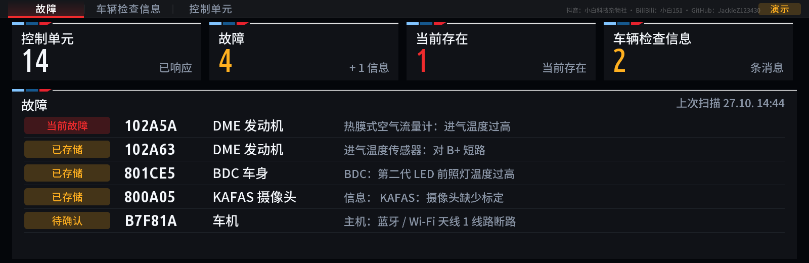

[English](README.md) | **简体中文** | [繁體中文](README.zh-TW.md)

# MGU Custom Apps 中文安装包

**汉化：抖音 小白科技杂物社 / BiliBili 小白151 / GitHub [JackieZ123430](https://github.com/JackieZ123430)**

[本仓库](https://github.com/JackieZ123430/idrive7-apps-cn) · [上游项目](https://github.com/cauliflowermossgrape/idrive7-apps) · [署名与来源](NOTICE.zh-CN.md)

英文、简体中文和繁体中文分别构建、分别安装。**安装中文包就是中文，安装英文包就是英文，应用设置中没有语言切换选项。** 三种包更新同一组应用，不是重复安装两套应用。

## 功能与汉化范围

包含 M 车辆仪表、换挡转速、虚拟马力机、制动测试、弹射模式、G 值仪表、暖机助手、eDrive助手、故障检测、保养信息和 Doom 共 11 个应用。

“弹射模式”对应原 Drag Timer，用于记录起步、加速分段和成绩。

中文包包含菜单、按钮、设置、仪表标题及内置提示的简体或繁体中文译文，并附带绘制这些文字所需的开源中文字形。中文画面右上角使用 12 px、约 25% 不透明度的小字署名：

**抖音：小白科技杂物社 · BiliBili：小白151 · GitHub：JackieZ123430**

英文包保留英文显示，不显示中文角落署名。原始版权及汉化贡献署名保留在文档、设置页和源码中。

- Doom 启动菜单和设置已汉化，游戏内部贴图和关卡文字保留原文。
- 故障状态、诊断拒绝原因和已补录的常见故障说明显示中文；尚未收录的原厂数据库说明保留原文。故障码、控制单元缩写和诊断指令保持原样。
- 自绘中文字库覆盖本版内置译文；车辆返回的任意中文长文本可能需要额外字形。原生 HMI 字符串使用车机自己的字体。
- 台架缺少对应控制单元时，可在应用设置中启用演示数据。
- 单个 HMI 字符串资源包按实机验证的 1024 条预算检查，本版预留 256 条动态资源，避免资源申请失败导致 Loading app。

## 显示预览

以下为离线演示数据预览，实际车机控件的字距、焦点和位置仍需实机验证。

英文包：


中文包：


故障页面中文示例（离线演示数据）：



## 构建英文、简体中文和繁体中文安装包

需要 Python 3、Node.js 14 以上，以及从自己车机提取的 BMW oap-sdk。已提交预生成字库和 GPU 渲染器，正常构建无需字体工具或 Docker。

原厂 SDK 不随公开仓库分发，也不要将含 SDK 的安装包公开上传。

1. 从自己的原厂 OAP 应用中获取 `source/javascript/app.js`，保存为 `own-app.js`。各车机应用 UID 不同，也可从 `/usr/lib/oap-mainapp/preinstalled_apps/` 下原厂应用 tgz 中解出这个文件。详细路径和说明见英文 README。

   ```powershell
   node kit/tools/extract_sdk.js own-app.js oap-sdk
   ```

2. 构建英文包（默认）：

   ```powershell
   python kit/tools/make_kit.py --language en
   ```

   输出：`dist/mgu-custom-apps.tar.gz`。

3. 构建中文包：

   ```powershell
   python kit/tools/make_kit.py --language zh-CN
   ```

   输出：`dist/mgu-custom-apps-zh-CN.tar.gz`。

   只构建一个应用可在命令末尾加应用 ID，例如 `python kit/tools/make_kit.py --language zh-CN warmup`。

英文构建输出 `dist/mgu-custom-apps.tar.gz`（与原有脚本兼容），中文构建输出 `dist/mgu-custom-apps-zh-CN.tar.gz`。两个语言安装包分别保存在不同文件中，可以先后构建，不会互相覆盖。

### 繁体中文包

```powershell
python kit/tools/make_kit.py --language zh-TW
```

输出 `dist/mgu-custom-apps-zh-TW.tar.gz`，使用独立的繁体中文词库和 Noto Sans TC 字库。安装繁体包时，将 `-Kit` 后的文件替换为该路径。英文默认行为保持不变。

## Windows 安装

适用于已具有 root SSH 的 iDrive 7 MGU。本项目部署应用，不刷写 MGU 固件。上游测试固件为 `P18_23w44.2`；本台架的 `P18_23w44.2-1-3` 已验证安装及保养应用启动，其他功能和版本需按实际设备测试。

指定要安装的语言包、自己的 SSH 私钥和车机 IP，先执行检查：

```powershell
powershell -ExecutionPolicy Bypass -File deploy/push-to-car.ps1 check -Kit dist/mgu-custom-apps-zh-CN.tar.gz -Key "C:\你的目录\id_rsa" -Ip "车机IP"
```

检查通过后安装：

```powershell
powershell -ExecutionPolicy Bypass -File deploy/push-to-car.ps1 install -Kit dist/mgu-custom-apps-zh-CN.tar.gz -Key "C:\你的目录\id_rsa" -Ip "车机IP"
```

要安装英文版，将 `-Kit` 后的文件换成 `dist/mgu-custom-apps.tar.gz`。安装器会备份配置并重启应用平台，首次设置 Doom 控制器插件可能重启车机。恢复使用同一脚本的 `restore` 命令；更多细节见 [英文原文档](README.md)。

## 主页小组件的中文

`eDrive` 的中文名称统一为 **eDrive助手**。小组件选择列表、原生文字格及自绘图片使用所安装包的语言。
小组件拥有独立字符串包，预留 64 个 `SID_WIDGET_DYNAMIC_*` 槽位；主应用继续使用自己的 256 个槽位。多个小组件实例的文字互相隔离，删除后可复用槽位。

小组件的布尔值、数值、布局模板名、图片和诊断标识符不参与翻译。小组件图片使用同一个语言包的中文字库；原生文字使用车机 HMI 字体。

离线测试验证了资源生成、实例隔离、槽位预算、更新顺序和生命周期，**不能代替车机上的大小布局、裁切和字体验证**。实机测试方法见 [小组件中文测试](docs/widget-chinese-test.md)。

## 新增其他语言

不需要复制一套应用代码或新增车机语言菜单。每种语言是构建时选择的译文文件：

1. 在 `kit/runtime/locales/` 新增 UTF-8 JSON，例如 `fr.json`：

   ```json
   {
     "Settings": "Paramètres",
     "Next page": "Page suivante",
     "Oil": "Huile"
   }
   ```

2. 构建工具会自动发现新文件：`python kit/tools/make_kit.py --language fr`，生成 `dist/mgu-custom-apps-fr.tar.gz`。没有译文的文本保留英文。
3. 检查该语言所需字形。含现有字库未覆盖的字符时需补充字库；右向左文字等还需相应排版支持，不能只放入译文就假定显示正确。
4. 验证原生菜单、仪表排版、动态提示和资源总量。信号名、设置内部取值、故障码及协议字段保持原样。

简体和繁体译文分别维护在 `kit/runtime/locales/zh-CN.tsv` 和 `zh-TW.tsv`：

```powershell
python kit/tools/sync_zh.py --language zh-CN
python kit/tools/sync_zh.py --language zh-TW
python kit/tools/bake_cjk.py --language zh-CN
python kit/tools/bake_cjk.py --language zh-TW
```

字体重建需要 Pillow；正常构建直接使用已提交的字库，无需 OpenCC 或字体生成工具。繁体使用台湾用语，不等同于粤语翻译。每个安装包仅携带一份选定的 CJK 字库，保留对应 OFL 许可。

## 检查与预览

```powershell
python kit/tools/test_zh.py
node kit/tools/test_zh.js
node kit/tools/test_widget_text.js
node kit/tools/test_zh.js dist/warmup/source/javascript/kit
node kit/tools/preview.js dist/warmup preview
```

第三条检查当前已构建应用的固定语言和字形；第四条预览当前语言的应用。安装包包含的语言由构建参数决定，不读取旧版的语言设置。
