[English](README.md) | [简体中文](README.zh-CN.md) | **繁體中文**

<h1 align="center">MGU 自訂應用程式</h1>

<p align="center"><b>為 BMW MGU 主機（iDrive 7）打造的自訂應用程式，使用獨立 GPU 渲染引擎，以真正的 60 fps 繪製。</b><br>同時提供一套完整的應用程式開發工具。</p>

<p align="center"><b>繁體中文譯者：加速度SpeedUP（GitHub <a href="https://github.com/JSD-SpeedUP">JSD-SpeedUP</a>） · 簡體中文原譯：<a href="https://github.com/JackieZ123430">JackieZ123430</a></b></p>

> 本文以 [簡體中文 README](README.zh-CN.md) 為底稿，保留章節、範例、參數和媒體，並採用台灣車用術語。原作者及第三方版權歸各自權利人所有。另見 [翻譯署名與來源](NOTICE.zh-CN.md)。

<p align="center">
  
  
  
  
</p>

<p align="center">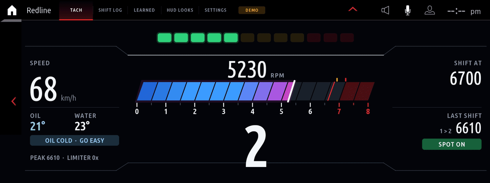</p>

為插電式油電車提供實際純電續航、電池健康和充電記錄，以及即時電池功率、電芯溫度和空調功耗。運動儀表提供增壓、燃油壓力、點火正時、失火和輪胎資料。還包括換檔燈與全螢幕轉速表、虛擬馬力機、煞車和加速計時器、G 值儀表、機油暖機指南、故障碼掃描與清除、車輛保養項目，以及停車時玩的 Doom。應用程式執行於車輛原有應用程式平台，使用 HMI 原生按鈕和設定選單，讀取即時車輛資料，重新啟動後仍可使用；一條指令即可移除全部改動。

> **免責聲明。** 這是一個非官方愛好項目，與 BMW AG 無關聯，未獲其認可或支援。修改主機的風險由使用者自行承擔。請在停車或封閉賽道環境使用應用程式，駕駛時注意道路。故障檢測能夠清除全車控制單元的故障記憶區，請先讀取故障碼。

---

<a id="not-a-png-slideshow-a-custom-render-engine"></a>
## 自訂渲染引擎：真正連續的畫面

BMW 應用程式平台提供的自訂圖形顯示方式，是用 JavaScript 畫圖、壓縮成 **PNG**，交給 HMI 解碼並顯示在圖像框中。SDK 只有這條自繪通道，幀率通常只有每秒幾幀：在主機的 Atom CPU 上，僅壓縮一張 1600 × 520 PNG 就要約 60 ms，還不包含繪製和傳送。

這些應用程式隨附 **`mgu-renderd`**，一個使用 C 和 OpenGL ES 2 的渲染引擎。自 2.0 起，它使用 Robert Nisipeanu 和 IterioDev 開發的 [mgu-render](kit/renderd/README.md#the-engine-mgu-render)，該引擎從本項目最初的引擎發展而來。應用程式每幀傳送幾 KB 的**繪圖指令**，由主機 Intel GPU 在獨立合成層上繪製，並與顯示更新同步，實現**真正的 60 fps**，指針和條形動畫連續平滑。

<p align="center">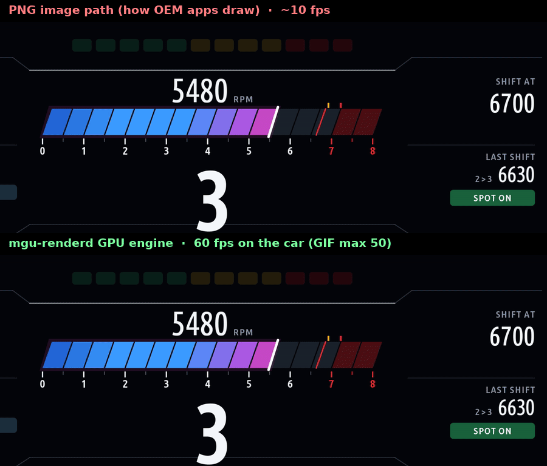<br><sub>上：將相同幀停留到 10 fps，模擬 PNG 通道的常見速率。下：引擎繪製的每一幀。</sub></p>

| | 原有 PNG 方式 | `mgu-renderd` |
|---|---|---|
| **應用程式傳送內容** | 每幀一張壓縮位圖 | 每幀幾 KB 繪圖指令 |
| **繪製方** | CPU 上的 JavaScript，逐像素繪製 | Intel HD Graphics 505 GPU |
| **幀率** | 每秒幾幀，僅 PNG 編碼就約 60 ms | **60 fps**，由顯示器節拍控制 |
| **運動效果** | 數值在幀之間跳變 | 每幀用彈簧平滑算法更新儀表 |
| **螢幕空間** | HMI 圖像框、標題欄和 120 px 按鈕欄 | 全螢幕，頁頭位於 HMI 標題條，按鈕欄僅 48 px |

**實車測量**（主機應用程式日誌，10 秒平均值）：

| 應用程式 | 幀率 | 每幀 GPU 時間 | 每幀應用程式 JavaScript 時間 |
|---|---|---|---|
| M Vitals | 60–61 fps | 1.0–1.3 ms，峰值 11 ms | 2–5 ms |
| eDrive | 60–61 fps | 1.0–1.2 ms | |
| G-Force | 56–61 fps | 1.3 ms | |

60 fps 下每幀有 16.7 ms，GPU 約用其中 1 ms，因此餘量充足。卡片、表盤、刻度等靜態部分只繪製一次並快取在 GPU 上。未安裝引擎時，同一套程式碼會自動回退到 PNG 通道，外觀保持一致。

```
 app (Node.js)  ──  drawing commands  ──▶  mgu-renderd (C, OpenGL ES 2)  ──▶  own layer above the HMI
     │              Unix socket, per frame        Intel GPU, synced to vsync          (input still goes to the HMI)
     └── buttons, settings, tiles: BMW's own HMI widgets, so the iDrive controller and touch work as usual
```

圖中每幀繪圖指令經 Unix socket 傳送到 GPU 引擎，獨立圖層位於 HMI 上方；輸入仍交給 HMI。按鈕、設定和圖塊採用 BMW 原生 HMI 控制項，iDrive 控制器和觸控照常工作。

詳見 [應用程式如何繪圖](#44-how-apps-draw-remote-hmi-rhmi) 和 [`kit/renderd`](kit/renderd/README.md)。

---

<a id="gallery"></a>
## 畫廊

<table>
<tr>
<td width="50%">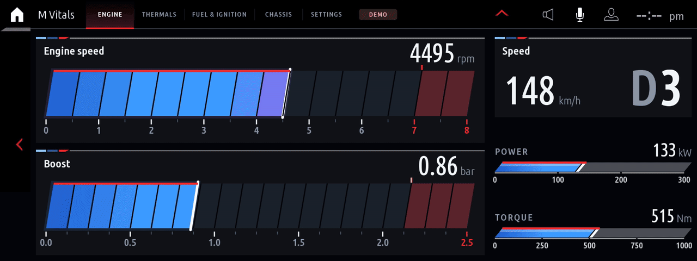<br><b>M Vitals</b>: 轉速、增壓、車速與檔位、功率、扭力</td>
<td width="50%">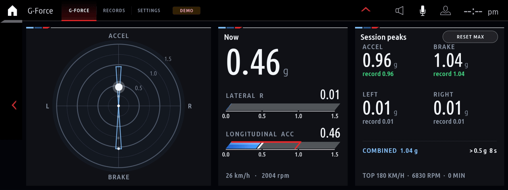<br><b>G-Force</b>: 摩擦圓與軌跡、附著力邊界、峰值和記錄</td>
</tr>
<tr>
<td>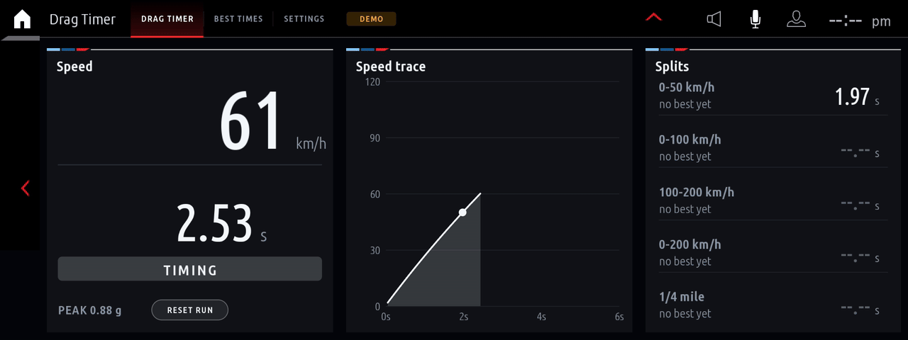<br><b>Drag Timer</b>: 即時車速曲線、分段、¼ 英里</td>
<td>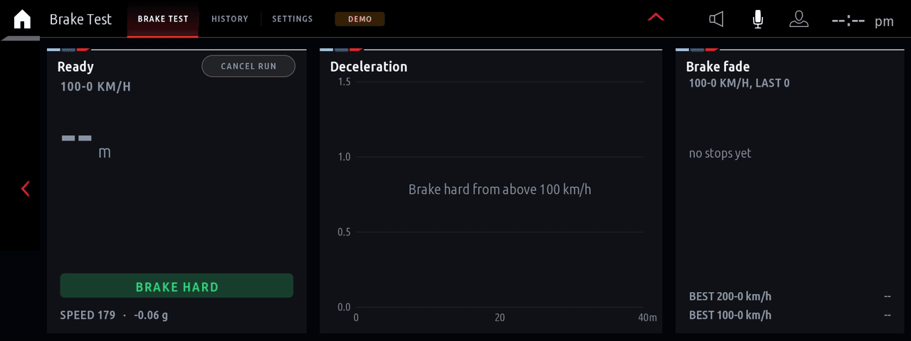<br><b>Brake Test</b>: 100–0 距離、減速度曲線、煞車衰退</td>
</tr>
<tr>
<td>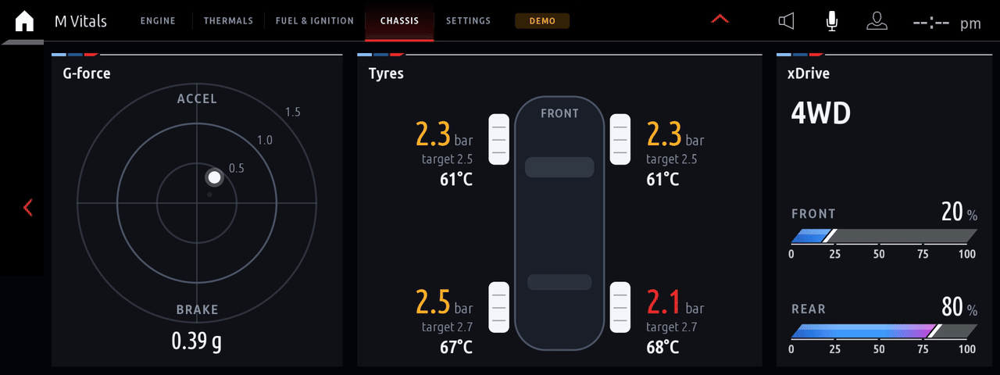<br><b>M Vitals</b>: G 值、胎壓與胎溫、xDrive 分配</td>
<td>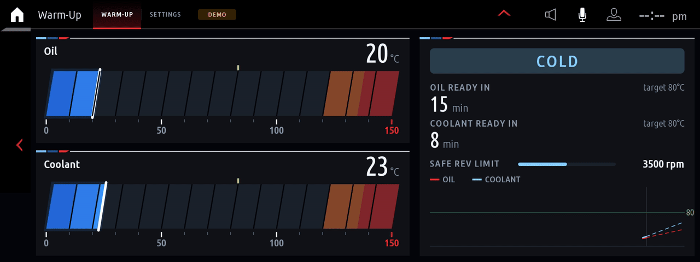<br><b>Warm-Up</b>: 達到工作溫度的時間、安全轉速上限</td>
</tr>
<tr>
<td>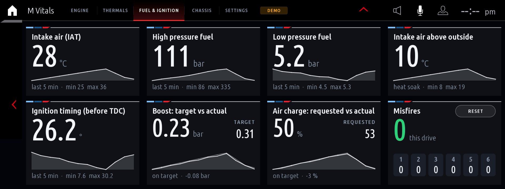<br><b>M Vitals</b>: 進氣、高低壓燃油壓力、點火正時、各缸失火</td>
<td>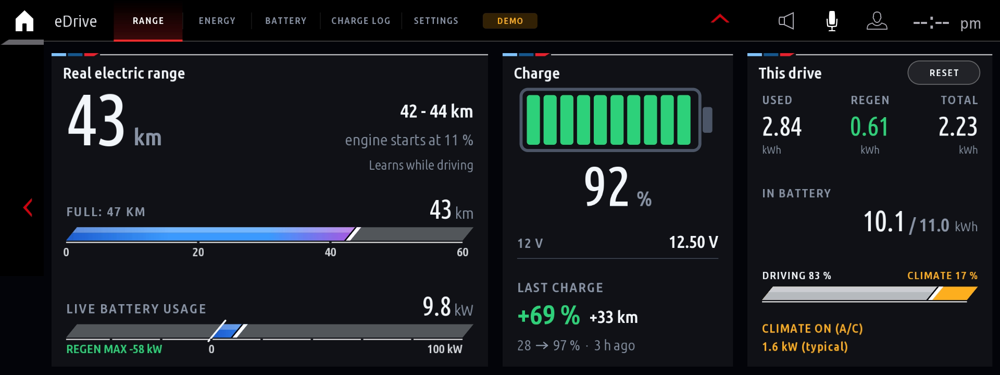<br><b>eDrive</b>: 實際純電續航、電池健康、上次充電、12 V</td>
</tr>
<tr>
<td>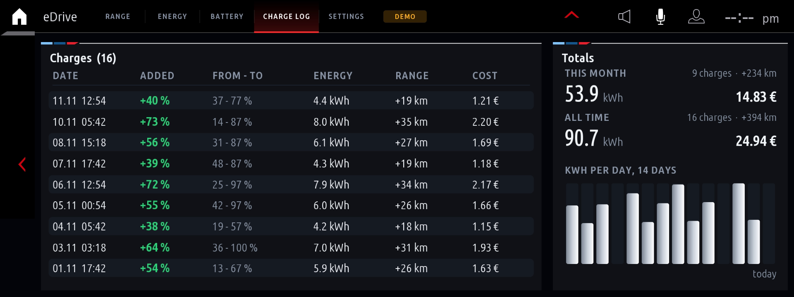<br><b>eDrive</b>: 充電日誌、費用與總計</td>
<td>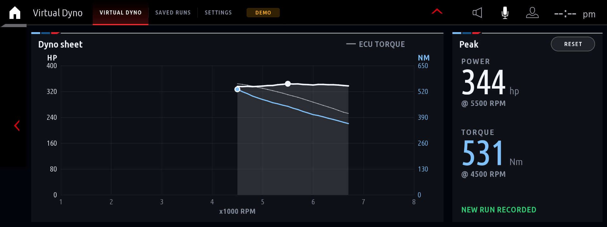<br><b>Virtual Dyno</b>: 一次加速的功率與扭力曲線</td>
</tr>
<tr>
<td>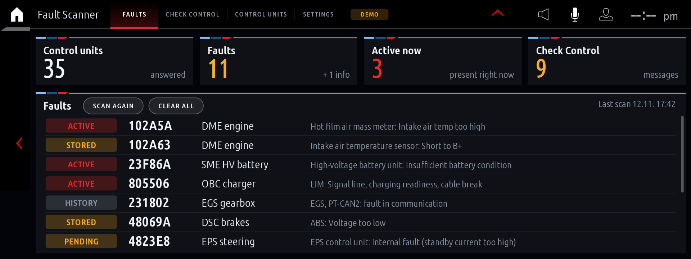<br><b>Fault Scanner</b>: 全控制單元故障碼與說明</td>
<td>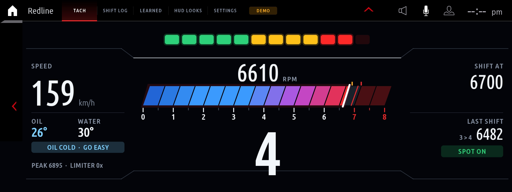<br><b>Redline</b>: G20 風格轉速條、大號檔位、換檔評分</td>
</tr>
<tr>
<td>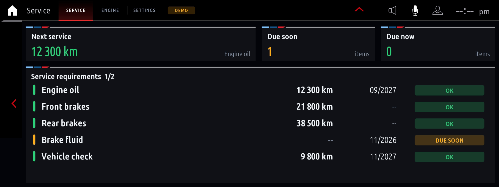<br><b>Service</b>: 保養需求、下次保養、項目詳情</td>
<td>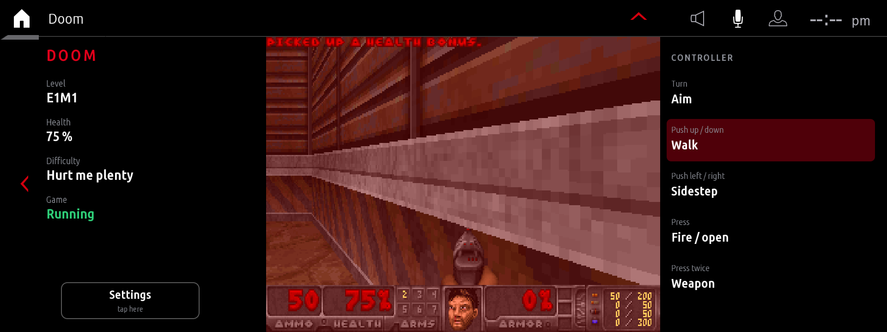<br><b>Doom</b>: 全解析度全螢幕 Freedoom，iDrive 控制器操作，自動存檔</td>
</tr>
<tr>
<td>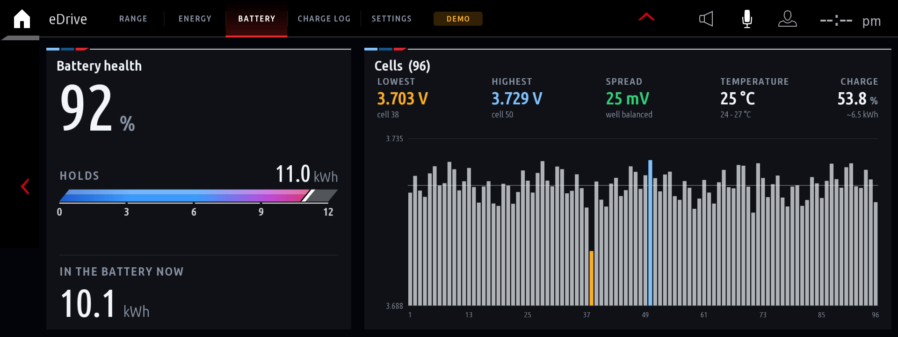<br><b>eDrive</b>: 高壓電池即時功率、回收與驅動相對電池限制、本次行程總計</td>
<td>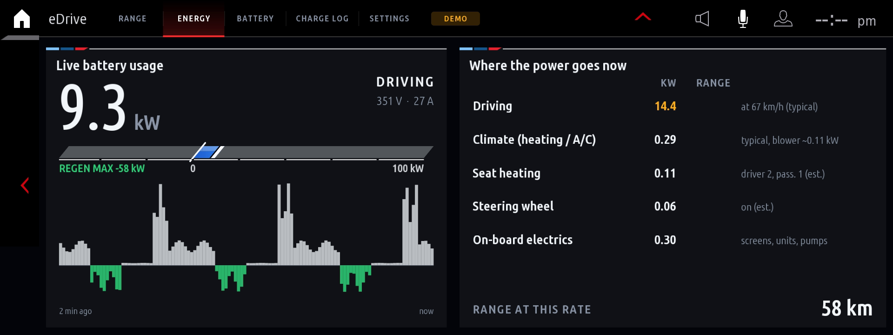<br><b>eDrive</b>: 電芯溫度與電壓、冷卻液、電池允許功率</td>
</tr>
</table>

<sub>所有動畫均使用應用程式內建的離線示範行程，經引擎自身繪圖程式碼錄製（`mgu-renderd --replay`，見 [6.3](#63-preview-build-deploy)），保留 HMI 返回箭頭和狀態圖示，採用預設 M 三色主題。GIF 最高僅播放 50 fps，實車顯示為 60 fps。每個應用程式另有 M 紅、冰白和夜間琥珀主題；實車中的相同頁面顯示即時車輛資料。</sub>

## 目錄

- [自訂渲染引擎](#not-a-png-slideshow-a-custom-render-engine) · [畫廊](#gallery)
1. [應用程式](#1-the-apps)
2. [所需條件](#2-what-you-need)
3. [快速開始](#3-quick-start)
4. [主機工作原理](#4-how-the-head-unit-works)
5. [應用程式如何安裝到主機](#5-how-the-apps-get-onto-the-unit)
6. [編寫自己的應用程式](#6-writing-your-own-app)
7. [車輛訊號參考](#7-vehicle-signals-reference)
8. [故障排查與注意事項](#8-troubleshooting-and-gotchas)
9. [已知限制](#9-known-limits)
10. [存放庫結構](#10-repository-layout)

---

<a id="1-the-apps"></a>
## 1. 應用程式

每個應用程式都有采用 HMI 原生樣式的設定頁：四種配色（預設 M 三色、M 紅、冰白、夜間琥珀）、單位、車速讀值更新頻率（像 BMW 儀表一樣每秒 5 次，最高 60 次）和示範模式。成績與記錄儲存於主機，重新啟動後保留。

| 應用程式 | 功能 |
|---|---|
| **Redline（換檔轉速）** | G20 Live Cockpit 風格轉速顯示：寬幅轉速條在中央以傾斜分段從左向右填充，顏色從主題色過渡到換檔點的紅色；上方為數字轉速，下方為大號檔位，另有數字車速及 12 燈換檔指示。到達換檔點時，換檔燈、檔位和 SHIFT 提示變為純紅色；預設關閉的“閃爍與閃屏”可使其頻閃並令全螢幕閃紅。檔位來自變速箱或由轉速/車速學習得到。每次升檔評分為過早、正好、過晚或觸及限轉，並記錄換檔日誌及準確度。始終提示冷機油；預設開啟的冷機保護會在機油升溫前降低換檔點。 |
| **Virtual Dyno（虛擬馬力機）** | 在一個檔位內全油門加速，根據加速度、車重、空氣阻力和滾阻計算功率與扭力曲線。可設定車重、車身形狀、傳動損耗及 hp/PS/kW、Nm/lb-ft/kgm。儲存測量記錄，可固定一次為基準，使每次新測量顯示正負差值；可選疊加引擎電腦自身的扭力讀值。 |
| **Brake Test（煞車測試）** | 記錄 100–0、200–0 km/h 或 60–0、100–0 mph 的距離、時間、峰值減速度和減速曲線。起始速度交點在取樣間插值，結果不依賴取樣率。煞車衰退圖比較最近幾次停車，距離增長時提示。儲存最佳成績及完整歷史。 |
| **Drag Timer（彈射模式）** | 記錄 0–50、0–100、100–200、0–200 km/h 和 ¼ 英里（或對應英制項目），提供插值分段、可選一英尺起步預留（rollout）、即時速度曲線及最佳時間。 |
| **G-Force（G 值儀表）** | 摩擦圓帶漸隱軌跡，隨各方向實際使用的附著力擴展邊界；顯示橫縱向即時條、各方向本次峰值、超過 0.5 g 的持續時間和歷史記錄。G 值數字按設定頻率更新，預設每秒 10 次；圓點與軌跡以完整幀率移動。 |
| **Warm-Up（暖機助手）** | 機油和冷卻液儀表，以及暖機計算器：根據實測升溫速率計算達到工作溫度所需分鐘數和預計時刻，並投射在溫度趨勢圖上；樣本不足時使用典型速率，油電車純電行駛時顯示引擎關閉。提供隨油溫升高的安全轉速上限，以及激烈駕駛後的渦輪冷卻倒計時：高轉或高功率後需溫和駕駛 30 秒至 3 分鐘，取決於此前激烈駕駛時長。 |
| **M Vitals（M 車輛儀表）** | 多頁運動儀表及峰值：轉速、增壓（壓力單位 bar、psi 或 kPa）、帶 D/S/M 與數字檔位的車速、iDrive 運動顯示提供的功率（百分比乘以車輛最大功率，適用於原廠及調校引擎；kW/hp/PS）、扭力（Nm/lb-ft）、冷卻液、機油溫度及 G 值等。燃油與點火頁顯示進氣溫度 IAT、高壓燃油 HPFP/油軌及低壓燃油 LPFP 壓力、點火正時、目標/實際增壓和請求/實際空氣充量（均附 5 分鐘曲線；BMW DME DID 4AB0 / 580B / 480C / 5813，OBD PID 0x70 作為後備），以及本次駕駛循環各缸失火計數（OBD 服務 06）；通過 UDS/OBD 從 DME 讀取，標準 OBD 標識可在 `app.json` 的 config.dme 調整，同時顯示進氣比車外高多少度。溫度頁另從變速箱單元 EGS 讀取油溫（config.dme.egs）。各項均可自動/顯示/隱藏，未回應項讓出空間。底盤頁大字顯示胎壓（對照目標）和胎溫，xDrive 卡片可設自動（車輛報告四驅後顯示）、顯示或隱藏，適用於後驅車；無原車扭力分配訊號時，讀取分動箱 LMV 的前軸扭力（UDS `22 DB32`，config.xdrive），結合引擎扭力和檔位估算，卡片註明來源。增壓、變速箱油溫、輪胎卡片和胎溫同樣支援自動/顯示/隱藏；自動模式收到真實資料後顯示。255 °C 胎溫等不合理值及始終為 0 °C 的變速箱油溫等不變值視為無資料；原始值寫入日誌（`raw tyre temperature`、`raw gearbox oil`、`raw FES boost`），用於校準 config.scaling。增壓優先來自運動顯示，無可用值時從 DME 的 OBD 讀取增壓/歧管絕對壓力減環境氣壓（config.dme.boost 中的候選項），也可用 Boost from 手動指定。接近紅線或增壓上限時，儀表由藍轉紅。 |
| **Fault Scanner（故障檢測）** | 經主機診斷閘道器通過 UDS 掃描全車控制單元，按模組顯示故障碼與狀態，即時顯示 Check Control 訊息，支援兩次按鍵確認清除。故障說明來自本車編碼工具匯出（`kit/tools/dtc_texts.py`）、少量手寫文字，以及可選匯入的全控制單元故障資料庫（`--db`）；對有故障的單元讀取 SGBD 索引（UDS 22 F1 50）以選擇名稱和文字。僅匯入英文文字，混有德文的條目被跳過，相應故障無說明。CSV 故障碼清單（`--codes`）為適用單元補齊仍缺失的說明；執行 `--db` 後用 `kit/tools/dtc_tables.py` 生成 `dtc_scanner_*.json`，按單元類型與地址補充文字。建置用 `pack_data.py` 將約 19 MB 文字壓入約 3.7 MB 的 `dtc_db.pack`，應用程式只解壓目前故障所需的幾 KB。存放庫已獲許可隨附故障說明表和 SGBD 索引的壓縮包 `apps/dtc_scanner/dtc_db.pack`；自行匯入的 `dtc_db/` 會替代它。匯入資料庫和車輛匯出檔案不進入 git。 |
| **eDrive（EDrive助手）** | 面向插電式油電/電動車，按實際駕駛學習純電續航：以引擎啟動閾值以上的可用電量，結合每公里行駛能耗（最近約 60 km 純電行駛）與空調、車載電器每小時功耗計算。冷天制熱、熱天製冷的功耗按外溫區間，在引擎關閉且靜止/緩行時學習；行駛能耗按低於 35、35–60、60–85、85–110、高於 110 km/h 分檔，按目前速度估計續航，因此高速續航比市區少。行駛時也根據同速下相對空調關閉狀態的額外能耗學習空調功耗；座椅和方向盤加熱按檔位計入。能量頁顯示各速度檔能耗、目前驅動/空調/座椅/方向盤/車載用電及各自消耗的公里數、車輛自身功率分配和高壓電池溫度（續航頁也顯示）。空調按小時耗電，擁堵時對里程影響更大，頁面顯示 kW 和損失里程。空調開關讀取 ClimateMaster `statusClimateSystemOn`：關閉時僅扣除獨立學習的車載用電（通常 0.3 kW），續航升高；開啟時下降，顯示 CLIMATE ON/OFF，A/C 按鍵開啟時另有 A/C 標記。尚未學習時按外溫估算：滿電在 20 °C 約 50 km、10 °C 為 40–45、0 °C 為 30–38、−10 °C 為 20–30，按本車 20 °C 續航縮放，並顯示高低範圍、SOH（滿充容量相對新電池的百分比與 kWh）及目前電量 kWh。新電池容量可設定，例如 330e/530e 為 12 kWh、X5 45e 為 24 kWh。還顯示上次高壓充電增加的百分比/kWh/里程（主機休眠期間充電會在下次啟動顯示）和 12 V 電壓。充電日誌記錄日期、充入電量、增加里程和按電價計算的費用（預設 0.25 €/kWh），提供月度/累計總計和 14 天圖表。純電動車（BEV，針對 iX3 G08）：電池報告的可用容量超過 45 kWh 時自動識別，也可將“驅動系統”設為“純電動車”；顯示相同頁面但不含引擎內容，續航計算至 0 %（或設定的 5–20 %），電量讀取 `E5CE`（iX3 對 `DDBC` 只返回零），每 % 對應的 kWh 與健康度來自電池自身的可用容量（`E5C7`，與新車可用容量對比，預設 74 kWh），即時功率為 `E54D` × `E561`，交流慢充也會記錄，且不會詢問引擎和變速箱控制單元。無油電系統時偵測到電池單元不回應，只顯示 12 V，或將“驅動系統”設為“無”。電量和 SOH 通過 UDS 讀取，診斷頁展示原始回應，便於按車型修改 `app.json` 的 DID。 |
| **eDrive 即時頁面** | `apps/edrive/live.js` 預設適配 24 kWh 的 X5 xDrive45e，可調整用於其他插電式油電車型。**電池：**每秒讀取電壓和電流，相乘得到即時 kW，正值為驅動、負值為回收或充電；條形範圍為電池目前允許的最大回收至最大驅動功率，附兩分鐘曲線、電芯與冷卻液溫度；逐個電芯電壓條標出最高、最低及壓差。本次行程統計耗電、回收、淨耗電、驅動與空調份額及峰值；選單 Reset drive totals 開始新行程。**能量頁空調：**引擎關閉、未插電且靜止時，電池只供應車內負載，因此總功耗減去空調關閉時學習的基線，即實際制熱/製冷功耗；該行優先顯示這個測量值或空調單元自身資料，替代估計值。經 SME 的 UDS 讀取 `DD68` 電壓、`DD69` 電流、`DDBF` 電芯電壓、`DDC0` 電芯溫度、`DD6C` 冷卻液、`DD7D` 電流限值（採用 OVMS 在 i3 上解析的 BMW 標識）；診斷頁顯示回應，若電流方向相反可用 `powerSign` 翻轉。**首頁小工具**（`startWidget`）的大組件顯示即時功率、狀態、電壓/電流、電量、功率條、電芯和本次行程，小工具以文字行顯示相同資訊；Battery unit 與 Scan 頁面由 Diagnostics pages 設定控制。 |
| **Service（保養資訊）** | 讀取 BMW CBS 保養需求，與 iDrive“車輛狀態 > 保養需求”一致：機油、煞車、煞車油、車輛檢查、年檢等，每項使用車輛原有語言和單位顯示距離、日期，以綠/黃/紅區分，並給出下次保養摘要及詳細提示。資料來自儀表 `KombiInterface_2`。只讀：這些車輛沒有提供供主機調用的保養復位，需要在儀表選單或維修車間完成。 |
| **Doom** | Freedoom: Phase 1（四章免費遊戲資料）以 WebAssembly 在主機執行。3D 視圖使用全螢幕完整解析度 1920 × 504，擴展 Doom 的視野以適應螢幕；狀態欄、選單及訊息以 4:3 疊加，VM 上可達 35 fps。先進入 Play/Continue、New game 和設定主選單，遊戲中無頁頭或按鈕欄，BACK 返回選單。**旋轉控制器瞄準，推杆行走和橫移，按下開火與開門，按兩下切換下一武器。** 遊戲中獨佔旋鈕、按壓與傾斜，向前推不再開啟 HMI 下拉選單，向左推不再離開遊戲；BACK、MENU 和觸控始終有效。依賴安裝器載入到 HMI 的控制器門控外掛程式，見 [5.1](#51-what-deploy-carsh-install-does)。沒有外掛程式時仍讀取控制器訊號，但 HMI 也會回應。離開頁面或被彈窗/來電遮擋時暫停並自動存檔，下次從停止位置繼續。主選單可設定難度、章節、移動速度（預設慢走，可選步行/跑步）、瞄準速度與方向、渲染解析度（全/中/低）。採用 GPL-2.0，見[授權條款](#doom-and-renderer-licences)。預設僅停車執行，行駛時儲存並等待；Parked only 可關閉。 |

VM 或無車輛資料的台架上，所有應用程式在 5 秒後進入內建示範行程，含起步、逐檔加速、急停、轉彎和冷機升溫。資料非來自車輛時顯示 **DEMO** 標記。

> **本次中文故障庫補充：**簡體故障檢測包為隨包資料庫的 86,735 條唯一文字提供對應，其中 86,716 條含中文，19 條純內部標識保留。使用機器輔助翻譯，尚未逐句人工審校；沒有說明的故障碼不編造含義。匯入的新資料庫仍可能含未翻譯說明。詳見 [覆蓋範圍與驗證方法](docs/diagnostic-chinese.md)。

---

<a id="2-what-you-need"></a>
## 2. 所需條件

**車輛端**

- **搭載 MGU（iDrive 7 / ID7）的 BMW。** 開發與測試韌體為 `P18_23w44.2`，其他 MGU 版本很可能可用；安裝器的 `check` 會在修改前報告檢查結果。
- **主機 root shell 存取權限**，通過 SSH 或序列埠主控台。本項目不提供此權限，也無法公開獲取方法；可自行查找社區 MGU root 指南。後文假定已能以 `root` 登錄。
- **從本車提取的 BMW 應用程式 SDK `oap-sdk`。** 它是 BMW 版權程式碼，不包含在存放庫中；車機每個 BMW 應用程式內都有，`kit/tools/extract_sdk.js` 可很快從其中一個應用程式重建，見快速開始。

**電腦端**

支援 Windows、macOS、Linux，只需 **Python 和 Node.js**，無需 Linux 環境、編譯器或 Docker。存放庫含[預編譯 GPU 渲染器](kit/renderd/prebuilt)，建置器會檢查它與原始碼是否匹配。

| 工具 | 用途 | 是否必需 |
|---|---|---|
| **Python 3.6+** | `build.py` 打包應用程式，`make_kit.py` 打包車機套件 | 是 |
| **Node.js 14+** | 建置時生成圖示、提取 SDK、預覽 | 是 |
| **OpenSSH 的 ssh/scp** | 通過部署腳本安裝到車機 | 是，Windows 10/11、macOS、Linux 自帶 |
| **Docker** | 自行重新編譯 `mgu-renderd` | 僅修改渲染器 C 程式碼時 |
| **ffmpeg、bash** | `make_gif.sh` 錄製上面的動畫 | 可選 |
| **Pillow**（`pip install pillow`） | `bake_fonts.py` 重新烘焙字庫 | 可選 |

無需 npm 包，建置僅使用 Node 和 Python 標準庫。Windows 從 [python.org](https://www.python.org/downloads/) 安裝 Python 並勾選 Add python.exe to PATH，再從 [nodejs.org](https://nodejs.org/) 安裝 Node.js LTS。macOS 可用 Homebrew 的 `brew install python node`，或相同網站的安裝包。Ubuntu/WSL 可執行 `sudo apt install python3 nodejs openssh-client`；Node 必須至少 14，Ubuntu 24.04 自帶 18，22.04 及更早版本的包太舊，應使用 nodejs.org 或 nvm。

在任意系統終端檢查版本：

```sh
python3 --version     # Windows: python --version
node --version
```

**修改渲染器 `kit/renderd/src` 時**需要 Docker：Windows/macOS 使用 [Docker Desktop](https://www.docker.com/products/docker-desktop/)，Linux 使用 [Docker Engine](https://docs.docker.com/engine/install/)。建置器在 Ubuntu 18.04 鏡像內編譯以匹配車機庫，首次約下載 550 MB、耗時數分鐘；包括 Apple Silicon 等 ARM 電腦也始終建置 x86-64。之後更新預編譯副本供提交。原始碼變化而無法編譯時，會明確提示，並在使用舊渲染器打包前詢問。

---

<a id="3-quick-start"></a>
## 3. 快速開始

<a id="31-get-the-sdk-from-your-unit"></a>
### 3.1 從本機提取 SDK

將韌體自帶的 x_call 應用程式複製到電腦並提取 SDK：

```sh
scp root@<unit>:'/usr/lib/oap-mainapp/preinstalled_apps/x_call@*.tgz' .
mkdir x_call && tar xzf x_call@*.tgz -C x_call
node kit/tools/extract_sdk.js x_call/javascript/app.js     # 輸出 ./oap-sdk/
```

Windows PowerShell 也可執行這些指令，內建 scp 和 tar；請將 `x_call@*.tgz` 換成實際檔案名。提取結果如下：

| 路徑 | 內容 |
|---|---|
| `oap-sdk/index.js`、`package.json` | 建置時放入每個應用程式的執行階段，供 `require('oap-sdk')` 使用 |
| `oap-sdk/source/` | 每個 SDK 模組按實際路徑儲存為可讀檔案，例如 `source/src/core/OnlineApp.js` |

韌體中的 SDK 24.10.x 包含完整公開 API。車機後續下載的 x_call（`/var/opt/public/oap/oap_12204/source/javascript/app.js`）可能攜帶較新 SDK，但缺少 `telephony`、`appstart`、`map`、`poi`。本套件應用程式不依賴它們，因此也可用，提取工具會列出缺失項。`oap-sdk/` 已在 `.gitignore` 中，**切勿提交**。

<a id="32-build"></a>
### 3.2 建置

```sh
python3 kit/tools/build.py            # 全部應用程式 -> dist/<id>@<ver>.mgu
python3 kit/tools/build.py redline    # 僅一個應用程式
python3 kit/tools/build.py --language zh-TW   # 繁體中文 -> dist/<id>@<ver>-zh.tw.1.mgu
node kit/tools/preview.js dist/redline preview wait=10   # 在電腦上預覽 -> preview/*.png
```

Windows 請將 `python3` 換成 `python`。預設建置英文版。`--language zh-TW` 使用繁體中文介面及獨立的 Noto Sans TC 字形圖集。介面語言在建置時固定，安裝其他語言的套件會更新同一個應用程式。

故障檢測的獨立故障碼資料庫說明仍使用英文。無 BMW SDK 時可用 `python3 kit/tools/build.py --language zh-TW --preview-only live_adjustments` 產生離線預覽，裝置安裝需要完整建置。

`.mgu` 檔案包含 BMW SDK，僅供自己的車機使用，請勿公開發布。

<a id="33-install-on-the-car"></a>
### 3.3 安裝到車輛

車輛停穩、點火開啟，最好連線電瓶充電器。先把應用程式、安裝器和 GPU 渲染器打包為 `dist/mgu-custom-apps.tar.gz`：

```sh
deploy/make-car-kit.sh                 # macOS / Linux / WSL
deploy\make-car-kit.cmd                # Windows (cmd or PowerShell)
python3 kit/tools/make_kit.py redline  # 任意系統，僅部分應用程式
python3 kit/tools/make_kit.py --language zh-TW   # 繁體中文套件 -> dist/mgu-custom-apps-zh-TW(.tar.gz)
```

部署繁體中文套件時，shell 請指定 `KIT=dist/mgu-custom-apps-zh-TW`，PowerShell 請指定 `-Kit dist\mgu-custom-apps-zh-TW.tar.gz`。

隨後通過 SSH 推送。macOS/Linux/WSL：

```sh
HU=root@<unit-ip> PORT=22 KEY=~/.ssh/id_mgu deploy/push-to-car.sh check    # 只讀檢查主機，列出將修改內容
HU=root@<unit-ip> PORT=22 KEY=~/.ssh/id_mgu deploy/push-to-car.sh install  # 備份 -> 安裝 -> 重新啟動應用程式平台
HU=root@<unit-ip> PORT=22 KEY=~/.ssh/id_mgu deploy/push-to-car.sh restore  # 撤銷，恢復備份
```

`check` 只讀檢查主機並列出將觸及的內容；`install` 依次備份、安裝、重新啟動應用程式平台；`restore` 恢復備份。`KEY` 是主機 SSH 私鑰，權限應為 `chmod 600`；每條指令都需提供，除非已在 `~/.ssh/config` 或 ssh-agent 中配置。

**Windows：**`deploy/push-to-car.ps1` 使用系統 OpenSSH 完成相同工作，可使用 [idrive7-8-ssh-root](https://github.com/cauliflowermossgrape/idrive7-8-ssh-root) 工具寫出的密鑰 `data\enrollments\<VIN>\id_rsa`；主機 IP 在旁邊的 `connect.txt` 中。

```powershell
powershell -ExecutionPolicy Bypass -File deploy\push-to-car.ps1 check   -Key <path>\id_rsa -Ip <unit-ip>
powershell -ExecutionPolicy Bypass -File deploy\push-to-car.ps1 install -Key <path>\id_rsa -Ip <unit-ip>
```

預設讀取 `dist\mgu-custom-apps.tar.gz`，可用 `-Kit <path>` 指定。無網路時，可把 `dist/mgu-custom-apps/` 複製到 U 盤，在主機先執行 `sh deploy-car.sh check`，再執行 `sh deploy-car.sh install`。

約 1–2 分鐘後，應用程式圖塊出現在 **Apps** 中。主機 `/var/opt/mgu-custom-apps` 下還可執行：

```sh
sh deploy-car.sh status     # 已安裝應用程式、執行和掛鉤狀態
sh deploy-car.sh backups    # 列出備份
sh deploy-car.sh restore    # 恢復原廠（要求輸入 YES）
```

`status` 顯示已安裝應用程式、執行和掛鉤狀態，`backups` 列出備份，`restore` 恢復原廠並要求輸入 YES。

<a id="34-doom-the-extra-steps"></a>
### 3.4 Doom 的額外步驟

Doom 像其他應用程式一樣安裝，除非建置時只列出其他應用程式，否則包含在套件中。四個區別：

1. **首次建置下載遊戲資料。** git 不儲存 WAD。第一次 `build.py`/`make-car-kit` 從 [Freedoom 發佈頁](https://github.com/freedoom/freedoom/releases/tag/v0.13.0) 下載 Freedoom: Phase 1 0.13.0 的 24 MB zip，核對 SHA-256，儲存為 `apps/doom/freedoom1.wad`，以後複用。電腦無法聯網時可在別處下載 `freedoom-0.13.0.zip` 並把其中的 `freedoom1.wad` 放到 `apps/doom/`。其他 WAD，包括 id 原版 `doom.wad`，無法通過驗證。
2. **體積更大。** 引擎與遊戲資料約 11 MB，推送稍慢，無需額外處理。
3. **全螢幕需要 GPU 渲染器。** 套件會安裝 `mgu-renderd`；未執行階段回退為普通應用程式區域內的較小畫面。
4. **安裝結束會為控制器門控外掛程式重新啟動一次主機。** `deploy-car.sh install` 將 `mgu-inputgate.so` 配置為隨 HMI 載入，讓遊戲獨佔控制器，見 [5.1](#51-what-deploy-carsh-install-does)。它在主機啟動時載入，因此安裝後會黑畫面約一分鐘，隨後自動恢復。若外掛程式導致 HMI 無法正常啟動，會自動排除外掛程式。要稍後重新啟動可用 `NO_REBOOT=1 sh deploy-car.sh install`，外掛程式下次用車時載入；不需要外掛程式可用 `NO_INPUTGATE=1 sh deploy-car.sh install`。此時 Doom 仍能執行，但 HMI 也會回應控制器，例如向前推會開啟下拉選單。

```sh
python3 kit/tools/build.py doom                       # -> dist/doom@<ver>.mgu (首次下載 WAD)
deploy/make-car-kit.sh doom                           # 僅打包 Doom，不帶參數則打包全部應用程式
HU=root@<unit-ip> PORT=22 KEY=~/.ssh/id_mgu deploy/push-to-car.sh install
```

車機 **Apps → Doom** 開啟主選單（開始/繼續、新遊戲、設定）。首次啟動需數秒編譯引擎。存檔在應用程式資料目錄中，重裝同一應用程式仍保留，執行 `restore` 則不保留。

<a id="35-back-to-stock"></a>
### 3.5 恢復原廠

`restore` 停止平台並移除所有自訂應用程式、掛鉤及啟動配置，再從**原廠備份**精確恢復所有觸及檔案。該備份是首次安裝建立的備份，永不覆蓋；每個檔案都與備份驗證。最後重新啟動 HMI，使圖塊無需整機重新啟動即可消失。

---

<a id="4-how-the-head-unit-works"></a>
## 4. 主機工作原理

以下是與應用程式有關的 MGU 內部結構，內容均來自執行中的主機。

<a id="41-hardware"></a>
### 4.1 硬體

| 部分 | 詳情 |
|---|---|
| CPU | Intel Apollo Lake x86-64，Intel GPU，i915/Mesa，EGL + GLES2 |
| 系統 | Linux 4.14（`-apl`），systemd，BusyBox 使用者空間 |
| 儲存 | eMMC：只讀根檔案系統和可寫 `/var/opt`，應用程式位於 `/var/opt/public`。另有 2.5 英寸硬盤，包含導航等只讀分區，以及 `/var/opt/hdshare` 下約 90 GB 可寫共享區。 |
| 影片輸入 | Intel IPU4 攝影機採集模組，六個 CSI-2 端口；作者主機沒有連線攝影機，攝影機視圖經乙太網路輸入，見 4.6。 |
| 網路 | `socnet0` 連線車輛，以 VLAN 劃分不同車載域；`wlan0` 用於手機熱點/CarPlay。 |

<a id="42-software-stack"></a>
### 4.2 軟體堆疊

```
 ┌───────────────────────────── HMI (HmiMain3D, RAMSES 3D renderer) ─────────────────────────────┐
 │  BMW's screens and menus   +   "Remote HMI" (RHMI) screens that apps describe and fill with data │
 └───────────────▲──────────────────────────────────────────────────────────▲────────────────────┘
                 │ SOME/IP + joynr                                             │ SOME/IP
 ┌───────────────┴──────────────┐   ┌──────────────────────────────────────┴─────────────────────┐
 │  OAP app platform            │   │  Native services                                             │
 │  oapcontroller -> MainApp    │   │  media (mediaengine, mediaapp), cameras (dasvideo,           │
 │  (Node.js) -> one Node       │   │  icam2proxy), AVB streams, navigation, phone, diagnostics    │
 │  process per app             │   │  gateway (TASU), provisioning, connectivity (connman)        │
 └───────────────┬──────────────┘   └──────────────────────────────────────┬─────────────────────┘
                 │                     SOME/IP over Ethernet VLANs            │
 ┌───────────────┴────────────────────────────────────────────────────────────┴─────────────────┐
 │  The rest of the car: engine and chassis data, instrument cluster, cameras, telematics (TCB)   │
 └───────────────────────────────────────────────────────────────────────────────────────────────┘
```

圖中上層為 HMI（HmiMain3D 與 RAMSES 3D），同時顯示 BMW 介面與應用程式描述的 RHMI 頁面；下層為 OAP 應用程式平台和原生服務，經 SOME/IP 與車輛其他部分相連。

- **SOME/IP（vsomeip）**是主要匯流排。主機與車內每項服務都記錄在 `/etc/oap/someip/someip-interfaces.json` 中，包括介面、欄位及其讀取方法/變更通知、方法、事件、線纜協定 ID 和類型。轉速、車速、溫度、加速度以欄位通知傳入。
- **joynr** 是其上的高級 RPC 層；BMW 集群控制器監聽 4242/4243，平台用它管理應用程式和 HMI 入口。
- **HMI** 是帶 BMW 資源資料庫的 RAMSES 3D 渲染器。應用程式通過 BMW 控制項模板描述頁面，再傳入文字、圖像和屬性，見 4.4。

<a id="43-the-app-platform-oap"></a>
### 4.3 OAP 應用程式平台

BMW 稱其為 **Online Apps Platform**，天氣、新聞、M Laptimer、緊急呼叫、保養、電池等原廠應用程式都由此執行，本項目採用相同機制。

- `oapcontroller.service` 啟動 `/usr/lib/oap-mainapp` 中的 **MainApp**，它是 uid 12201 的 Node.js 宿主，負責安裝、啟動、停止和監督應用程式。
- **每個應用程式是 npm 風格包**，含 `package.json`、`manifest.json`、`permissions.json`、`rhmiData/`、`javascript/app.js`，安裝到 `/var/opt/public/oap/oap_<uid>/`，以 uid 12203 起的獨立 Linux 使用者執行。車機使用 Node.js 8 和 SOME/IP、證書、編碼等原生擴展。
- **註冊資訊：**`oap_12201/security/uids.txt` 映射 uid 與應用程式；`oap_12201/data/apps/<app>.json` 儲存版本、安裝來源和狀態。
- **安裝來源：**BMW 後台應用程式商店或只讀目錄 `/usr/lib/oap-mainapp/preinstalled_apps/`。MainApp 根據應用程式 manifest 和服務目錄生成 `someipInterfaces/*.json` 及 `acl.json`；應用程式只能存取所申請的服務與欄位。
- **服務配置決定可見性。** BMW 後台推送的簽名檔案 `/var/opt/public/tm/tm_12000/data/prov/ProvSigned.xml` 列出車輛獲准的應用程式與功能，未啟用的被 MainApp 隱藏。簽名檔案不能直接編輯，套件採用 5.2 的後備機制。
- **崩潰處理嚴格。** 意外退出會觸發 `CorruptAppsHandler` 清空應用程式資料，第二次會卸載應用程式。不要手動終止處理程序。需要重新啟動時用 `systemctl restart oapcontroller`，由平台正常停止應用程式。
- 每個應用程式的 CPU、內存和磁盤限制來自 `package.json` 中的 `oapAppSettings`。

<a id="44-how-apps-draw-remote-hmi-rhmi"></a>
### 4.4 應用程式如何繪圖：Remote HMI（RHMI）

HMI 不執行應用程式程式碼，應用程式隨附頁面**描述**：

- `rhmiData/application.json`：應用程式身份與 Apps 選單入口的圖示、標題和位置。
- `rhmiData/uiDescriptions/ID7/application.xml` 和 `uiDescription.json`：由標籤、按鈕、清單、勾選框、圖像等組件組成的狀態/頁面，各自使用 `LT_State_*`、`LT_Label_*`、`LT_Button_*` 等 BMW 模板。
- 執行階段推送文字、可見性、啟用狀態、清單行和圖像。

套件用一個大型圖像組件作為首頁面，由應用程式自行繪製。兩條顯示路徑自動選擇：

- **GPU 引擎，60 fps。** `kit/runtime/record.js` 記錄矩形、漸變、圓弧、線條、烘焙字體字形和快取層，經 Unix socket 發給小型系統服務 `mgu-renderd`。它通過 OpenGL ES 2 在 HMI 上方的獨立合成層繪製，合成器接收上一幀後再請求下一幀，使顯示器決定節拍。卡片、表盤與刻度預繪成 GPU 紋理，儀表通過彈簧算法平滑。看門狗會隱藏停止送幀的應用程式，卡死的應用程式不會一直擋住 HMI。
- **原有 PNG 後備通道。** 無服務或設定 Renderer = Software 時，同一段記錄交給純 JavaScript 柵格化器 `kit/runtime/canvas.js`，編碼成 PNG，以 4–15 fps 傳送到 HMI 圖像組件；程式碼與外觀相同，保留 HMI 自身標題和按鈕欄。

使用渲染器時，預設 Screen layout = Full screen：

```
 ┌──┬──────────────────────────────────────────────────────┬───────────────────────┐
 │H │ M Vitals  ENGINE  THERMALS  FUEL & IGN.  CHASSIS │ HMI status strip       │  header: app name + page tabs
 ├──┼──────────────────────────────────────────────────────┴───────────────────────┤
 │  │                                                                              │
 │ <│                       page content, scaled up to fill                        │
 │  │                                                                              │
 ├──┴──────────────────────────────────────────────────────────────────────────────┤
 │      NEXT PAGE          PREVIOUS PAGE          SETTINGS                          │  slim 48 px bar
 └─────────────────────────────────────────────────────────────────────────────────┘
```

- **頁頭**位於 HMI 黑色標題條，只覆蓋應用程式名稱、頁籤和 DEMO 等標記所需寬度；右側透明，原車電台、手機訊號、通知、音量、語音、個人資料和時鐘照常顯示與工作。
- **細按鈕欄**為 48 px，替代 HMI 的 120 px，由套件繪製。文字與下方 HMI 按鈕對齊，觸控和控制器按鍵繼續由 HMI 接收；`Focusable=3` 報告焦點，使控制器選中的按鈕像原廠控制項一樣高亮。
- 返回箭頭與首頁按鈕保持可見，該列在按鈕欄以上透明；下方遮住原廠按鈕欄，左下不再重複顯示。選項、警告、來電等彈窗出現時會隱藏渲染表面。
- Screen layout = Standard 保留 HMI 自身標題和 120 px 欄，渲染器只覆蓋圖像區域。

按鈕和設定頁使用正常 RHMI 控制項，旋鈕、觸控、返回操作與原廠一致。控制項詞彙、ID 和更新格式見 [`docs/rhmi-widgets.md`](docs/rhmi-widgets.md)。

<a id="45-diagnostics"></a>
### 4.5 診斷

主機充當診斷閘道器，SOME/IP 服務 `com.harman.infotainment.systemfunctions.tasu.tasu.InternalTasu` 可向任意控制單元傳送 UDS 請求，或用功能地址 `0xDF` 發給所有單元，回應通過事件返回。車機原廠診斷任務表也使用相同請求：

- 讀取故障：`0x19 02 <mask>`，按狀態掩碼 ReadDTCInformation。
- 清除故障：`0x14 FF FF FF`，ClearDiagnosticInformation。
- 讀取資料：`0x22 <DID>`，例如 `F190` 為 VIN。

清除全部模組的故障可能令控制單元重新啟動，主機自身也可能重新啟動。

<a id="46-media-cameras-and-the-drive-recorder"></a>
### 4.6 媒體、攝影機與 Drive Recorder

- 主機與全車之間的音影片使用乙太網路 **AVB**。網卡專用驅動 `igb_avb` 繞過普通 Linux 網路棧，把流直接交給 BMW 流處理器。
- 倒車/環視圖像通過 **AVB 上的 H.264** 輸入，由 `dasvideo` 顯示；僅在螢幕顯示攝影機視圖時推流。
- BMW 行車記錄服務 `VideoBuffer`（由 `icam2proxy` 提供）需要同時開啟編碼標記和簽名服務配置中的 `oap_drive_recorder`。只編碼無效；缺少任一項都不會有供應用程式錄製的服務。

<a id="47-connectivity"></a>
### 4.7 聯網

主機沒有獨立網際網路路由，只能通過內部 VLAN 上的遠端通訊單元 **TCB** 存取 BMW 伺服器。若 TCB 無移動連線，例如美規車在歐洲無法使用其 eSIM，主機會離線，無法更新服務配置，BMW 線上應用程式也不可用。本項目自訂應用程式不依賴網際網路。

---

<a id="5-how-the-apps-get-onto-the-unit"></a>
## 5. 應用程式如何安裝到主機

<a id="51-what-deploy-carsh-install-does"></a>
### 5.1 `deploy-car.sh install` 做了什麼

1. **檢查**主機，並針對目前韌體試建置 MainApp 補丁；遇到預期之外的情況，在改檔案前停止。
2. **備份**所有待修改檔案到腳本旁 `backups/<time>/` 和 `/var/opt/public/mgu_custom_backup/<time>/`，驗證兩份副本；首次備份作為原廠備份保留。
3. **啟用服務配置掛鉤**（5.2），通過 `oapcontroller.service` 的 systemd drop-in 使其重新啟動後生效。
4. **安裝每個 `.mgu`** 到 `/var/opt/public/oap/oap_<uid>/`，使用 12221 起的 uid，不觸及原廠應用程式；載入主機韌體自帶 BMW 生成器生成 SOME/IP 配置和 ACL，註冊為預裝應用程式並修正所有權和權限。
5. **安裝 GPU 渲染器 `mgu-renderd`**，作為隨平台啟動的 systemd 服務，以 root 身份、合成器組執行。其前台門控通過 SOME/IP 讀取目前前台應用程式，獨佔觸控的應用程式使用 nft 路由觸控。它還從主機 HMI 建立頁面內繪製模板，最多約 2 分鐘；每次 HMI 啟動前從 `/run` 掛載，帶啟動保護，不寫入分區，`NO_EMBED=1` 可跳過。應用程式接入方式見 [`kit/renderd`](kit/renderd/README.md#using-it-in-an-app)。無法安裝時應用程式仍可軟體繪製。
6. **配置控制器門控 `mgu-inputgate.so`** 隨 HMI 載入，使用 `hmi.service` 的 drop-in 並保留其他預載入項。全螢幕應用程式請求獨佔時（如 Doom 遊戲中），HMI 看到旋鈕、按壓、傾斜均未觸碰，應用程式通過渲染器接收真實事件；BACK、MENU 等按鈕和觸控從不攔截。只有請求獨佔且螢幕可見的應用程式使渲染器持續更新 `/run/mgu-renderd/inputgate` 標記時才生效；應用程式關閉、崩潰、彈窗覆蓋或渲染器消失後，0.7 秒內恢復 HMI 控制。為此不會直接重新啟動 HMI，因為其停止會使用 SIGABRT，主機對此會整機重新啟動。外掛程式通過 HMI 前執行的 `mgu-inputgate-guard.service` 在下次開機載入；`mgu-inputgate-check.service` 在啟動 2 分鐘後確認健康，連續兩次不健康會自動排除外掛程式，重新安裝可重試。兩服務永久保持活動，因為此主機任何服務停止都可能引發重新啟動。`status` 顯示已載入、已配置待下次啟動或已被保護機制排除；`NO_INPUTGATE=1` 跳過。
7. **重新啟動應用程式平台一次**，HMI 約 1–2 分鐘更新應用程式清單。若剛配置門控，改為在安裝完成 10 秒後整機重新啟動，以載入門控並重新啟動其他服務。`NO_REBOOT=1` 可跳過，下次用車時載入。

涉及的檔案如下，註釋說明應用程式 ID 清單、註冊表、新建掛鉤及服務等：

```
/var/opt/public/oap/oap_12201/security/uids.txt          app id list
/var/opt/public/oap/oap_12201/data/apps/                 app registry
/var/opt/public/oap/oap_12201/data/custom_apps.json      (new) list of custom apps
/var/opt/public/oap/_mgu_custom/                         (new) patched main.js + boot script
/etc/systemd/system/oapcontroller.service.d/50-mgu-custom-apps.conf   (new)
/var/opt/public/oap/oap_12221 ... oap_12299/              (new) the apps
/var/opt/mgu-renderd/                                    (new) the GPU renderer
/etc/systemd/system/mgu-renderd.service                  (new) its service (+ oapcontroller.service.wants link)
/etc/systemd/system/mgu-renderd-hmi.service              (new) mounts the page template before the HMI (+ hmi.service.wants link)
/etc/systemd/system/display-bridge*.d/mgu-renderd.conf   (new) display-bridge stands down while the renderer is installed
/etc/systemd/system/hmi.service.d/zz-mgu-inputgate.conf  (new) loads the controller gate into the HMI
/etc/systemd/system/mgu-inputgate-guard.service          (new) decides at each start whether it loads
/etc/systemd/system/mgu-inputgate-check.service          (new) confirms the HMI is healthy with it
```

<a id="52-the-provisioning-hook"></a>
### 5.2 服務配置掛鉤

MainApp 只顯示 BMW 簽名服務配置啟用的應用程式，其中不會包含自訂應用程式。套件複製 MainApp 的 `main.js`，增加一個後備分支：“若服務配置無該應用程式條目，則使用 `custom_apps.json` 的條目”，並在平台啟動時以 **bind mount** 覆蓋原檔案。只讀系統分區不修改，BMW 原廠應用程式仍使用真實配置，不偽造或重新簽名。

韌體更新後，啟動腳本發現 MainApp 改變便不會應用程式舊副本，主機按原廠方式執行，自訂應用程式只是被隱藏。再次執行 `sh deploy-car.sh install` 可為新韌體重建掛鉤。

---

<a id="6-writing-your-own-app"></a>
## 6. 編寫自己的應用程式

在 `apps/<id>/` 中提供 `app.json`（應用程式定義）和 `main.js`（行為）即可。`build.py` 為其生成 BMW 包結構：RHMI 版面配置、入口、圖示、33 種 HMI 語言的文字資源、manifest、權限與啟動器。

<a id="61-appjson"></a>
### 6.1 `app.json`

以下保留可直接使用的原始配置，協定鍵與範例內部值不翻譯：

```json
{
  "id": "boost",
  "title": "Boost",
  "description": "Big boost gauge",
  "version": "1.0.0",
  "vendor": "custom",
  "loggingId": "OAA1",
  "iconGlyph": "gauge",
  "signals": {
    "de.bmw.infotainment.vehicle.CDS": { "statusEngineSpeed2": "rs" },
    "de.bmw.infotainment.vehicle.Vehicle2": { "statusCarSpeed2": "rs" }
  },
  "screens": [
    { "name": "MAIN", "kind": "canvas", "title": "Boost",
      "buttons": [["BTN_RESET", "Reset peak"], ["BTN_SETTINGS", "Settings"]] }
  ],
  "settings": [
    { "key": "theme", "label": "Colour theme", "type": "choice", "default": "m_red",
      "options": [["m_red", "M Red"], ["ice", "Ice White"]] },
    { "key": "max", "label": "Gauge max", "type": "number", "unit": "bar", "default": 2.0, "steps": [1.5, 2.0, 2.5] },
    { "key": "peakHold", "label": "Hold peak", "type": "bool", "default": true }
  ]
}
```

| 鍵 | 含義 |
|---|---|
| `loggingId` | 4 字元日誌標識，每個應用程式唯一。BMW 使用 `OA1x`，本項目使用 `OA93`–`OA9F`。 |
| `iconGlyph` | 無 `icon.png` 時由 `make_icon.js` 繪製圖塊圖示，可用 `gauge`、`flag`、`engine`、`rpm`、`dyno`、`brake`、`temp`、`gforce`、`battery`、`wrench`、`doom` 或最多約 3 個字母。應用程式目錄內 140 × 140 透明 `icon.png` 優先。隨附圖示源於 `kit/icons/<app>.svg`，用 `python3 kit/tools/render_icons.py` 渲染為透明背景，需 Pillow 和 Chromium/Chrome；`--sheet out.png` 生成預覽，`--tile` 放到玻璃圖塊上。 |
| `signals` | `接口 → {字段: 标志}`。`r` 啟動時讀取一次，需 getter；`s` 訂閱變更，需 notifier；`w` 通過 setter 與 `ctx.signals.set` 寫入。可選 `_instances`、`_methods`、`_broadcasts`。`"_optional": "缺失时失去的功能"` 使缺少該介面的韌體仍可安裝，安裝器和日誌說明缺項；未設可選時拒絕安裝，`deploy-car.sh` 跳過該應用程式。 |
| `screens` | `canvas` 頁面含一張大圖和最多 4 個按鈕，`BTN_SETTINGS` 開啟根據 `settings` 生成的設定頁。`"bar": false` 不繪按鈕欄，將全高留給遊戲，但下方 HMI 按鈕仍存在，用於焦點和點選；`"chrome": false` 移除頁頭、欄和麵板，應用程式佔整屏（`cv.place.full`）。`"kind": "menu"` 加 `"items"`（`["button", NAME, label]` 或 `["text", NAME, label]`）建立 HMI 清單頁，`"settings": true` 把所有設定放進去，不另建設定頁。 |
| `assets` | 建置下載並按 SHA-256 驗證的資源，格式 `[{ "file", "sha256", "url" }]`；zip 可另設 `zipSha256`、`zipMember`，例如 Doom 資料。應用程式目錄裡的 `.wasm`、`.wad`、`LICENSE`、`NOTICE` 原樣打包。 |
| `settings` | `choice`、按 `steps` 切換的 `number`、`bool`，儲存在 `data/settings.json`。先顯示應用程式設定，再顯示主題、更新率、版面配置、渲染器、示範等螢幕設定。`"markDefault": true` 在預設行附加“預設”；`"reset": n` 的 n 改變時，讓每輛車一次性恢復該項新預設值。 |
| `startWidget` | 可選首頁小工具，按 Drive Recorder/Weather 方式生成 `rhmiDataStartWidget/`。`name` 為清單名，`layout` 為 HMI 模板（如 `LT_Table_OnlineApps_DriveRecorderWidget`），`image` 為圖像目標單元（如 `BackgroundImage1`），`size` 為圖片寬高（HMI 縮放到大組件並居中裁剪，G05 適合 384 × 256），`cells` 為每次放置組件時寫入一次的 `{cell: [value, type]}`。用 `ctx.widget.loop(fps, (inst) => canvas)` 繪製，用 `ctx.widget.set(spawnId, cell, value, type)` 更新其他單元；點選開啟應用程式，見 `apps/edrive/live.js`。 |

**對照服務目錄檢查標誌。** 無 getter 的欄位不能使用 `r`，getter ID 為 0 也視為缺失，安裝器會拒絕。把主機目錄複製為 `reference/someip-interfaces.json` 後執行：

```sh
python3 kit/tools/check_signals.py      # 對照目錄檢查所有 app.json
python3 kit/tools/sigdoc.py de.bmw.infotainment.vehicle.CDS2   # 欄位、讀取與通知介面、資料類型
```

第一條核對所有 `app.json`，第二條列出介面欄位、getter/notifier 和類型。

<a id="62-mainjs"></a>
### 6.2 `main.js`

```js
'use strict';
const mgu = require('./kit/mgu');
const G = require('./kit/gauges');
const Car = require('./kit/car');

mgu.run({
    async start(ctx) {
        const car = new Car(ctx, ['rpm', 'speed']);     // 缩放后的信号与自动演示回退
        let peak = 0;
        car.onSample((d) => { if (G.isNum(d.rpm)) peak = Math.max(peak, d.rpm); }, () => { peak = 0; });
        ctx.ui.onClick('BTN_RESET', () => { peak = 0; });

        // 页面可见时，GPU 模式按显示刷新绘制（60 fps），
        // 否则 10 fps
        ctx.loop('MAIN', 10, () => {
            const t = ctx.theme(), d = car.data();
            const cv = ctx.canvas(1600, 520).clear(t.bg);
            G.frame(cv, t, ['Boost'], 0, [d.demo && { text: 'DEMO' }]);   // 页签（页头）
            G.radial(cv, t, 800, 290, 210, { value: d.rpm, min: 0, max: 8000, label: 'RPM', ticks: 8 });
            cv.text('PEAK ' + peak, 800, 500, 32, t.dim, { align: 'center', font: 'bold' });
            return ctx.ui.image('MAIN_GFX', cv);
        });
    },
});
```

範例建立帶縮放與自動示範回退的轉速/車速訊號對象，記錄峰值並提供重置按鈕；頁面可見時 GPU 模式每次更新繪製，否則每秒 10 次。`G.frame` 繪製頁籤，`G.radial` 繪製轉速儀表。

**`ctx` 提供：**

| API | 用途 |
|---|---|
| `ctx.ui` | `image(name, canvas)`、`text(name, str)`、`visible(name, on)`、`checked(name, on)`、`rows(name, n)`、`onClick(name, fn)`。 |
| `ctx.settings` | `get(key)`、`onChange(fn)`。 |
| `ctx.canvas(w, h)` | 可複用的單幀畫布，交給 `ui.image`。使用 1600 × 520，頁籤由 `G.frame` 繪製，內容位於 `G.TOP`（44）與 `G.BOTTOM`（512）之間。套件接管螢幕且頁面下方沒有按鈕欄時，頁面下方還有空間：`G.pageBottom(cv)` 為 `G.BOTTOM` 加上該空間（`cv.extra`，否則為 0）；`G.panel` 會把延伸到頁面底部的面板拉伸到該處，並返回實際繪製的矩形（`G.stat` 與 `G.segBar` 隨之調整），圖表或清單可據此使用實際高度。讀取 `cv.extra`（或 `G.pageBottom`，或含有此類面板）的頁面與有窄按鈕欄時的起始位置相同；其他頁面在該空間內垂直居中。 |
| `ctx.loop(screen, fps, fn)` | 僅在頁面顯示時執行；GPU 模式每次更新一幀，否則每秒 fps 次，返回 `{stop()}`。 |
| `ctx.theme()` | 目前主題，含 `bg`、`text`、`dim`、`accent`、`warn`、`crit`、`cold` 等。 |
| `ctx.signals` | 原始 SOME/IP 存取：`watch(iface, instance, handlers)`、`proxy`、`call`、`set(proxy, field, value)`，寫入需 `w`。 |
| `require('./kit/parked')` | `watch(ctx, log)` 返回 `{ moving(), speed() }`，判斷車速是否超過 3 km/h，供遊戲等僅停車執行功能使用。訊號暫時安靜時保留上次狀態，無任何車速（VM/台架）視為停車。需 `Vehicle2.statusCarSpeed2` 的 `rs`。每個遊戲都有預設開啟的布爾設定 `parkedOnly`，`moving()` 時暫停。 |
| `ctx.controller` | `grab(on)` 僅在本應用程式顯示時獨佔旋鈕、按壓和傾斜，HMI 不再回應這些操作，BACK/MENU/觸控仍有效。`onInput(fn)` 接收 `frontRotaryEncoderOperation`、`frontRotaryEncoderPushButton`、`frontRotaryEncoderDeflection`，數值與 FrontCCU 相同；需要 GPU 渲染器及 5.1 門控外掛程式。 |
| `ctx.log` | `info/warn/error` 寫入系統日誌及 `data/<id>.log`。 |
| `ctx.dataDir` | 持久儲存的可寫應用程式目錄。 |

**繪圖**（`ctx.canvas()`）：`fillRect`、`gradientRect`、`roundRect`、`strokeRoundRect`、`arc(cx, cy, r0, r1, a0, a1, color, {round, ramp})`、`circle`、`line`、`polyline`、`quad`、`fillUnder`、`rampRect`、`clip`/`noclip`、`alpha`；`text(str, x, baselineY, size, color, {font, align, spacing})` 返回寬度，另有 `textWidth`、`blit(layer, x, y)`。`image(id, x, y, w, h)` 繪製遊戲幀等像素圖像，通過 `kit/record` 的 `setImage(id, w, h, rgba)` 設定，僅變化時重新上傳 GPU。`xf(1, 0, 0)` 到 `xf()` 之間按螢幕像素繪製，`cv.place` 給出幀位置。不支援讀像素；靜態內容用 `G.layer(key, w, h, (c) => ...)` 繪製一次，每幀 blit，快取在 GPU。

**模板**（`kit/runtime/gauges.js`，均接受主題 t）：`panel`、`radial`、`needle`、`ring`、`bar`、`segBar`、`stat`、`readout`、`shiftLights`、`gear`、`chart`、`table`、`pill`、`tyres`、`gmeter`、`frame`（全螢幕時頁簽在頁頭，否則為細頁籤欄）、`header`、`menuBar`（`slim`/`standard`）。儀表、條形和 G 值自動平滑過渡；自己的繪圖可用 `G.smooth(key, value)`。字體有 `label`、`bold`、`num`、`light`、`gear`；大字號僅含數字與少量字母，需要更多可用 `kit/tools/bake_fonts.py` 重新烘焙 Ubuntu 字體族。

**`Car`**（`kit/runtime/car.js`）提供 `rpm`、`speed`、`temps`、`accel`、`gear`、`torque` 分組，`car.data()` 返回真實單位的 `{ rpm, speed, gLong, gLat, coolant, oil, gear, torque, demo }`，過濾無效原始值。示範模式遵循應用程式 `demo` 設定，`auto` 在 5 秒沒有車輛資料後切換模擬行程。

<a id="63-preview-build-deploy"></a>
### 6.3 預覽、建置、部署

```sh
python3 kit/tools/build.py boost
node kit/tools/preview.js dist/boost out wait=8 BTN_RESET render --set theme=ice
deploy/make-car-kit.sh boost && HU=root@<unit> KEY=~/.ssh/id_mgu deploy/push-to-car.sh install
```

`preview.js` 在電腦上以模擬主機和示範資料執行已建置應用程式，把軟體通道推送的每幀儲存為 PNG。檢視全螢幕 GPU 版面配置時，錄製渲染器接收的內容並用 `mgu-renderd` 回放，見[無車測試](kit/renderd/README.md#test-without-a-car)：

```sh
node kit/tools/preview.js dist/boost out wait=8 render --gpu out/stream.bin
```

錄製文首動畫時，`frames=<n>` 以每秒 60 幀即時繪製 n 幀，`mgu-renderd --replay ... --raw` 寫出每幀。`make_gif.sh` 完成整個流程並編碼 GIF，需 Docker 和 ffmpeg：

```sh
kit/tools/make_gif.sh docs/media/redline.gif redline 6 6 --set coldGuard=false   # 示範行程 6 秒後，錄製 6 秒
```

範例在示範行程開始 6 秒後錄製 6 秒。

---

<a id="7-vehicle-signals-reference"></a>
## 7. 車輛訊號參考

應用程式使用的訊號與 `car.js` 縮放公式為：原始值 × 係數 + 偏移。

| 數值 | 介面 · 欄位 | 縮放/含義 |
|---|---|---|
| 引擎轉速 | `vehicle.CDS` · `statusEngineSpeed2` | × 0.25 rpm |
| 車速 | `vehicle.Vehicle2` · `statusCarSpeed2` | × 0.015625 km/h |
| 冷卻液/機油溫度 | `vehicle.CDS` · `statusEngineTemperature`（`temperatureEngineDrive`、`temperatureEngineOilDrive`） | × 1 − 48 °C |
| 縱向/橫向加速度 | `vehicle.CDS2` · `statusLongitudinalAccelerationMassCenter` / `statusLateralAccelerationMassCenter` | × 0.002 − 65 m/s² |
| 檔位 | `vehicle.VehicleInformation` · `statusGearboxDrive.statusActualGearDrive` | 枚舉 R=1、N/P=2、1 擋=3 … 10 擋=12，僅事件 |
| 引擎扭力 | `vehicle.FES` · `statusActualValueTorque2.actualValueTorqueCrankshaft` | 原始 4095 無效 |
| iDrive 控制器 | `controlelements.FrontCCU` · `statusRotaryEncoderState` | `frontRotaryEncoderOperation` 為 16 位循環旋鈕計數；`frontRotaryEncoderPushButton` 為按壓（`DREHGEBER_KURZ/LANG_GEDRUECKT`）；`frontRotaryEncoderDeflection` 為上下左右推杆（`NORD_KURZ_GEDRUECKT` 等），`MITTELSTELLUNG` 為居中。枚舉按名稱傳入，全為 `SIGNAL_UNGUELTIG` 表示無控制器（VM）。HMI 也會回應。 |
| 控制器按鈕 | `controlelements.FrontCCU` · `statusPushButtonsState` | `frontOperationButton1..8` 的短按、長按、觸控；HMI 自身用於 MENU/BACK 等。 |
| 保養項目 | `KombiInterface_2` · `cbsDataServiceList` | 儀表清單：ID、名稱、顏色及文字形式的距離和日期。 |

目錄中還有增壓、轉向角、橫擺角速度、輪速、踏板位置、電池、外溫和儀表介面等，使用 `sigdoc.py` 探索。

---

<a id="8-troubleshooting-and-gotchas"></a>
## 8. 故障排查與注意事項

- **圖塊一直顯示 Loading app。** 應用程式處理程序沒有連線 HMI。檢視 `/var/opt/public/oap/oap_<uid>/data/<id>.log` 中的啟動步驟和致命錯誤，以及 `sh deploy-car.sh status`。
- **崩潰後應用程式消失。** 這是 MainApp 的崩潰處理，見 4.3；修復崩潰後重新 `install`。
- **不要 `kill` 應用程式處理程序。** 用 `systemctl restart oapcontroller` 重新啟動平台，HMI 會更新清單。
- **移除後仍有圖塊。** HMI 有快取，`restore` 會依次重新啟動 `hmi.service` 與平台處理，整機重新啟動也有效。
- **安裝時報 `interface generation failed ... no getter available`。** 無 getter 的欄位設了 `r`；執行 `check_signals.py` 並改成 `s`。
- **實車全是 DEMO。** 對應訊號組 5 秒未收到資料，檢視日誌並確認點火已開；只有主機喚醒時不會傳送許多車輛訊號。
- **韌體更新後應用程式消失。** 應用程式仍已安裝但被隱藏，因為掛鉤拒絕修改未知 MainApp；重新執行 `sh deploy-car.sh install`。

---

<a id="9-known-limits"></a>
## 9. 已知限制

- **不能當行車記錄器。** 攝影機錄製需要獲得 BMW 服務配置授權的 Drive Recorder 服務，見 4.6。應用程式不能截取原始攝影機流，而且僅顯示攝影機時才推流。
- **離線車仍會離線。** 這些應用程式不需要網際網路，但不能修復 TCB 連線或解鎖 BMW 線上服務。
- **物理按鈕。** 應用程式能接收部分方向盤按鈕（滾輪按壓、語音、音量）與 iDrive 旋鈕/按壓/推杆，但 HMI 也會回應；BACK、MENU、OPTION 仍會退出或遮擋應用程式。
- 馬力、煞車距離等計算值的精度取決於車速和加速度感測器，應與已知資料比較並在平路測量。

---

<a id="10-repository-layout"></a>
## 10. 存放庫結構

```
apps/<id>/            app.json + main.js (+ helpers) per app
apps/doom/            Doom: doom-core.js (WebAssembly runner, files over Node fs), controls.js
                      (controller -> keys), doom.wasm (built from third_party/doomgeneric), GPL-2.0
kit/runtime/          app runtime: mgu.js (platform glue), record.js + display.js + renderd.js
                      (GPU path), canvas.js (software path), gauges.js, themes.js,
                      car.js (signals + demo), sim.js (demo drive), signals.js (SOME/IP),
                      diag.js (UDS over TASU), fonts/
kit/renderd/          mgu-renderd: the GPU renderer service (mgu-render: C, GLES2, Wayland/ivi),
                      GPL-3.0-or-later; prebuilt/ = the ready binary + the source fingerprint it
                      was built from; inputgate/ = the controller gate
kit/platform/         permissions template used by build.py
kit/tools/            build.py, make_kit.py, preview.js, make_gif.sh, make_icon.js, render_icons.py,
                      bake_fonts.py, extract_sdk.js, check_signals.py, sigdoc.py, oapgen/gen.js
kit/icons/            the apps' tile icons as SVG (render_icons.py -> apps/<app>/icon.png)
deploy/               make-car-kit.sh/.cmd, push-to-car.sh/.ps1, mgu-app-install.sh, mainapp-patch.js
deploy/car/           deploy-car.sh (runs on the unit) + its README
docs/                 RHMI widget reference, screenshots (docs/screens), animations (docs/media)
third_party/doomgeneric/  Doom's engine source (GPL-2.0) with the changes for the app (mgu.patch,
                      MGU.md) and build.sh, which builds apps/doom/doom.wasm
```

`apps/<id>/` 儲存各應用程式定義、主程式與輔助檔案；`apps/doom/` 含 WebAssembly 執行器、控制器映射及 Doom 引擎；`kit/runtime/` 為平台銜接、GPU/軟體繪圖、儀表主題、車輛訊號、示範和診斷執行階段。`kit/renderd/` 是基於 mgu-render 的 C/GLES2/Wayland/ivi GPU 服務，採用 GPL-3.0-or-later，`prebuilt/` 為二進位與原始碼指紋，`inputgate/` 為控制器門控。`kit/platform/` 為權限模板，`kit/tools/` 為建置、預覽、圖示字體、SDK 提取、訊號與介面生成工具，`kit/icons/` 為 SVG 圖示。`deploy/` 為電腦端部署工具，`deploy/car/` 為主機腳本與說明，`docs/` 為 RHMI 文件和媒體。`third_party/doomgeneric/` 為 GPL-2.0 Doom 引擎原始碼、`mgu.patch`、`MGU.md` 和生成 `apps/doom/doom.wasm` 的 `build.sh`。

以下內容有意不放入存放庫：

- `oap-sdk/`：BMW SDK，請從本機提取，見 3.1。
- `reference/someip-interfaces.json`：從本機複製的服務目錄。
- `dist/`：建置輸出，每個 `.mgu` 都包含 BMW SDK。
- VIN、密鑰、服務配置檔案等能標識車輛的內容。

安裝時所需的 BMW 介面生成器，同樣由 `kit/tools/oapgen/gen.js` 從主機自身韌體載入，因此存放庫不散佈 BMW 程式碼。

<a id="doom-and-renderer-licences"></a>
### Doom 與渲染器授權條款

存放庫採用 MIT，但有兩部分例外。GPU 渲染器 `kit/renderd` 是 Robert Nisipeanu 和 IterioDev 的 [mgu-render](https://github.com/robertnisipeanu/mgu-store)，採用 GPL-3.0-or-later（`kit/renderd/LICENSE`）；來自本存放庫最初渲染器的部分仍同時保留 MIT（`kit/renderd/LICENSE.mgu-renderd`），`kit/renderd/inputgate` 門控採用 MIT。渲染器作為獨立程式執行，因此經 socket 與它通訊的應用程式仍採用 MIT。

另一部分是 Doom：`apps/doom/doom.wasm` 是以 WebAssembly 編譯的 [doomgeneric](https://github.com/ozkl/doomgeneric) 引擎（GPL-2.0），所以 Doom 應用程式整體按 GPL-2.0 散佈，見 `apps/doom/LICENSE` 和 `NOTICE`。完整原始碼及適配修改在 `third_party/doomgeneric`，使用 zig 0.13 和 binaryen 119 執行其 `build.sh` 可逐位元組重建 `doom.wasm`。遊戲資料 [Freedoom: Phase 1](https://freedoom.github.io) 0.13.0 採用 BSD，聲明在 NOTICE 中；資料不放入存放庫，由建置腳本下載並核對 SHA-256。Doom 是 id Software 的商標，Freedoom 與本應用程式均不隸屬於 id Software。

---

**繁體中文譯者：加速度SpeedUP（[JSD-SpeedUP](https://github.com/JSD-SpeedUP)）。簡體中文原譯：JackieZ123430（[idrive7-apps-cn](https://github.com/JackieZ123430/idrive7-apps-cn)）。**
