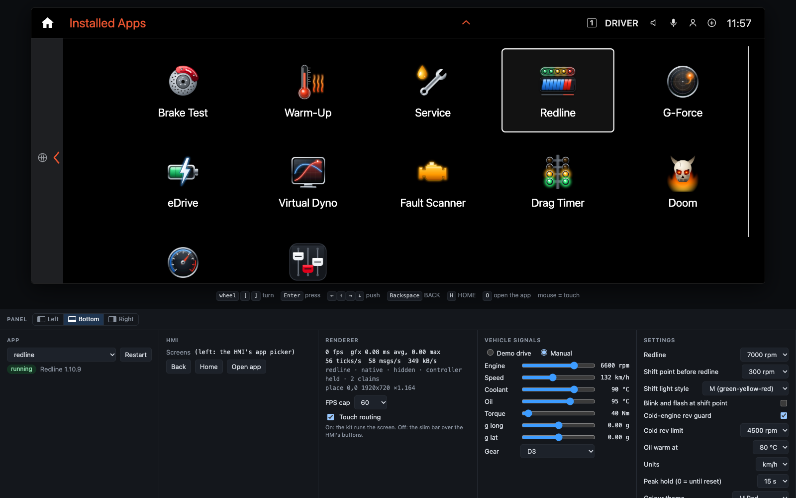
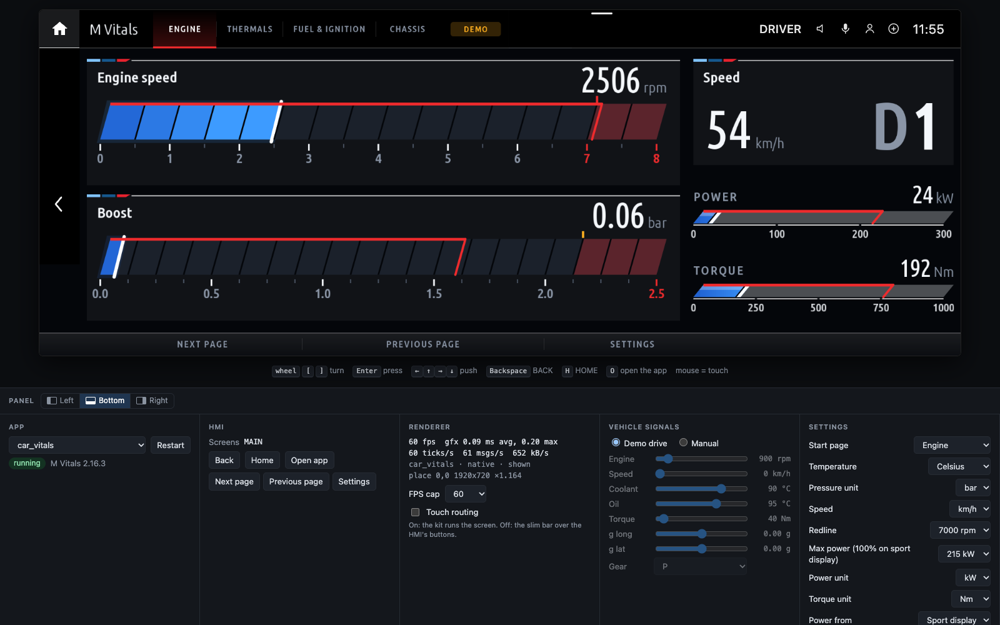
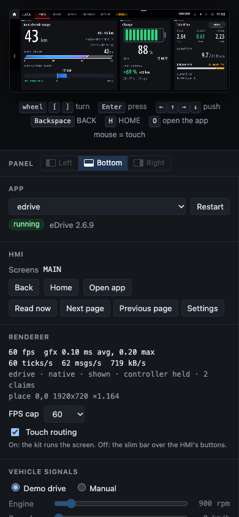

# Live emulator

Run an app on your computer, see it as the car draws it, and see each change you save in about
a second. You need no car, no head unit VM and no Docker: only Node.js and Python, as for the build.

<p align="center">
  <br>
  <sub>Redline with manual signals (6600 rpm, 132 km/h, 3rd gear). Under the screen: the panel with the app, the HMI's buttons, the renderer's numbers, the vehicle signals and the app's settings.</sub>
</p>

```sh
python3 kit/tools/build.py redline     # once: emu.js builds again by itself after each save
node kit/tools/emu.js redline          # then open http://localhost:8077
```

| Option | Does |
|---|---|
| `--port 8080` | another port (default 8077); several emulators can run at the same time |
| `--bg hmi.png` | a 1920 x 720 screenshot of your head unit's screen, shown instead of the HMI frame the page draws: it shows where the app leaves the screen see-through (the home and back column, the status corner). A photo of the screen does not line up |
| `--no-touch` | start with touch routing off (see [Touch routing](#touch-routing)) |

The server answers this computer only (127.0.0.1), and only pages it serves itself, because it
can rebuild and restart apps.

## What it is

The page draws every frame with the car's own draw engine: `kit/renderd/src/gfx.c`, compiled
unchanged to WebAssembly and drawn with WebGL 2 on your computer's GPU. The pixels are the
car's: compared with `mgu-renderd --replay`, frames differ by at most 3 of 255 per colour, and
Doom matches byte for byte.

The app runs with the real `kit/runtime`, as on the car. `emu.js` stands in for the rest of the
head unit:

```
 apps/<id>, kit/runtime ── save ──▶ build.py (0.2 s) ──▶ the app (node, hu-stub.js: a stubbed head unit)
                                                              │  drawing commands, as to mgu-render
                                                              ▼  (Unix socket, kit/renderd/PROTOCOL.md)
                                                       emu.js: the renderer's side of the socket
                                                              │  WebSocket
                                                              ▼
             browser: gfx.c as WebAssembly ──▶ WebGL 2 canvas, 1920 x 720, up to 60 fps
                      mouse = touch, keys = iDrive controller, panel = signals and settings
```

- **The app** gets READY, TICK, touch and the controller as `mgu-render` gives them on the car,
  so the kit runs the screen itself: header tabs, page buttons, the settings sheet, scrolling.
- **Ticks** come when the page has drawn a frame, so the app runs exactly as fast as the page
  shows it, as on the car. The panel's FPS cap limits it (60, 30, 20, 10, none).
- **Live reload:** a save under `apps/<id>/` or `kit/runtime/` builds the app and restarts it;
  the page stays open and keeps the app's screen. A build that fails shows its output on the page,
  and the last good build keeps running.

## Using it

| Input | Does |
|---|---|
| mouse on the screen | touch: taps, drags, scrolling |
| home icon, `H` | HOME: the app list |
| back arrow, `Backspace` | BACK: the app's previous screen, or the app list from its first one |
| mouse wheel, `[` `]` | turn the iDrive knob |
| `Enter` | press the knob |
| arrow keys | push the knob up / right / down / left |
| `O` | open the app again from the app list |

The keys work while the page has the focus and no panel control does.

### The app list

<p align="center">
  <br>
  <sub>BACK from the app's first screen, or HOME, shows the HMI's app list, as in the car.</sub>
</p>

BACK on the app's first screen, or HOME, leaves the app for "Installed Apps", drawn as in the
car. The app keeps running hidden, as on the car: it gets no ticks and no input, and a rebuild
keeps it there. Its tile opens it again; another app's tile builds and starts that app. Turn the
knob or use the arrow keys to move the frame, and press `Enter` to open. On the car HOME goes
to the main menu; the app list stands in for it here.

### The panel

The panel docks at the bottom, left or right (its own control at the top, or
`?panel=bottom|left|right` in the URL). In a narrow window it goes to the bottom by itself.

- **App:** switch to another app, or build and restart this one. **Screenshot** saves the screen as shown
  (the HMI around the app and the app itself) as a 1920 x 720 PNG.
- **HMI:** the app's HMI screen, and buttons for what the HMI would do: Back, Home, Open app,
  and the screen's own bar buttons (the menus and buttons of Doom, for example).
- **Renderer:** frames per second, the draw time, ticks and bytes per second, the app's
  placement; the FPS cap; the touch routing switch.
- **Vehicle signals:** *Demo drive*, the kit's simulated drive (`sim.js`: a full-throttle pull, a
  hard stop, corners, the engine warming up), or *Manual* sliders for engine speed, speed,
  coolant, oil, torque, longitudinal and lateral g, and the gear. Manual values go to the app as
  the car's raw signal values (section 7 of the README), so `car.js` scales them as in the car.
- **Settings:** the app's settings, applied at once. They are saved in `preview/emu/<id>/`.
- **Log:** the app's log, the builds and the renderer's messages.

### Touch routing

<p align="center">
  <br>
  <sub>Touch routing off: M Vitals with the slim bar over the HMI's own buttons, as in docs/screens.</sub>
</p>

The panel's *Touch routing* switch (or `--no-touch`) picks which renderer the emulator is:

- **On** (default), as the Store's `mgu-render`: touch on the app's areas goes to the app, and
  the kit runs the screen: tabs, page buttons, Settings as a tab, no bar.
- **Off**, as a renderer without touch routing: the kit draws the slim bar over the HMI's own
  buttons. Taps on the bar and the controller's focus go to those buttons, and the header tabs
  can't be tapped.

The app connects again when you switch, without a restart, so its state stays.

### Small screens

The page fits any window: the screen is always the largest 8:3 box that fits, and touch maps
exactly at every size.

<p align="center">
  
</p>

## Limits

- Of the BMW HMI only its frame around the app (home icon, back arrow, status corner) and the
  app list are drawn. Its popups, main menu, menu lists and own settings screen are not; the
  panel stands in for them.
- Frame times are your computer's GPU and CPU, not the car's. The head unit's GPU needs about
  1 ms a frame; test the frame rate on the car.
- Signals come at 20 Hz without the car's timing or gaps, and nothing answers diagnostics (UDS)
  or other SOME/IP calls: Fault Scanner and eDrive's live values show their no-answer states.
- No video frames, and no apps that use mgu-render's display bridge (DBR1).
- A large app such as Doom takes a few seconds to build after a save.

## Files

| Path | What |
|---|---|
| `kit/tools/emu.js` | the server: page, WebSocket, the renderer's side of the socket, builds and live reload |
| `kit/tools/hu-stub.js` | the stubbed head unit, shared with `preview.js` |
| `kit/emu/web/` | the page (`index.html`, `emu-app.js`, `emu.css`) |
| `kit/emu/web/gfx/` | the draw engine as WebAssembly (built, committed) and its loader |
| `kit/emu/wasm/` | its source and `build.sh`, see [its README](../kit/emu/wasm/README.md) |

After a change to `kit/renderd/src/gfx.c`, `dialect.c` or `proto.h`, rebuild the WebAssembly
module with `kit/emu/wasm/build.sh` (Docker; the same input gives the same bytes).
`kit/emu/web/gfx/gfx-test.html` compares its frames with `mgu-renderd --replay`.

The draw engine's build (`kit/emu/wasm`, `kit/emu/web/gfx`) is GPL-3.0-or-later, as
`kit/renderd`; the rest of the emulator is MIT.
